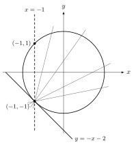

<a href="../triples/">English</a><a class="on">한국어</a>

현대대수 특강2일차 · 피타고라스 세 쌍

# 2일차 — 피타고라스 세 쌍 { .part-title #day-2-pythagorean-triples }

특강, 2026년 11월 26일 · 이 날의 두 번째 강의 · <a class="pdf-link" href="notes.pdf" download="현대대수-특강-2일차-피타고라스-세-쌍.pdf">이 강의를 PDF로 보기</a>

**이 강의에서는.** 원시 피타고라스 세 쌍과 그 매개변수 공식, 단위원 위의 유리점을 이용한 공식의 증명, 연속한 변과 기약이 아닌 이차 다항식 쌍, 그리고 원뿔곡선의 유리 매개화를 다룬다. 이 강의는 Serre를 따르지 않는다. 절과 명제는 슬라이드의 번호(보조정리 1.1, 정리 1.2, …)를 그대로 쓴다. 대수적 증명(§2)과 정리 1.2의 역의 증명은 다루지 않았다.

---

## 1 도입 { #1-introduction }

!!! note "정의"
    $a^2 + b^2 = c^2$을 만족하는 양의 정수의 세 쌍 $(a, b, c)$를 **피타고라스 세 쌍**이라 한다. 예를 들어 $(3, 4, 5)$, $(5, 12, 13)$, $(8, 15, 17)$이 있다.

바빌로니아 점토판 플림프턴 322에는 피타고라스 세 쌍과 관련된 수치 자료가 기록되어 있다.

!!! note "정의"
    $a, b, c$가 $1$보다 큰 공약수를 갖지 않으면 피타고라스 세 쌍 $(a, b, c)$를 **원시**라고 한다.

어떤 세 쌍은 다른 세 쌍의 상수배이다. 예를 들어 $(6, 8, 10) = 2(3, 4, 5)$이다. 피타고라스 세 쌍 $(a, b, c)$에 대해 $d = \gcd(a, b, c)$라 하면 $(a/d, b/d, c/d)$는 원시 세 쌍이고, 원래 세 쌍은 그것의 $d$배이다. 따라서 원시 피타고라스 세 쌍만 모두 구하면 충분하다.

!!! abstract "보조정리 1.1"
    피타고라스 세 쌍 $(a, b, c)$에 대해 다음은 동치이다.

    (1) $a, b, c$가 공약수를 갖지 않는다. 즉 세 쌍이 원시이다.

    (2) $a, b, c$가 쌍마다 서로소이다.

    (3) $a, b, c$ 중 두 수가 서로소이다.

!!! success "증명"
    (2) $\Rightarrow$ (3)과 (3) $\Rightarrow$ (1)은 바로 나온다.

    (1) $\Rightarrow$ (2)는 대우로 보인다. 소수 $p$가 $a$와 $b$를 모두 나누면 $p \mid c^2 = a^2 + b^2$이고, $p$가 소수이므로 $p \mid c$이다. 마찬가지로 $p$가 $a$와 $c$를(또는 $b$와 $c$를) 나누면 $p$는 $b^2 = c^2 - a^2$을(또는 $a^2$을), 따라서 $b$를(또는 $a$를) 나눈다. 어느 경우든 $p$는 $a, b, c$의 공약수이다. $\square$

!!! abstract "정리 1.2 (피타고라스 세 쌍의 분류)"
    $(a, b, c)$가 원시 피타고라스 세 쌍이면 $a, b$ 중 하나는 짝수이고 다른 하나는 홀수이다. $b$를 짝수로 잡으면

    $$
    a = k^2 - \ell^2, \qquad b = 2k\ell, \qquad c = k^2 + \ell^2
    $$

    로 쓸 수 있다. 단 $k, \ell$은

    $$
    k > \ell > 0, \qquad (k, \ell) = 1, \qquad k \not\equiv \ell \pmod 2
    $$

    인 정수이다. 역으로, 이런 정수 $k, \ell$에 대해 이 공식은 원시 피타고라스 세 쌍을 준다.

| $k$ | $\ell$ | $a = k^2 - \ell^2$ | $b = 2k\ell$ | $c = k^2 + \ell^2$ |
|---|---|---|---|---|
| 2 | 1 | 3 | 4 | 5 |
| 3 | 2 | 5 | 12 | 13 |
| 4 | 1 | 15 | 8 | 17 |
| 4 | 3 | 7 | 24 | 25 |

$b$를 짝수로 잡았으므로 세 쌍 $(8, 15, 17)$은 $(15, 8, 17)$로 나타난다. $k$와 $\ell$ 중 어느 쪽이든 짝수일 수 있다. 어느 쪽인지는 §3의 기하적 증명이 설명한다.

!!! info "비고"
    $k = 3$, $\ell = 1$은 홀짝 조건을 어기고, 원시가 아닌 세 쌍 $(8, 6, 10)$을 준다.

정리 1.2의 역의 증명은 강의에서 다루지 않았으므로 이 노트에서는 생략한다.

---

## 2 정리 1.2의 대수적 증명 { #2-proof-by-algebra }

$(a, b, c)$를 원시 피타고라스 세 쌍이라 하자. $a, b$가 둘 다 홀수라면

$$
c^2 = a^2 + b^2 \equiv 1 + 1 = 2 \pmod 4
$$

인데, 제곱수는 법 $4$로 $0$ 또는 $1$이므로 불가능하다. $a, b$가 둘 다 짝수라면 $c$도 짝수가 되어 원시라는 데 모순이다. 따라서 $a, b$ 중 정확히 하나가 짝수이고 $c$는 홀수이다. 필요하면 $a$와 $b$를 바꾸어 $a$는 홀수, $b$는 짝수로 둔다.

!!! abstract "보조정리 2.1"
    $x, y, z \in \mathbb Z_{>0}$이고 $(x, y) = 1$일 때 $xy = z^2$이면 $x$와 $y$는 둘 다 제곱수이다.

대수적 증명의 나머지와 보조정리 2.1의 증명은 강의에서 다루지 않았으므로 이 노트에서는 생략한다.

---

## 3 정리 1.2의 기하적 증명 { #3-proof-by-geometry }

피타고라스 세 쌍은 단위원 위의 유리점을 준다.

$$
\left(\frac ac\right)^2 + \left(\frac bc\right)^2 = 1 .
$$

사실 원시 세 쌍은 단위원의 열린 제1사분면에 있는 유리점과 정확히 대응한다.

$$
\mathcal P = \{(a, b, c) \in \mathbb N^3 \mid a^2 + b^2 = c^2,\ \gcd(a, b, c) = 1\}
\;\longleftrightarrow\;
\mathcal Q = \{(q_1, q_2) \in \mathbb Q^2 \mid q_1^2 + q_2^2 = 1,\ q_1, q_2 > 0\}
$$

대응은 $(a, b, c) \mapsto (a/c, b/c)$이다. 반대 방향으로는 $q_1, q_2$의 최소공통분모를 $c$라 하고 $a = q_1c$, $b = q_2c$로 둔다.

$a$를 홀수, $b$를 짝수로 잡자. $(-1, 0)$과 $\left(\frac ac, \frac bc\right)$을 지나는 직선의 기울기는

$$
m = \frac{b/c}{1 + a/c} = \frac{b}{a + c} \in \mathbb Q
$$

이고, 그 방정식은 $y = m(x + 1)$이다.

<figure markdown>
  { .tex-fig width="320" }
  <figcaption markdown="span">그림 1. $(-1, 0)$을 지나는 기울기 $m$인 직선은 단위원과 $\left(\frac ac, \frac bc\right)$에서 다시 만난다.</figcaption>
</figure>

!!! success "증명"
    $y = m(x + 1)$을 $x^2 + y^2 = 1$에 대입하면

    $$
    x^2 + m^2(x + 1)^2 = 1, \qquad (m^2 + 1)x^2 + 2m^2x + m^2 - 1 = 0
    $$

    이다. 한 근이 $x = -1$이므로 다른 근은 $x = \frac{1 - m^2}{1 + m^2}$이고, $y = m(x + 1) = \frac{2m}{1 + m^2}$이다. 두 번째 교점은

    $$
    \left(\frac{1 - m^2}{1 + m^2},\ \frac{2m}{1 + m^2}\right)
    $$

    이다. 따라서 기울기가 유리수이면 교점도 유리점이고, 역으로 두 유리점을 지나는 직선의 기울기는 유리수이다.

    이제 $m = \frac{b}{a + c} = \frac{\ell}{k}$를 기약분수로 쓰자. $k > \ell > 0$, $(k, \ell) = 1$이다. $b < c$이므로 $m < 1$이다. 그러면

    $$
    \frac ac = \frac{1 - m^2}{1 + m^2} = \frac{1 - \ell^2/k^2}{1 + \ell^2/k^2} = \frac{k^2 - \ell^2}{k^2 + \ell^2}, \qquad
    \frac bc = \frac{2m}{1 + m^2} = \frac{2\ell/k}{1 + \ell^2/k^2} = \frac{2k\ell}{k^2 + \ell^2}
    $$

    이다. $k \not\equiv \ell \pmod 2$임을 보이면 충분하다. $(k, \ell) = 1$이므로 둘 다 짝수일 수는 없다. $k \equiv \ell \pmod 2$라면 $k, \ell$은 둘 다 홀수이고

    $$
    \frac bc = \frac{2k\ell}{k^2 + \ell^2} = \frac{k\ell}{(k^2 + \ell^2)/2}
    $$

    인데, 마지막 분수는 기약분수이다($k\ell$을 나누는 소수는 $k, \ell$ 중 정확히 하나만 나누므로 $k^2 + \ell^2$을 나누지 않는다). $(b, c) = 1$이므로 $b = k\ell$이 되어 홀수인데, $b$는 짝수이다. 모순이다.

    따라서 $k \not\equiv \ell \pmod 2$이다. 그러면 $k^2 + \ell^2$은 홀수이고, $k^2 + \ell^2$과 $k^2 - \ell^2$(또는 $2k\ell$)의 공약수는 홀수이면서 $2k^2$과 $2\ell^2$을 나누므로 $1$이다. 위의 두 분수는 기약분수이고 $\frac ac$, $\frac bc$도 기약분수이다(보조정리 1.1). 그러므로

    $$
    (a, b, c) = (k^2 - \ell^2,\ 2k\ell,\ k^2 + \ell^2)
    $$

    가 그 원시 피타고라스 세 쌍이다. $\square$

!!! info "비고 3.1"
    기하적 계산은 완전히 대수적으로 쓸 수도 있다. $x^2 + y^2 = 1$이고 $x \neq -1$이면 $m = \frac{y}{x + 1}$로 두자. 그러면

    $$
    0 = x^2 + m^2(x + 1)^2 - 1 = (x + 1)\big((1 + m^2)x + m^2 - 1\big)
    $$

    이다. $x \neq -1$이므로 $x = \frac{1 - m^2}{1 + m^2}$, $y = \frac{2m}{1 + m^2}$이다. 왜 하필 이 치환이 유용한지는 그림이 설명해 준다.

등식

$$
\frac{\ell}{k} = \frac{b}{a + c}
$$

은 분수를 약분한 뒤 어느 매개변수가 짝수인지도 알려 준다.

- $a + c$가 $b$보다 $2$의 더 높은 거듭제곱으로 나누어지면 $k$가 짝수이다. $(3, 4, 5)$이면 $b/(a + c) = 4/8 = 1/2$이므로 $(k, \ell) = (2, 1)$이다.
- $b$가 $a + c$보다 $2$의 더 높은 거듭제곱으로 나누어지면 $\ell$이 짝수이다. $(5, 12, 13)$이면 $b/(a + c) = 12/18 = 2/3$이므로 $(k, \ell) = (3, 2)$이다.

---

## 4 응용 { #4-applications }

!!! info "질문"
    두 항이 연속한 정수인 피타고라스 세 쌍 $(a, b, c)$는 어떻게 이해할 수 있을까?

먼저 두 직각변이 연속한 경우이다. 다음 표에서는 두 직각변의 차가 $1$이다.

| $x$ | $y$ | $k = x + y$ | $\ell = y$ | $a$ | $b$ | $c$ |
|---|---|---|---|---|---|---|
| 1 | 1 | 2 | 1 | 3 | 4 | 5 |
| 3 | 2 | 5 | 2 | 21 | 20 | 29 |
| 7 | 5 | 12 | 5 | 119 | 120 | 169 |
| 17 | 12 | 29 | 12 | 697 | 696 | 985 |
| 41 | 29 | 70 | 29 | 4059 | 4060 | 5741 |

모든 행에서 $a - b = x^2 - 2y^2 = \pm 1$이다. 짝수인 직각변은 $(a, b, c)$의 가운데 자리에 있고, 더 긴 변일 필요는 없다.

일반적인 원시 세 쌍에서는

$$
a - b = (k - \ell)^2 - 2\ell^2
$$

이다. 따라서 가능한 부호 있는 차는 정확히

$$
x^2 - 2y^2, \qquad x, y > 0,\quad x \text{는 홀수},\quad (x, y) = 1
$$

이다. 여기서 $x = k - \ell$, $y = \ell$이고, 역으로 $k = x + y$, $\ell = y$이다.

!!! example "연습문제"
    두 직각변의 차가 $5$인 원시 피타고라스 세 쌍은 없음을 보여라. (*힌트.* 홀수의 제곱은 법 $8$로 $1$이다. $x^2 - 2y^2 \equiv \pm 5 \pmod 8$을 생각하라.)

다음으로 한 직각변과 빗변의 차가 $1$이라 하자. 빗변은 홀수이므로 그 직각변은 짝수인 변 $b$여야 한다. 차는

$$
c - b = k^2 + \ell^2 - 2k\ell = (k - \ell)^2
$$

이다. $k > \ell$이므로 이 값이 $1$일 필요충분조건은 $k = \ell + 1$이다. 따라서 짝수인 변을 둘째에 둔 이런 세 쌍은 모두

$$
(a, b, c) = (2\ell + 1,\ 2\ell^2 + 2\ell,\ 2\ell^2 + 2\ell + 1), \qquad \ell \ge 1
$$

이다. 역으로 연속한 매개변수 $k = \ell + 1$, $\ell$은 서로소이고 홀짝이 다르다. 따라서 이 목록의 세 쌍은 모두 원시이다.

| $\ell$ | $a = 2\ell + 1$ | $b = 2\ell^2 + 2\ell$ | $c = 2\ell^2 + 2\ell + 1$ |
|---|---|---|---|
| 1 | 3 | 4 | 5 |
| 2 | 5 | 12 | 13 |
| 3 | 7 | 24 | 25 |
| 4 | 9 | 40 | 41 |

빗변과 짝수인 직각변의 차는 언제나 홀수의 제곱 $(k - \ell)^2$이다. 이 표는 그 값이 $1$인 경우이다.

!!! info "질문"
    $X^2 + mX + n$과 $X^2 + mX - n$이 둘 다 $\mathbb Z$ 위에서 인수분해되는 것은 언제인가?

예를 들어 $X^2 + 4X + 3 = (X + 1)(X + 3)$이지만 $X^2 + 4X - 3$은 기약이다. 반면 $X^2 + 5X + 6 = (X + 2)(X + 3)$이고 $X^2 + 5X - 6 = (X - 1)(X + 6)$이다. $m$의 부호를 바꾸면 근의 부호가 바뀌므로 $m > 0$으로 잡아도 된다. $n$은 두 부호를 모두 생각하므로 $n > 0$으로 잡는다.

최고차 계수가 1인 정수 계수 이차식이 $\mathbb Z$ 위에서 인수분해될 필요충분조건은 판별식이 완전제곱수인 것이다. 따라서 두 다항식이 모두 인수분해될 필요충분조건은 어떤 정수 $r, s \ge 0$에 대해 $m^2 - 4n = r^2$, $m^2 + 4n = s^2$인 것이다. 이때 $r, s$는 $m$과 홀짝이 같고, $a = \frac{s + r}{2}$, $b = \frac{s - r}{2}$는

$$
a^2 + b^2 = \frac{s^2 + r^2}{2} = m^2, \qquad ab = \frac{s^2 - r^2}{4} = 2n
$$

을 만족한다. 역으로 피타고라스 세 쌍 $(a, b, c)$는 $m = c$, $n = ab/2$를 주고, $m^2 \pm 4n = (a \pm b)^2$이다. 따라서 $(a, b, c)$에 대응하는 쌍은

$$
X^2 + cX + \frac{ab}{2}, \qquad X^2 + cX - \frac{ab}{2}
$$

이다.

!!! example "연습문제"
    대응하는 세 쌍이 원시일 필요충분조건은 $(m, n) = 1$임을 보여라.

| $(a, b, c)$ | $X^2 + cX + ab/2$ | $X^2 + cX - ab/2$ |
|---|---|---|
| $(3, 4, 5)$ | $(X + 2)(X + 3)$ | $(X - 1)(X + 6)$ |
| $(5, 12, 13)$ | $(X + 3)(X + 10)$ | $(X - 2)(X + 15)$ |
| $(8, 15, 17)$ | $(X + 5)(X + 12)$ | $(X - 3)(X + 20)$ |
| $(20, 21, 29)$ | $(X + 14)(X + 15)$ | $(X - 6)(X + 35)$ |

쌍 $X^2 + 5X \pm 6$은 $(3, 4, 5)$에 대응하며 가장 간단한 예이다.

정리 1.2를 쓰면 $(m, n) = 1$인 인수분해되는 쌍은 정확히

$$
X^2 + (k^2 + \ell^2)X \pm k\ell(k^2 - \ell^2)
$$

이다. 단

$$
k > \ell > 0, \qquad (k, \ell) = 1, \qquad k \not\equiv \ell \pmod 2
$$

이다. 두 직각변을 바꾸어도 곱 $ab$는 변하지 않는다.

!!! example "연습문제"
    이 두 다항식의 인수분해를 $k$와 $\ell$로 명시적으로 구하라.

---

## 5 일반화 { #5-generalizations }

기하적 증명은 서로 역인 대응

$$
m \longmapsto \left(\frac{1 - m^2}{1 + m^2},\ \frac{2m}{1 + m^2}\right), \qquad (x, y) \longmapsto \frac{y}{1 + x}
$$

을 준다. 이것은 실수 $m$과 $x^2 + y^2 = 1$ 위의 $(-1, 0)$이 아닌 점 사이의 대응이다. 두 공식 모두 유리수를 넣으면 유리수가 나오므로 $m \in \mathbb Q \iff x, y \in \mathbb Q$이다. 이 유리 매개화는 유리점을 기술하기에 알맞다. 반면 삼각함수 매개화 $(\cos\theta, \sin\theta)$는 보통 유리점에 다루기 불편한 각을 준다.

| $m$ | $x = (1 - m^2)/(1 + m^2)$ | $y = 2m/(1 + m^2)$ |
|---|---|---|
| $1/2$ | $3/5$ | $4/5$ |
| $1/3$ | $4/5$ | $3/5$ |
| $2/5$ | $21/29$ | $20/29$ |
| $7/9$ | $16/65$ | $63/65$ |

$(\cos\theta, \sin\theta)$와 비교하면

$$
\cos\theta = \frac{1 - m^2}{1 + m^2}, \qquad \sin\theta = \frac{2m}{1 + m^2}
$$

이다. $(-1, 0)$에서 나오는 직선은 수평축과 각 $\theta/2$를 이룬다(원주각은 중심각의 절반이다). 따라서 그 기울기는

$$
m = \frac{\sin\theta}{1 + \cos\theta} = \tan\frac\theta2
$$

이다.

<figure markdown>
  { .tex-fig width="300" }
  <figcaption markdown="span">그림 2. $(-1, 0)$에서 $(\cos\theta, \sin\theta)$로 가는 직선은 수평축과 각 $\theta/2$를 이룬다.</figcaption>
</figure>

$u = \tan(\theta/2)$로 두면

$$
\cos\theta = \frac{1 - u^2}{1 + u^2}, \qquad \sin\theta = \frac{2u}{1 + u^2}
$$

이다. 또

$$
du = \frac12\sec^2\frac\theta2\,d\theta = \frac{1 + u^2}{2}\,d\theta, \qquad d\theta = \frac{2}{1 + u^2}\,du
$$

이다. 따라서 유리함수 $R$에 대해

$$
\int R(\cos\theta, \sin\theta)\,d\theta = \int R\left(\frac{1 - u^2}{1 + u^2}, \frac{2u}{1 + u^2}\right)\frac{2}{1 + u^2}\,du
$$

이다. 이렇게 얻은 피적분함수는 $u$의 유리함수이다. 이것이 **바이어슈트라스 치환**이다.

같은 생각을 유리 계수 방정식으로 정의된 매끄러운 원뿔곡선에도 쓸 수 있다. 유리점 하나에서 시작해, 그 점을 지나는 직선과 원뿔곡선의 교점을 생각한다. 기울기가 유리수이면 두 번째 교점도 유리점이고, 역으로 두 번째 유리점은 유리수 기울기를 정한다. 수직 방향은 필요하면 따로 다루고, 시작점 자체는 접선이 맡는다. 원 $x^2 + y^2 = 2$로 이를 보이자.

!!! abstract "정리 5.2"
    $x^2 + y^2 = 2$ 위의 $(-1, 1)$이 아닌 유리점은

    $$
    \left(\frac{1 + 2m - m^2}{m^2 + 1},\ \frac{m^2 + 2m - 1}{m^2 + 1}\right), \qquad m \in \mathbb Q
    $$

    이다. $(-1, \pm 1)$이 아닌 유리점 $(x, y)$는 $m = (y + 1)/(x + 1)$로 이렇게 얻어지고, $(-1, -1)$은 $m = -1$로 얻어진다.

<figure markdown>
  { .tex-fig width="300" }
  <figcaption markdown="span">그림 3. 원 $x^2 + y^2 = 2$ 위의 유리점 $(-1, -1)$을 지나는 직선들. 접선 $y = -x - 2$의 기울기는 $-1$이고, 수직선 $x = -1$은 원과 $(-1, 1)$에서 다시 만난다.</figcaption>
</figure>

!!! success "정리 5.2의 증명"
    유리점 $(-1, -1)$을 쓴다. 이 점을 지나는 수직이 아닌 직선은

    $$
    y = m(x + 1) - 1
    $$

    이다. 이 직선은 원과 두 번째 점에서 만난다. 단 접선 방향 $m = -1$에서는 두 교점이 일치한다. 직선을 원의 방정식에 대입하면

    $$
    0 = x^2 + \big(m(x + 1) - 1\big)^2 - 2 = (x + 1)\big((1 + m^2)x + m^2 - 2m - 1\big)
    $$

    이다. 한 근은 $x = -1$이고, 다른 근은

    $$
    x = \frac{1 + 2m - m^2}{1 + m^2}
    $$

    이다. 이를 직선의 방정식에 넣으면

    $$
    y = \frac{m^2 + 2m - 1}{1 + m^2}
    $$

    이다. $m$이 유리수이면 두 좌표 모두 유리수이다. $x \neq -1$이면 점에서 $m = \frac{y + 1}{x + 1}$로 매개변수를 되찾는다. 수직선 $x = -1$은 원과 $(-1, -1)$, $(-1, 1)$에서 만나므로, 유한한 기울기의 매개화는 $(-1, 1)$을 놓친다. 그래도 $(-1, -1)$은 포함된다. $m = -1$을 넣으면 이 점이 나오고, 이 매개변수는 접선 $y = -x - 2$에 해당한다. 이로써 증명이 끝난다. $\square$

!!! info "비고 5.3"
    원 $x^2 + y^2 = 2$는 다음 관계로 단위원과 이어진다.

    $$
    x^2 + y^2 = 2 \iff \left(\frac{x - y}{2}\right)^2 + \left(\frac{x + y}{2}\right)^2 = 1 .
    $$

    단위원의 매개화를 쓰면

    $$
    \frac{x - y}{2} = \frac{1 - m^2}{1 + m^2}, \qquad \frac{x + y}{2} = \frac{2m}{1 + m^2}
    $$

    이다. 더하고 빼면 정리 5.2의 공식이 다시 나온다.
