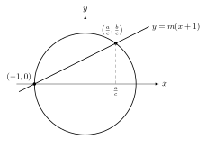
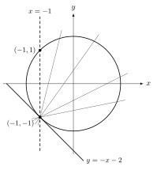

<a class="on">English</a><a href="../triples-ko/">한국어</a>

Abstract AlgebraDay 2 · Pythagorean Triples

# Day 2 — Pythagorean Triples { .part-title #day-2-pythagorean-triples }

Special lecture, 26 November 2026 · second lecture of the day · <a class="pdf-link" href="notes.pdf" download="Abstract-Algebra-Day-2-Pythagorean-Triples.pdf">This lecture as PDF</a>

**In this lecture.** Primitive Pythagorean triples and their parametric formula; a proof of the formula through rational points on the unit circle; consecutive sides and pairs of reducible quadratic polynomials; and rational parametrizations of conics. This lecture does not follow Serre; sections and statements keep the numbers they have on the slides (Lemma 1.1, Theorem 1.2, …). The algebraic proof (§2) and the proof of the converse in Theorem 1.2 were not covered.

---

## 1 Introduction { #1-introduction }

!!! note "Definition"
    A **Pythagorean triple** is a triple of positive integers $(a, b, c)$ such that $a^2 + b^2 = c^2$. Examples include $(3, 4, 5)$, $(5, 12, 13)$, $(8, 15, 17)$.

The Babylonian tablet Plimpton 322 records numerical data related to Pythagorean triples.

!!! note "Definition"
    A Pythagorean triple $(a, b, c)$ is **primitive** if $a, b, c$ have no common factor greater than $1$.

Some triples are scalar multiples of others, for example $(6, 8, 10) = 2(3, 4, 5)$. For any Pythagorean triple $(a, b, c)$, let $d = \gcd(a, b, c)$. Then $(a/d, b/d, c/d)$ is a primitive triple, and the original triple is $d$ times it. Thus it suffices to describe all primitive Pythagorean triples.

!!! abstract "Lemma 1.1"
    For a Pythagorean triple $(a, b, c)$, the following properties are equivalent.

    (1) $a, b, c$ have no common factor, that is, the triple is primitive.

    (2) $a, b, c$ are pairwise relatively prime.

    (3) Two of $a, b, c$ are relatively prime.

!!! success "Proof"
    (2) $\Rightarrow$ (3) and (3) $\Rightarrow$ (1) are immediate.

    For (1) $\Rightarrow$ (2) we use the contrapositive. If a prime $p$ divides both $a$ and $b$, then $p \mid c^2 = a^2 + b^2$, and since $p$ is prime, $p \mid c$. Likewise, if $p$ divides $a$ and $c$ (or $b$ and $c$), then $p$ divides $b^2 = c^2 - a^2$ (or $a^2$), hence $b$ (or $a$). In each case $p$ is a common factor of $a, b, c$. $\square$

!!! abstract "Theorem 1.2 (Classification of Pythagorean triples)"
    If $(a, b, c)$ is a primitive Pythagorean triple, then one of $a, b$ is even and the other is odd. Taking $b$ to be even, we can write

    $$
    a = k^2 - \ell^2, \qquad b = 2k\ell, \qquad c = k^2 + \ell^2
    $$

    for some integers $k, \ell$ with

    $$
    k > \ell > 0, \qquad (k, \ell) = 1, \qquad k \not\equiv \ell \pmod 2 .
    $$

    Conversely, for such integers $k, \ell$, these formulas give a primitive Pythagorean triple.

| $k$ | $\ell$ | $a = k^2 - \ell^2$ | $b = 2k\ell$ | $c = k^2 + \ell^2$ |
|---|---|---|---|---|
| 2 | 1 | 3 | 4 | 5 |
| 3 | 2 | 5 | 12 | 13 |
| 4 | 1 | 15 | 8 | 17 |
| 4 | 3 | 7 | 24 | 25 |

The triple $(8, 15, 17)$ appears as $(15, 8, 17)$ because $b$ is chosen to be even. Either $k$ or $\ell$ may be even; the geometric proof in §3 explains which.

!!! info "Remark"
    $k = 3$, $\ell = 1$ violates the parity condition and gives the non-primitive triple $(8, 6, 10)$.

The proof of the converse in Theorem 1.2 was not covered in the lecture and is skipped in these notes.

---

## 2 Proof of Theorem 1.2 by Algebra { #2-proof-by-algebra }

Let $(a, b, c)$ be a primitive Pythagorean triple. If $a, b$ were both odd, then

$$
c^2 = a^2 + b^2 \equiv 1 + 1 = 2 \pmod 4,
$$

which is impossible, since a square is $0$ or $1$ modulo $4$. If $a, b$ were both even, then $c$ would also be even, contradicting primitivity. Thus exactly one of $a, b$ is even, and $c$ is odd. Interchanging $a$ and $b$ if necessary, $a$ is odd and $b$ is even.

!!! abstract "Lemma 2.1"
    If $xy = z^2$, where $x, y, z \in \mathbb Z_{>0}$ and $(x, y) = 1$, then $x$ and $y$ are both squares.

The rest of the algebraic proof, and the proof of Lemma 2.1, were not covered in the lecture and are skipped in these notes.

---

## 3 Proof of Theorem 1.2 by Geometry { #3-proof-by-geometry }

A Pythagorean triple gives a rational point on the unit circle:

$$
\left(\frac ac\right)^2 + \left(\frac bc\right)^2 = 1 .
$$

In fact primitive triples correspond exactly to rational points in the open first quadrant of the circle:

$$
\mathcal P = \{(a, b, c) \in \mathbb N^3 \mid a^2 + b^2 = c^2,\ \gcd(a, b, c) = 1\}
\;\longleftrightarrow\;
\mathcal Q = \{(q_1, q_2) \in \mathbb Q^2 \mid q_1^2 + q_2^2 = 1,\ q_1, q_2 > 0\},
$$

by $(a, b, c) \mapsto (a/c, b/c)$. In the other direction, let $c$ be the least common denominator of $q_1, q_2$ and put $a = q_1c$, $b = q_2c$.

Take $a$ odd and $b$ even. The line through $(-1, 0)$ and $\left(\frac ac, \frac bc\right)$ has slope

$$
m = \frac{b/c}{1 + a/c} = \frac{b}{a + c} \in \mathbb Q ,
$$

and its equation is $y = m(x + 1)$.

<figure markdown>
  { .tex-fig width="320" }
  <figcaption markdown="span">Figure 1. The line of slope $m$ through $(-1, 0)$ meets the unit circle again at $\left(\frac ac, \frac bc\right)$.</figcaption>
</figure>

!!! success "Proof"
    Substituting $y = m(x + 1)$ into $x^2 + y^2 = 1$ gives

    $$
    x^2 + m^2(x + 1)^2 = 1, \qquad (m^2 + 1)x^2 + 2m^2x + m^2 - 1 = 0 .
    $$

    One root is $x = -1$, so the other is $x = \frac{1 - m^2}{1 + m^2}$, and then $y = m(x + 1) = \frac{2m}{1 + m^2}$. The second intersection point is

    $$
    \left(\frac{1 - m^2}{1 + m^2},\ \frac{2m}{1 + m^2}\right).
    $$

    So a rational slope gives a rational point, and conversely the slope through two rational points is rational.

    Now write $m = \frac{b}{a + c} = \frac{\ell}{k}$ in lowest terms, with $k > \ell > 0$ and $(k, \ell) = 1$; here $m < 1$ because $b < c$. Then

    $$
    \frac ac = \frac{1 - m^2}{1 + m^2} = \frac{1 - \ell^2/k^2}{1 + \ell^2/k^2} = \frac{k^2 - \ell^2}{k^2 + \ell^2}, \qquad
    \frac bc = \frac{2m}{1 + m^2} = \frac{2\ell/k}{1 + \ell^2/k^2} = \frac{2k\ell}{k^2 + \ell^2} .
    $$

    It is enough to show $k \not\equiv \ell \pmod 2$. Since $(k, \ell) = 1$, they are not both even. If $k \equiv \ell \pmod 2$, then $k, \ell$ are both odd, and

    $$
    \frac bc = \frac{2k\ell}{k^2 + \ell^2} = \frac{k\ell}{(k^2 + \ell^2)/2} ,
    $$

    where the last fraction is in lowest terms (a prime dividing $k\ell$ divides exactly one of $k, \ell$, hence not $k^2 + \ell^2$). Since $(b, c) = 1$, this forces $b = k\ell$, which is odd; but $b$ is even. This is a contradiction.

    So $k \not\equiv \ell \pmod 2$. Then $k^2 + \ell^2$ is odd, and a common divisor of $k^2 + \ell^2$ and $k^2 - \ell^2$ (or $2k\ell$) is odd and divides $2k^2$ and $2\ell^2$, so it is $1$. Both fractions above are in lowest terms, as are $\frac ac$ and $\frac bc$ (Lemma 1.1). Hence

    $$
    (a, b, c) = (k^2 - \ell^2,\ 2k\ell,\ k^2 + \ell^2)
    $$

    is the primitive Pythagorean triple. $\square$

!!! info "Remark 3.1"
    The geometric calculation can be formulated entirely algebraically. If $x^2 + y^2 = 1$ and $x \neq -1$, set $m = \frac{y}{x + 1}$. Then

    $$
    0 = x^2 + m^2(x + 1)^2 - 1 = (x + 1)\big((1 + m^2)x + m^2 - 1\big).
    $$

    Since $x \neq -1$, $x = \frac{1 - m^2}{1 + m^2}$ and $y = \frac{2m}{1 + m^2}$. The picture explains why this particular substitution is useful.

The identity

$$
\frac{\ell}{k} = \frac{b}{a + c}
$$

also tells us which parameter is even after the fraction is reduced.

- If $a + c$ is divisible by a higher power of $2$ than $b$, then $k$ is even. For $(3, 4, 5)$, $b/(a + c) = 4/8 = 1/2$, so $(k, \ell) = (2, 1)$.
- If $b$ is divisible by a higher power of $2$ than $a + c$, then $\ell$ is even. For $(5, 12, 13)$, $b/(a + c) = 12/18 = 2/3$, so $(k, \ell) = (3, 2)$.

---

## 4 Applications { #4-applications }

!!! info "Question"
    How can we understand the Pythagorean triples $(a, b, c)$ in which two terms are consecutive?

First, the legs. In the following table both legs differ by $1$.

| $x$ | $y$ | $k = x + y$ | $\ell = y$ | $a$ | $b$ | $c$ |
|---|---|---|---|---|---|---|
| 1 | 1 | 2 | 1 | 3 | 4 | 5 |
| 3 | 2 | 5 | 2 | 21 | 20 | 29 |
| 7 | 5 | 12 | 5 | 119 | 120 | 169 |
| 17 | 12 | 29 | 12 | 697 | 696 | 985 |
| 41 | 29 | 70 | 29 | 4059 | 4060 | 5741 |

For every row, $a - b = x^2 - 2y^2 = \pm 1$. The even leg stays in the middle column of $(a, b, c)$; it need not be the larger leg.

For a general primitive triple,

$$
a - b = (k - \ell)^2 - 2\ell^2 .
$$

Thus the possible signed differences are exactly

$$
x^2 - 2y^2, \qquad x, y > 0,\quad x \text{ odd},\quad (x, y) = 1,
$$

using $x = k - \ell$, $y = \ell$ and conversely $k = x + y$, $\ell = y$.

!!! example "Exercise"
    Show that no primitive Pythagorean triple has its legs differing by $5$. (*Hint.* An odd square is $1$ modulo $8$. Consider $x^2 - 2y^2 \equiv \pm 5 \pmod 8$.)

Next, suppose a leg and the hypotenuse differ by $1$. The hypotenuse is odd, so that leg must be the even leg $b$. The difference is

$$
c - b = k^2 + \ell^2 - 2k\ell = (k - \ell)^2 .
$$

It equals $1$ if and only if $k = \ell + 1$, because $k > \ell$. Consequently all such triples, with the even leg second, are

$$
(a, b, c) = (2\ell + 1,\ 2\ell^2 + 2\ell,\ 2\ell^2 + 2\ell + 1), \qquad \ell \ge 1 .
$$

Conversely, consecutive parameters $k = \ell + 1$, $\ell$ are relatively prime, and of opposite parity. Hence every triple in this list is primitive.

| $\ell$ | $a = 2\ell + 1$ | $b = 2\ell^2 + 2\ell$ | $c = 2\ell^2 + 2\ell + 1$ |
|---|---|---|---|
| 1 | 3 | 4 | 5 |
| 2 | 5 | 12 | 13 |
| 3 | 7 | 24 | 25 |
| 4 | 9 | 40 | 41 |

The difference between the hypotenuse and the even leg is always an odd square, $(k - \ell)^2$. This table describes the case in which it is $1$.

!!! info "Question"
    When do both $X^2 + mX + n$ and $X^2 + mX - n$ factor over $\mathbb Z$?

For example, $X^2 + 4X + 3 = (X + 1)(X + 3)$ but $X^2 + 4X - 3$ is irreducible. In contrast, $X^2 + 5X + 6 = (X + 2)(X + 3)$ and $X^2 + 5X - 6 = (X - 1)(X + 6)$. Changing the sign of $m$ changes the signs of the roots, so we may take $m > 0$. Since we are considering both signs of $n$, take $n > 0$ as well.

A monic integer quadratic factors over $\mathbb Z$ exactly when its discriminant is a perfect square. So both polynomials factor if and only if $m^2 - 4n = r^2$ and $m^2 + 4n = s^2$ for some integers $r, s \ge 0$. Then $r, s$ have the parity of $m$, and $a = \frac{s + r}{2}$, $b = \frac{s - r}{2}$ satisfy

$$
a^2 + b^2 = \frac{s^2 + r^2}{2} = m^2, \qquad ab = \frac{s^2 - r^2}{4} = 2n .
$$

Conversely, a Pythagorean triple $(a, b, c)$ gives $m = c$, $n = ab/2$, with $m^2 \pm 4n = (a \pm b)^2$. So the pair corresponding to $(a, b, c)$ is

$$
X^2 + cX + \frac{ab}{2}, \qquad X^2 + cX - \frac{ab}{2} .
$$

!!! example "Exercise"
    Show that the corresponding triple is primitive if and only if $(m, n) = 1$.

| $(a, b, c)$ | $X^2 + cX + ab/2$ | $X^2 + cX - ab/2$ |
|---|---|---|
| $(3, 4, 5)$ | $(X + 2)(X + 3)$ | $(X - 1)(X + 6)$ |
| $(5, 12, 13)$ | $(X + 3)(X + 10)$ | $(X - 2)(X + 15)$ |
| $(8, 15, 17)$ | $(X + 5)(X + 12)$ | $(X - 3)(X + 20)$ |
| $(20, 21, 29)$ | $(X + 14)(X + 15)$ | $(X - 6)(X + 35)$ |

The pair $X^2 + 5X \pm 6$ corresponds to $(3, 4, 5)$ and is the simplest example.

Using Theorem 1.2, the reducible pairs with $(m, n) = 1$ are exactly

$$
X^2 + (k^2 + \ell^2)X \pm k\ell(k^2 - \ell^2),
$$

where

$$
k > \ell > 0, \qquad (k, \ell) = 1, \qquad k \not\equiv \ell \pmod 2 .
$$

The product $ab$ is unchanged when the legs are interchanged.

!!! example "Exercise"
    Work out the factorization of these two polynomials explicitly in terms of $k$ and $\ell$.

---

## 5 Generalizations { #5-generalizations }

The geometric proof gives inverse correspondences

$$
m \longmapsto \left(\frac{1 - m^2}{1 + m^2},\ \frac{2m}{1 + m^2}\right), \qquad (x, y) \longmapsto \frac{y}{1 + x}
$$

between real numbers $m$ and points on $x^2 + y^2 = 1$ other than $(-1, 0)$. Both formulas take rational input to rational output, hence $m \in \mathbb Q \iff x, y \in \mathbb Q$. This rational parametrization is suited to describing rational points, whereas the trigonometric parametrization $(\cos\theta, \sin\theta)$ usually assigns them less convenient angles.

| $m$ | $x = (1 - m^2)/(1 + m^2)$ | $y = 2m/(1 + m^2)$ |
|---|---|---|
| $1/2$ | $3/5$ | $4/5$ |
| $1/3$ | $4/5$ | $3/5$ |
| $2/5$ | $21/29$ | $20/29$ |
| $7/9$ | $16/65$ | $63/65$ |

Comparing with $(\cos\theta, \sin\theta)$ gives

$$
\cos\theta = \frac{1 - m^2}{1 + m^2}, \qquad \sin\theta = \frac{2m}{1 + m^2} .
$$

The line from $(-1, 0)$ makes angle $\theta/2$ with the horizontal axis (an inscribed angle is half the central angle). Its slope is therefore

$$
m = \frac{\sin\theta}{1 + \cos\theta} = \tan\frac\theta2 .
$$

<figure markdown>
  { .tex-fig width="300" }
  <figcaption markdown="span">Figure 2. The line from $(-1, 0)$ to $(\cos\theta, \sin\theta)$ makes angle $\theta/2$ with the horizontal axis.</figcaption>
</figure>

Set $u = \tan(\theta/2)$. Then

$$
\cos\theta = \frac{1 - u^2}{1 + u^2}, \qquad \sin\theta = \frac{2u}{1 + u^2} .
$$

Moreover,

$$
du = \frac12\sec^2\frac\theta2\,d\theta = \frac{1 + u^2}{2}\,d\theta, \qquad d\theta = \frac{2}{1 + u^2}\,du .
$$

Thus, for a rational function $R$,

$$
\int R(\cos\theta, \sin\theta)\,d\theta = \int R\left(\frac{1 - u^2}{1 + u^2}, \frac{2u}{1 + u^2}\right)\frac{2}{1 + u^2}\,du .
$$

The resulting integrand is rational in $u$. This is the **Weierstrass substitution**.

The same idea applies to a smooth conic defined by a rational equation. Starting with one rational point, intersect the conic with lines through that point. Rational slopes give rational second intersection points; conversely, a second rational point determines a rational slope. The vertical direction is treated separately when needed, and a tangent line accounts for the starting point itself. We illustrate this on the circle $x^2 + y^2 = 2$.

!!! abstract "Theorem 5.2"
    The rational points on $x^2 + y^2 = 2$ other than $(-1, 1)$ are

    $$
    \left(\frac{1 + 2m - m^2}{m^2 + 1},\ \frac{m^2 + 2m - 1}{m^2 + 1}\right), \qquad m \in \mathbb Q .
    $$

    A rational point $(x, y)$ other than $(-1, \pm 1)$ arises this way using $m = (y + 1)/(x + 1)$, and $(-1, -1)$ arises using $m = -1$.

<figure markdown>
  { .tex-fig width="300" }
  <figcaption markdown="span">Figure 3. Lines through the rational point $(-1, -1)$ on the circle $x^2 + y^2 = 2$. The tangent $y = -x - 2$ has slope $-1$; the vertical line $x = -1$ meets the circle again at $(-1, 1)$.</figcaption>
</figure>

!!! success "Proof of Theorem 5.2"
    Use the rational point $(-1, -1)$. A nonvertical line through it is

    $$
    y = m(x + 1) - 1 .
    $$

    It intersects the circle in a second point, except in the tangent direction $m = -1$, where the two intersections coincide. Substituting the line into the circle gives

    $$
    0 = x^2 + \big(m(x + 1) - 1\big)^2 - 2 = (x + 1)\big((1 + m^2)x + m^2 - 2m - 1\big).
    $$

    One root is $x = -1$. The other is

    $$
    x = \frac{1 + 2m - m^2}{1 + m^2} ,
    $$

    and substituting into the line gives

    $$
    y = \frac{m^2 + 2m - 1}{1 + m^2} .
    $$

    Both coordinates are rational when $m$ is rational. If $x \neq -1$, the parameter is recovered from the point by $m = \frac{y + 1}{x + 1}$. The vertical line $x = -1$ meets the circle at $(-1, -1)$ and $(-1, 1)$, so the finite-slope parametrization misses $(-1, 1)$. The point $(-1, -1)$ is nevertheless included: substituting $m = -1$ gives that point, and this parameter corresponds to the tangent line $y = -x - 2$. These observations complete the proof. $\square$

!!! info "Remark 5.3"
    The circle $x^2 + y^2 = 2$ is related to the unit circle by

    $$
    x^2 + y^2 = 2 \iff \left(\frac{x - y}{2}\right)^2 + \left(\frac{x + y}{2}\right)^2 = 1 .
    $$

    The unit-circle parametrization gives

    $$
    \frac{x - y}{2} = \frac{1 - m^2}{1 + m^2}, \qquad \frac{x + y}{2} = \frac{2m}{1 + m^2} .
    $$

    Adding and subtracting recovers the formulas of Theorem 5.2.
