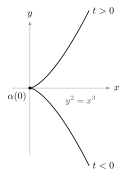
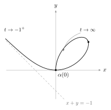
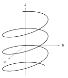
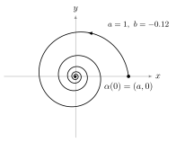
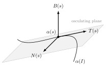
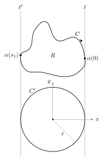

<a href="../chapter1/">English</a><a class="on">한국어</a>

미분기하학1장

# 1장 — 곡선 { .part-title #chapter-1-curves }

do Carmo 1장 · 강의 1–3 · 손필기: <a href="../originals/lec02.pdf">강의 2</a>, <a href="../originals/lec03.pdf">강의 3</a> · <a class="pdf-link" href="notes.pdf" download="미분기하학-1장.pdf">이 장을 PDF로 보기</a>

!!! quote "이 장에서 쓰는 규약."
    - *매끄럽다*는 $C^\infty$라는 뜻이다. 따로 말하지 않으면 구간 $I = (a, b) \subset \mathbb{R}$는 열린구간이다.
    - 곡선은 매끄러운 사상 $\alpha : I \to \mathbb{R}^3$이다. 프라임은 곡선의 매개변수에 대한 미분을 뜻한다. $\alpha'(t) = d\alpha/dt$이고, 곡선이 호의 길이로 매개화된 뒤에는 $d\alpha/ds$이다.
    - $\langle u, v\rangle$는 유클리드 내적, $|u| = \langle u, u\rangle^{1/2}$는 노름, $d(p, q) = |p - q|$는 거리, $u \wedge v$는 $\mathbb{R}^3$의 벡터곱이다. $A^t$는 행렬 $A$의 전치이다.
    - 고정된(상수) 벡터는 굵게 쓴다: $\mathbf{v}, \mathbf{v}_0, \mathbf{c}$.
    - $L_a^b(\alpha)$는 $[a, b]$ 위에서 $\alpha$의 길이이다. "p.a.l."은 *호의 길이로 매개화됨*, 즉 $|\alpha'| \equiv 1$을 뜻하고, 호의 길이 매개변수는 $s$로 쓴다.
    - *프레네 틀.* $T = \alpha'$, $\;N = T'/k$, $\;B = T \wedge N$이며, 곡률은 $k = |T'|$, 열률 $\tau$는 $B' = \tau N$으로 정의한다. 이 부호로는

        $$
        T' = kN, \qquad N' = -kT - \tau B, \qquad B' = \tau N .
        $$

    번호는 do Carmo의 절을 따른다. **정리 1.5.3**은 §1.5의 세 번째 번호 붙은 항목이다.

---

## 1.1 도입 { #11-introduction }

곡선의 미분기하학은 공간 속 곡선의 성질 가운데 어떤 것이 도함수로 계산되며, 곡선을 어떻게 매개화했는지나 어디에 놓였는지에 따라 달라지지 않는지를 묻는다. 이 장은 세 단계로 답한다. 먼저 곡선을 매끄러운 사상으로 정의하고, 길이를 정의하여 그것이 불변임을 보인다(§1.2–1.3). 다음으로 호의 길이로 매개화된 곡선을 따라 곡률과 열률이라는 두 함수를 붙이는데, 이 둘이 곡선을 강체 운동을 제외하고 결정한다는 것이 드러난다(§1.5). 마지막으로 닫힌 평면곡선에 관한 첫 대역적 결과인 등주부등식을 증명한다(§1.7).

---

## 1.2 매개곡선 { #12-parametrized-curves }

강의 1

### 정의 { #definitions }

!!! note "정의 1.2.1"
    1. **미분가능한 곡선**($C^\infty$)은 $C^\infty$ 사상 $\alpha : I \to \mathbb{R}^3$, $\;I = (a, b) \subset \mathbb{R}$이다.

        $$
        \alpha(t) = \big(x(t), y(t), z(t)\big), \qquad x, y, z \text{ 는 } C^\infty \text{ 함수.}
        $$

    2. 벡터 $\alpha'(t) = \big(x'(t), y'(t), z'(t)\big)$를 $\alpha(t)$에서 $\alpha$의 **접벡터**라 한다.
    3. $\alpha(I) \subset P$인 평면 $P \subset \mathbb{R}^3$가 있으면 $\alpha$를 **평면곡선**이라 한다. 강체 운동으로 $P = \{z = 0\}$이라 둘 수 있으며, 그러면 $\alpha(t) = \big(x(t), y(t), 0\big)$이다.

### 매끄러운 곡선은 어떻게 생길 수 있나 { #what-a-smooth-curve-can-look-like }

사상 $\alpha$가 매끄러워도 그 상 $\alpha(I)$가 매끄러울 필요는 없다.

!!! info "참고 1.2.2 — 모서리"
    $\alpha(I)$에는 모서리가 있을 수 있다. 예를 들어 $\alpha(t) = (t^2, t^3)$은 매끄럽지만, 그 상은 곡선 $y^2 = x^3$(즉 $x = y^{2/3}$)이고 원점에서 **첨점(cusp)**을 가진다.

    <figure markdown>
      { .tex-fig width="230" }
      <figcaption markdown="span">그림 1.1. $\alpha(t) = (t^2, t^3)$의 상.</figcaption>
    </figure>

!!! info "참고 — 모서리는 어디서 생기나"
    첨점에서는 접벡터가 0이 된다. $\alpha'(t) = (2t, 3t^2)$이므로 $\alpha'(0) = 0$이다. 곡선은 그 자리에서 멈춰야만 날카롭게 꺾일 수 있다. 모든 곳에서 $\alpha' \neq 0$인 곡선, 즉 §1.3의 *정칙* 곡선은 이렇게 될 수 없다.

!!! info "참고 1.2.3 — 단사만으로는 부족하다"
    $\alpha$가 단사여도 상으로의 위상동형사상이 아닐 수 있다. 예를 들어 **데카르트의 엽선**

    $$
    \alpha : (-1, \infty) \to \mathbb{R}^2, \qquad
    \alpha(t) = \left( \frac{3t}{1+t^3},\; \frac{3t^2}{1+t^3} \right)
    $$

    의 상은 곡선 $3xy = x^3 + y^3$ 위에 놓인다.

    <figure markdown>
      { .tex-fig width="330" }
      <figcaption markdown="span">그림 1.2. 데카르트의 엽선, $t \in (-1, \infty)$.</figcaption>
    </figure>

!!! info "참고 — 엽선이 실패하는 이유"
    $\alpha$는 단사이지만 $t \to \infty$일 때 $\alpha(t) \to (0, 0) = \alpha(0)$이다. 그래서 $t$가 아주 큰 점 $\alpha(t)$는 상에서 $\alpha(0)$에 가깝지만 $t$는 $0$에서 멀다. 즉 역사상 $\alpha(I) \to (-1, \infty)$가 원점에서 연속이 아니다.

### 예제 { #examples }

!!! example "예제 1.2.4 (직선)"
    $\alpha(t) = t\,\mathbf{v} + \mathbf{v}_0$, $\quad \mathbf{v}, \mathbf{v}_0 \in \mathbb{R}^3$, $\; t \in \mathbb{R}$.

!!! example "예제 1.2.5 (원)"
    $\alpha(t) = \mathbf{c} + r\left(\cos\tfrac{t}{r},\, \sin\tfrac{t}{r}\right)$, $\quad \mathbf{c} \in \mathbb{R}^2$, $\; r > 0$, $\; t \in \mathbb{R}$.

!!! example "예제 1.2.6 (나선)"
    $$
    \alpha(t) = \left( a\cos\frac{t}{\sqrt{a^2+b^2}},\; a\sin\frac{t}{\sqrt{a^2+b^2}},\; \frac{b\,t}{\sqrt{a^2+b^2}} \right),
    \qquad a, b \neq 0, \quad t \in \mathbb{R}.
    $$

    <figure markdown>
      { .tex-fig width="260" }
      <figcaption markdown="span">그림 1.3. $z$축을 감아 도는 나선.</figcaption>
    </figure>

!!! info "참고 — 이상해 보이는 매개변수"
    인수 $1/r$과 $1/\sqrt{a^2+b^2}$는 $|\alpha'(t)| = 1$이 되도록 고른 것이다. 나선의 경우 $|\alpha'|^2 = \frac{a^2 + b^2}{a^2+b^2} = 1$이다. 세 예제 모두 §1.3의 의미에서 호의 길이로 매개화되어 있다.

---

## 1.3 정칙곡선; 호의 길이 { #13-regular-curves-arc-length }

강의 1–2

### 길이 { #length }

$\alpha : I \to \mathbb{R}^3$와 $[a, b] \subset I$가 주어졌을 때, 길이 $L\big(\alpha([a, b])\big)$는 무엇인가?

$[a, b]$의 분할, 즉

$$
P = \{\, t_0 = a < t_1 < \dots < t_n = b \,\}
$$

을 하나 잡고

$$
L_a^b(\alpha, P) = \sum_{i=1}^{n} |\alpha(t_i) - \alpha(t_{i-1})|,
\qquad
|P| = \max_{1 \le i \le n} |t_i - t_{i-1}|
$$

라 하자. $L_a^b(\alpha, P)$는 곡선에 내접하는 다각형의 길이이고, $|P|$는 분할의 크기(mesh)이다.

<figure markdown>
  { .tex-fig width="540" }
  <figcaption markdown="span">그림 1.4. 꼭짓점이 $\alpha(t_0), \dots, \alpha(t_n)$인 다각형.</figcaption>
</figure>

!!! abstract "정리 1.3.1"
    모든 $\varepsilon > 0$에 대해 다음을 만족하는 $\delta > 0$가 있다.

    $$
    |P| < \delta \;\Longrightarrow\; \left| L_a^b(\alpha, P) - \int_a^b |\alpha'(t)|\, dt \right| < \varepsilon .
    $$

!!! note "정의 1.3.2 (길이)"
    $$
    L_a^b(\alpha) = \int_a^b |\alpha'(t)|\, dt .
    $$

!!! success "증명"
    *(정리 1.3.1의 증명)* 함수

    $$
    f : I \times I \times I \to \mathbb{R}, \qquad
    (t_1, t_2, t_3) \mapsto \sqrt{x'(t_1)^2 + y'(t_2)^2 + z'(t_3)^2}
    $$

    를 정의한다. $f$는 연속이므로 $[a, b]^3$에서 균등연속이다. 따라서 모든 $\varepsilon > 0$에 대해 $\delta > 0$가 있어서, $(t_1, t_2, t_3), (s_1, s_2, s_3) \in [a, b]^3$에 대해

    $$
    |t_1 - s_1| < \delta,\;\; |t_2 - s_2| < \delta,\;\; |t_3 - s_3| < \delta
    \;\Longrightarrow\;
    |f(t_1, t_2, t_3) - f(s_1, s_2, s_3)| < \frac{\varepsilon}{b - a}
    $$

    이다. 평균값 정리를 $x$, $y$, $z$에 각각 적용하면

    $$
    |\alpha(t_i) - \alpha(t_{i-1})| = f(\beta_i, \gamma_i, \eta_i)\,(t_i - t_{i-1})
    \quad\text{어떤 } \beta_i, \gamma_i, \eta_i \in [t_{i-1}, t_i] \text{ 에 대해}
    $$

    이므로 (판서에서는 세 번째 점을 $\delta_i$로 썼다)

    $$
    L_a^b(\alpha, P) = \sum_{i=1}^{n} f(\beta_i, \gamma_i, \eta_i)\,(t_i - t_{i-1})
    $$

    이다. 한편 적분의 평균값 정리에 의해

    $$
    \int_a^b |\alpha'(t)|\, dt = \sum_{i=1}^{n} \int_{t_{i-1}}^{t_i} |\alpha'(t)|\, dt
    = \sum_{i=1}^{n} |\alpha'(\xi_i)|\,(t_i - t_{i-1})
    = \sum_{i=1}^{n} f(\xi_i, \xi_i, \xi_i)\,(t_i - t_{i-1})
    $$

    인 $\xi_i \in [t_{i-1}, t_i]$가 있다. $|P| < \delta$이면 모든 $i$에 대해 $t_i - t_{i-1} < \delta$이므로

    $$
    |\beta_i - \xi_i| < \delta, \qquad |\gamma_i - \xi_i| < \delta, \qquad |\eta_i - \xi_i| < \delta
    $$

    이다. 따라서

    $$
    \left| L_a^b(\alpha, P) - \int_a^b |\alpha'| \right|
    \le \sum_{i=1}^{n} \big| f(\beta_i, \gamma_i, \eta_i) - f(\xi_i, \xi_i, \xi_i) \big|\,(t_i - t_{i-1})
    < \frac{\varepsilon}{b - a} \sum_{i=1}^{n} (t_i - t_{i-1}) = \varepsilon . \qquad \square
    $$

!!! info "참고 — 왜 서로 다른 세 점인가"
    평균값 정리는 좌표마다 따로 적용해야 하고, 각각 자기만의 중간점을 준다. 그래서 $f$가 인자를 하나가 아니라 셋 받으며, 세 점을 한데 모으려면 $f$의 균등연속성이 필요하다.

### 등거리변환에 대한 불변성 { #invariance-under-isometries }

!!! note "정의 1.3.3 (등거리변환)"
    $\mathbb{R}^3$의 **등거리변환**은 모든 $p, q$에 대해 $d(p, q) = d\big(\varphi(p), \varphi(q)\big)$인 $\mathbb{R}^3$의 변환 $\varphi$이다.

    이로부터 $\varphi$는 평행이동을 제외하면 선형사상이고, 그 행렬 $A$는 $A A^t = \mathrm{Id}$를 만족함이 따라 나온다.

!!! abstract "명제 1.3.4 (등거리변환에 대한 불변성)"
    $\varphi$가 $\mathbb{R}^3$의 등거리변환이고 $\alpha : I \to \mathbb{R}^3$가 곡선이면 $L_a^b(\varphi \circ \alpha) = L_a^b(\alpha)$이다.

!!! success "증명"
    $A A^t = \mathrm{Id}$인 $A$로 $\varphi(p) = A p + \mathbf{q}$라 쓰자. 그러면 $(\varphi \circ \alpha)'(t) = A\, \alpha'(t)$이고, 직교행렬은 노름을 보존한다: $|A u|^2 = \langle A u, A u\rangle = \langle u, A^t A u\rangle = |u|^2$. 따라서 피적분함수가 같다.

    $$
    L_a^b(\varphi \circ \alpha) = \int_a^b |A\, \alpha'(t)|\, dt = \int_a^b |\alpha'(t)|\, dt = L_a^b(\alpha). \qquad \square
    $$

### 최단 경로로서의 직선 { #lines-as-minima }

!!! example "예제 1.3.5 (최단 경로로서의 직선)"
    $\alpha : I \to \mathbb{R}^3$이고 $[a, b] \subset I$이면

    $$
    |\alpha(b) - \alpha(a)| \le L_a^b(\alpha) .
    $$

    <figure markdown>
      { .tex-fig width="300" }
      <figcaption markdown="span">그림 1.5. 선분은 끝점이 같은 어떤 곡선보다도 길지 않다.</figcaption>
    </figure>

!!! success "증명"
    미적분학의 기본정리와 적분의 삼각부등식에 의해

    $$
    |\alpha(b) - \alpha(a)| = \left| \int_a^b \alpha'(t)\, dt \right| \le \int_a^b |\alpha'(t)|\, dt = L_a^b(\alpha). \qquad \square
    $$

    다르게 말하면 $|\alpha(b) - \alpha(a)| = L_a^b(\alpha, \{a, b\})$이고, 삼각부등식에 의해 분할을 세분하면 $L_a^b(\alpha, P)$는 커지기만 한다.

### 재매개화 { #reparametrization }

!!! note "정의 1.3.6 (미분동형사상, 재매개화)"
    **미분동형사상** $\varphi : J \to I$($I, J$는 열린구간)는 $C^\infty$이고 가역이며 역사상도 $C^\infty$인 사상이다.

    $\alpha : I \to \mathbb{R}^3$가 주어지면 $\beta = \alpha \circ \varphi$로 *새로운* 곡선 $\beta : J \to \mathbb{R}^3$를 만들 수 있다. $\beta$를 $\alpha$의 **재매개화**라 한다.

!!! abstract "명제 1.3.7"
    $\varphi : J \to I$가 미분동형사상, $\alpha : I \to \mathbb{R}^3$, $[a, b] \subset J$, $\varphi([a, b]) = [c, d]$라 하자. 그러면

    $$
    L_a^b(\alpha \circ \varphi) = L_c^d(\alpha).
    $$

!!! success "증명"
    $$
    |(\alpha \circ \varphi)'(t)| = |\alpha'(\varphi(t))|\, |\varphi'(t)| .
    $$

    $\varphi$는 미분동형사상이므로 모든 곳에서 $\varphi' > 0$이거나 모든 곳에서 $\varphi' < 0$이다. $\varphi' > 0$이라 하고 $s = \varphi(t)$라 두면

    $$
    \int_a^b |(\alpha \circ \varphi)'(t)|\, dt
    = \int_a^b |\alpha'(\varphi(t))|\, \varphi'(t)\, dt
    = \int_c^d \left| \frac{d}{ds}\alpha(s) \right| ds = L_c^d(\alpha).
    $$

    $\varphi' < 0$이면 $|\varphi'| = -\varphi'$이고 $\varphi$는 $a \mapsto d$, $b \mapsto c$로 보내므로, 치환하면 $-\int_d^c = \int_c^d$가 되어 같은 결과가 나온다. $\square$

!!! info "참고 — 왜 $\varphi'$는 0이 되지 않는가"
    $\varphi^{-1}(\varphi(t)) = t$를 미분하면 $(\varphi^{-1})'(\varphi(t))\, \varphi'(t) = 1$이므로 $\varphi'(t) \neq 0$이다. 구간에서 한 번도 0이 되지 않는 연속함수는 중간값 정리에 의해 부호가 일정하다.

강의 2

### 호의 길이 함수 { #the-arc-length-function }

$\alpha : I \to \mathbb{R}^3$를 매끄러운 곡선이라 하고 $t_0 \in I$를 고정한다.

$$
s : I \to \mathbb{R}, \qquad s(t) = \int_{t_0}^{t} |\alpha'(u)|\, du = L_{t_0}^{t}(\alpha)
$$

로 정의하면, 이는 $t_0$부터 $t$까지 $\alpha$의 길이이다.

함수 $u \mapsto |\alpha'(u)|$는 일반적으로 연속일 뿐이므로 $s$도 일반적으로 $C^1$일 뿐이며

$$
s'(t) = |\alpha'(t)|
$$

이다. 특히 $s$는 일반적으로 미분동형사상이 **아니다**.

!!! info "참고 — 매끄러움은 어디서 잃는가"
    $\alpha'$ 자체는 매끄럽다. 문제는 노름 $x \mapsto |x|$로, $x = 0$에서 미분가능하지 않다. 그래서 $|\alpha'|$는 $\alpha'$가 0이 되는 점에서만 매끄러움을 잃을 수 있다.

모든 $t$에서 $|\alpha'(t)| \neq 0$이면 $s$는 실제로 $I$와 $s(I)$ 사이의 미분동형사상이다. 이제 $|\alpha'|$가 매끄러우므로 $s$는 $C^\infty$이고 $s' > 0$이다.

!!! note "정의 1.3.8 (정칙곡선)"
    모든 $t \in I$에서 $\alpha'(t) \neq 0$인 곡선 $\alpha : I \to \mathbb{R}^3$를 **정칙(regular)**이라 한다. 정칙곡선에서는 $s$가 $C^\infty$이다.

$J = s(I)$라 하고 $\varphi : J \to I$를 $s$의 역함수라 하자.

$$
\beta(s) = \alpha \circ \varphi \,(s) : J \to \mathbb{R}^3
$$

로 정의한다.

<figure markdown>
  { .tex-fig width="230" }
  <figcaption markdown="span">그림 1.6. 호의 길이로 재매개화하기.</figcaption>
</figure>

연쇄법칙과 $\varphi'(s) = 1 / s'(\varphi(s)) = 1/|\alpha'(\varphi(s))|$에 의해

$$
\beta'(s) = \alpha'(\varphi(s))\, \varphi'(s) = \frac{\alpha'(\varphi(s))}{|\alpha'(\varphi(s))|},
\qquad\text{따라서}\qquad
|\beta'(s)| = 1 \quad \forall s \in J .
$$

!!! note "정의 1.3.9 (호의 길이 매개화)"
    모든 $t$에서 $|\alpha'(t)| = 1$이면 $\alpha : I \to \mathbb{R}^3$가 **호의 길이로 매개화되었다**(p.a.l.)고 한다.

!!! abstract "정리 1.3.10"
    모든 정칙곡선은 호의 길이로 재매개화할 수 있다.

!!! info "참고"
    호의 길이 매개변수 $s$는 유일하지 않다. $t_0$의 선택, 즉 적분상수에 따라 달라진다.

### 호의 길이의 예 { #examples-of-arc-length }

!!! example "예제 1.3.11 (직선)"
    $\alpha(t) = t\,\mathbf{v} + \mathbf{v}_0$, $\;t \in \mathbb{R}$, $\;\mathbf{v} \neq 0$, $\;t_0 = 0$. 그러면 $\alpha'(t) = \mathbf{v}$이고

    $$
    s(t) = \int_0^t |\mathbf{v}|\, du = t\,|\mathbf{v}|,
    \qquad
    \varphi(s) = \frac{s}{|\mathbf{v}|},
    \qquad
    \beta(s) = \frac{s}{|\mathbf{v}|}\,\mathbf{v} + \mathbf{v}_0 .
    $$

!!! example "예제 1.3.12 (로그 나선)"
    $\alpha : \mathbb{R} \to \mathbb{R}^2$, $\quad t \mapsto \left(a e^{bt}\cos t,\; a e^{bt}\sin t\right)$, $\quad a > 0,\; b < 0,\; t_0 = 0$.

    $$
    \begin{aligned}
    s(t) &= \int_0^t |\alpha'(t)|\, dt \\
    &= \int_0^t \Big|\Big(a\big(b e^{bt}\cos t - e^{bt}\sin t\big),\; a\big(b e^{bt}\sin t + e^{bt}\cos t\big)\Big)\Big|\, dt \\
    &= \int_0^t a e^{bt}\left(b^2\cos^2 t + \sin^2 t + b^2\sin^2 t + \cos^2 t\right)^{1/2} dt \\
    &= \int_0^t a e^{bt}\,(b^2+1)^{1/2}\, dt
    \;=\; \frac{e^{bt}-1}{b}\; a\,(b^2+1)^{1/2} .
    \end{aligned}
    $$

    (셋째 줄에서 교차항 $\mp 2b\sin t\cos t$는 상쇄된다.)

    <figure markdown>
      { .tex-fig width="380" }
      <figcaption markdown="span">그림 1.7. $a = 1$, $b = -0.12$인 로그 나선.</figcaption>
    </figure>

!!! info "참고 — 길이가 유한한 나선"
    $b < 0$이므로 $t \to \infty$일 때 $e^{bt} \to 0$이고 $s(t) \to a\sqrt{1+b^2}\,/\,|b|$이다. 이 나선은 원점 주위를 무한히 많이 감지만 전체 길이는 유한하다.

---

## 1.4 $\mathbb{R}^3$의 벡터곱 { data-toc-label="1.4 R³의 벡터곱" #14-the-vector-product }

이 절은 강의에서 다루지 않았으므로 이 노트에서도 건너뛴다. 벡터곱 $u \wedge v$는 §1.5에서 종법선 $B = T \wedge N$을 정의하는 데 쓰인다. 거기서 필요한 사실은, $\{u, v\}$가 정규직교이면 $\{u, v, u \wedge v\}$가 양의 정규직교기저라는 것, $u \wedge u = 0$이라는 것, 그리고 곱의 미분법 $(u \wedge v)' = u' \wedge v + u \wedge v'$이다.

---

## 1.5 호의 길이로 매개화된 곡선의 국소 이론 { #15-the-local-theory-of-curves-parametrized-by-arc-length }

강의 2

### 곡률과 프레네 삼면체 { #curvature-and-the-frenet-trihedron }

이제부터 $\alpha$는 p.a.l.이다.

<figure markdown>
  { .tex-fig width="400" }
  <figcaption markdown="span">그림 1.8. $\alpha(s)$에서의 프레네 삼면체. $T$와 $N$이 접촉평면을 생성한다.</figcaption>
</figure>

$$
T(s) := \alpha'(s), \qquad |T(s)| = 1 \quad \forall s
$$

라 두자. $\langle T(s), T(s)\rangle = 1$을 미분하면

$$
\langle T'(s), T(s)\rangle + \langle T(s), T'(s)\rangle = 0
\quad\Longrightarrow\quad
\langle T'(s), T(s)\rangle = 0 .
$$

따라서 $T'$는 항상 $T$와 직교한다.

!!! note "정의 1.5.1"
    1. $k(s) = |T'(s)|$를 $s$에서 $\alpha$의 **곡률**이라 한다.
       이것은 연속일 뿐이며, 모든 $s$에서 $T'(s) \neq 0$이면 $C^\infty$이다.
       *이제부터 모든 $s$에서 $k(s) > 0$이라 가정한다.*
    2. $\displaystyle N(s) = \frac{T'(s)}{|T'(s)|} = \frac{T'(s)}{k(s)}$를 $s$에서 $\alpha$의 **법선벡터**라 한다.
    3. $B(s) := T(s) \wedge N(s)$를 $s$에서 $\alpha$의 **종법선벡터**라 한다.
    4. $\{T(s), N(s), B(s)\}$를 **프레네 삼면체**라 한다.

### 열률 { #torsion }

$N$의 정의에 의해

$$
T'(s) = k(s)\, N(s).
$$

$B = T \wedge N$을 미분하면

$$
B'(s) = T'(s) \wedge N(s) + T(s) \wedge N'(s) = T(s) \wedge N'(s)
$$

인데, $T' \wedge N = k\, N \wedge N = 0$이기 때문이다. 이제

- $B' = T \wedge N'$는 $T$와 직교하므로 $\langle B', T\rangle = 0$이고,
- $\langle B, B\rangle = 1$을 미분하면 $\langle B', B\rangle = 0$이다.

따라서 $B'$는 $T$와 $B$ 모두에 직교하므로 $N$과 평행하다.

$$
B'(s) = \tau(s)\, N(s).
$$

!!! note "정의 1.5.2 (열률)"
    $\tau(s)$를 $s$에서 $\alpha$의 **열률(비틀림률)**이라 한다. $\tau = \langle B', N\rangle$이므로 매끄럽다.

!!! warning "주의 — 열률의 부호"
    이 노트는 (do Carmo처럼) $B' = \tau N$을 쓴다. 다른 많은 책은 $B' = -\tau N$으로 열률을 정의하는데, 그러면 $\tau$의 부호와 아래 $N'$의 $\tau B$ 항의 부호가 바뀐다. 다른 책의 공식을 옮겨 올 때는 규약을 먼저 확인하라.

### 프레네 공식 { #the-frenet-formulas }

지금까지:

$$
T' \rightsquigarrow k, \qquad B' \rightsquigarrow \tau, \qquad N' \rightsquigarrow \;?
$$

$N$이 들어간 직교 관계를 미분한다.

$$
\begin{aligned}
\langle N, T\rangle = 0 &\;\Longrightarrow\; \langle N', T\rangle + \langle N, T'\rangle = 0 \;\Longrightarrow\; \langle N', T\rangle + k(s) = 0, \\
\langle N, B\rangle = 0 &\;\Longrightarrow\; \langle N', B\rangle + \langle N, B'\rangle = 0 \;\Longrightarrow\; \langle N', B\rangle + \tau(s) = 0 .
\end{aligned}
$$

($|N| = 1$이므로) $\langle N', N\rangle = 0$과 함께, $N'$을 정규직교기저 $\{T, N, B\}$로 전개하면 $N' = -kT - \tau B$를 얻는다.

!!! abstract "정리 1.5.3 (프레네 공식)"
    $\alpha : I \to \mathbb{R}^3$가 $k > 0$인 p.a.l. 곡선이면

    $$
    \begin{cases}
    T' = k N \\
    N' = -k T - \tau B \\
    B' = \tau N
    \end{cases}
    $$

!!! info "참고 — 행렬 형태"
    $$
    \frac{d}{ds}\begin{pmatrix} T \\ N \\ B \end{pmatrix}
    = \begin{pmatrix} 0 & k & 0 \\ -k & 0 & -\tau \\ 0 & \tau & 0 \end{pmatrix}
    \begin{pmatrix} T \\ N \\ B \end{pmatrix}.
    $$

    이 행렬은 반대칭이다. 우연이 아니다. 정규직교틀의 도함수이기 때문이다.

### 프레네 틀의 예 { #examples-of-the-frenet-frame }

!!! example "예제 1.5.4 (직선)"
    $|\mathbf{v}| = 1$인 $\alpha(t) = t\,\mathbf{v} + \mathbf{v}_0$. 그러면

    $$
    T(t) = \mathbf{v}, \qquad T' = 0, \qquad k(t) = 0 .
    $$

!!! example "예제 1.5.5 (원)"
    $\alpha(t) = r\left(\cos\tfrac{t}{r},\, \sin\tfrac{t}{r},\, 0\right) + \mathbf{c}$.

    $$
    \alpha'(t) = r\left(-\tfrac{1}{r}\sin\tfrac{t}{r},\, \tfrac{1}{r}\cos\tfrac{t}{r},\, 0\right) = \left(-\sin\tfrac{t}{r},\, \cos\tfrac{t}{r},\, 0\right)
    $$

    이므로 $t$는 호의 길이이고 $T = \alpha'$이다. 그러면

    $$
    T' = \left(-\tfrac{1}{r}\cos\tfrac{t}{r},\, -\tfrac{1}{r}\sin\tfrac{t}{r},\, 0\right) \;\Longrightarrow\; k(t) = \frac{1}{r} \;(\neq 0),
    $$

    $$
    N = \left(-\cos\tfrac{t}{r},\, -\sin\tfrac{t}{r},\, 0\right), \qquad
    B(t) = (0, 0, 1) \;\Longrightarrow\; B' = 0 \;\Longrightarrow\; \tau = 0 .
    $$

    <figure markdown>
      { .tex-fig width="340" }
      <figcaption markdown="span">그림 1.9. 원에서 $N$은 중심을 향하고 $B$는 지면 밖을 향한다.</figcaption>
    </figure>

### 직선과 평면곡선 { #lines-and-plane-curves }

!!! abstract "정리 1.5.6"
    $\alpha : I \to \mathbb{R}^3$가 p.a.l.이면, $k \equiv 0$일 필요충분조건은 $\alpha$가 직선의 일부인 것이다.

!!! success "증명"
    ($\Leftarrow$) 예제 1.5.4에서 보였다.

    ($\Rightarrow$) $k \equiv 0 \Rightarrow T' = 0 \Rightarrow T(s) = \alpha'(s) = \mathbf{v}$는 상수벡터이다. 적분하면 $\alpha(s) = s\,\mathbf{v} + \mathbf{v}_0$. $\square$

!!! abstract "정리 1.5.7"
    $\alpha : I \to \mathbb{R}^3$가 $k > 0$인 p.a.l. 곡선이면, $\alpha$가 평면곡선일 필요충분조건은 $\tau \equiv 0$이다.

!!! success "증명"
    ($\Leftarrow$) $\tau \equiv 0$이라 하자. 그러면 $B' = 0$이므로 $B(s) = \mathbf{v}$는 $|\mathbf{v}| = 1$인 상수벡터이고,

    $$
    \big(\langle \alpha(s), \mathbf{v}\rangle\big)' = \langle T, \mathbf{v}\rangle = 0
    \quad\Longrightarrow\quad
    \langle \alpha(s), \mathbf{v}\rangle = a, \quad a \in \mathbb{R}
    $$

    이며, 이것은 $\mathbb{R}^3$의 평면의 방정식이다. $\square$

!!! info "참고 — 반대 방향"
    손필기에는 ($\Leftarrow$)만 증명되어 있다. ($\Rightarrow$): $\alpha$가 $|\mathbf{v}| = 1$인 평면 $\langle x, \mathbf{v}\rangle = a$ 위에 있으면, 두 번 미분하여 $\langle T, \mathbf{v}\rangle = 0$과 $\langle T', \mathbf{v}\rangle = 0$, 즉 $\langle N, \mathbf{v}\rangle = 0$을 얻는다. 그러면 $B$와 $\mathbf{v}$는 모두 $T$와 $N$에 직교하는 단위벡터이므로 $B = \pm\mathbf{v}$이다. 연속성에 의해 부호는 일정하므로 $B$는 상수이고, $B' = 0$, $\tau = 0$이다. $\square$

### 곡선의 국소 이론의 기본정리 { #the-fundamental-theorem-of-the-local-theory-of-curves }

강의 3

$\alpha : I \to \mathbb{R}^3$가 $k > 0$인 p.a.l. 곡선이라 하고, 프레네 틀을 $\mathbb{R}^9$의 한 점으로 보자.

$$
s \longmapsto \begin{pmatrix} T(s) \\ N(s) \\ B(s) \end{pmatrix} \in \mathbb{R}^9 .
$$

$0_3$과 $\mathrm{Id}_3$를 $3 \times 3$ 영행렬과 단위행렬이라 쓰면, 프레네 공식은 이 점이 선형계를 푼다는 뜻이다.

$$
\begin{pmatrix} T' \\ N' \\ B' \end{pmatrix}
= \begin{pmatrix} kN \\ -kT - \tau B \\ \tau N \end{pmatrix}
= \begin{pmatrix} 0_3 & k\,\mathrm{Id}_3 & 0_3 \\ -k\,\mathrm{Id}_3 & 0_3 & -\tau\,\mathrm{Id}_3 \\ 0_3 & \tau\,\mathrm{Id}_3 & 0_3 \end{pmatrix}
\begin{pmatrix} T \\ N \\ B \end{pmatrix}.
$$

그러므로 곡률과 열률은 선형 상미분방정식을 통해 틀을 결정하고, 틀은 적분을 통해 곡선을 결정한다. 이것이 다음 정리의 내용이다.

!!! abstract "정리 1.5.8 (곡선의 국소 이론의 기본정리)"
    $k_0 > 0$인 $C^\infty$ 함수 $k_0, \tau_0 : I \to \mathbb{R}$가 주어지면, $k(s) = k_0(s)$이고 $\tau(s) = \tau_0(s)$인, 호의 길이로 매개화된 곡선 $\alpha : I \to \mathbb{R}^3$가 존재한다.

    더욱이 $\alpha$는 $\mathbb{R}^3$의 고유 등거리변환(방향 보존)을 제외하고 유일하다.

!!! success "증명"
    *존재성.* 선형계

    $$
    x'(s) = A_0(s)\, x(s), \qquad
    A_0(s) = \begin{pmatrix} 0_3 & k_0(s)\,\mathrm{Id}_3 & 0_3 \\ -k_0(s)\,\mathrm{Id}_3 & 0_3 & -\tau_0(s)\,\mathrm{Id}_3 \\ 0_3 & \tau_0(s)\,\mathrm{Id}_3 & 0_3 \end{pmatrix},
    \qquad x(s) \in \mathbb{R}^9 \tag{$*$}
    $$

    를 생각하자. $s_0 \in I$를 고정하고

    $$
    \mathbf{t}_0 = (a_1, a_2, a_3), \qquad \mathbf{n}_0 = (a_4, a_5, a_6), \qquad \mathbf{b}_0 = (a_7, a_8, a_9)
    $$

    가 $\mathbb{R}^3$의 양의 정규직교기저가 되도록 $a \in \mathbb{R}^9$를 고른다. $f : I \to \mathbb{R}^9$를 $f(s_0) = a$인 $(*)$의 해라 하고

    $$
    \mathbf{t} = (f_1, f_2, f_3), \qquad \mathbf{n} = (f_4, f_5, f_6), \qquad \mathbf{b} = (f_7, f_8, f_9)
    $$

    로 정의한다. 모든 $s \in I$에서 $\{\mathbf{t}, \mathbf{n}, \mathbf{b}\}$가 $\mathbb{R}^3$의 양의 정규직교기저임을 보이고자 한다. 내적들의 행렬

    $$
    M(s) = \begin{pmatrix}
    \langle \mathbf{t}, \mathbf{t}\rangle & \langle \mathbf{t}, \mathbf{n}\rangle & \langle \mathbf{t}, \mathbf{b}\rangle \\
    \langle \mathbf{t}, \mathbf{n}\rangle & \langle \mathbf{n}, \mathbf{n}\rangle & \langle \mathbf{n}, \mathbf{b}\rangle \\
    \langle \mathbf{t}, \mathbf{b}\rangle & \langle \mathbf{n}, \mathbf{b}\rangle & \langle \mathbf{b}, \mathbf{b}\rangle
    \end{pmatrix}
    $$

    을 보자. $F(s)$를 행이 $\mathbf{t}, \mathbf{n}, \mathbf{b}$인 $3 \times 3$ 행렬이라 하면 $M = F F^t$이고, $(*)$은

    $$
    A(s) = \begin{pmatrix} 0 & k_0 & 0 \\ -k_0 & 0 & -\tau_0 \\ 0 & \tau_0 & 0 \end{pmatrix}(s), \qquad A^t = -A
    $$

    에 대해 $F' = A F$라는 뜻이다. 따라서

    $$
    M' = F' F^t + F (F')^t = A M + M A^t = A M - M A, \qquad M(s_0) = \mathrm{Id}_3 .
    $$

    이것은 다시 $M$에 대한 선형계이므로 주어진 초깃값에 대한 해는 유일하다. 그런데 $A\,\mathrm{Id}_3 - \mathrm{Id}_3\,A = 0$이므로 모든 $s$에서 $M(s) = \mathrm{Id}_3$인 것이 해이다. 따라서 $M \equiv \mathrm{Id}_3$이고, 모든 $s$에서 $\{\mathbf{t}, \mathbf{n}, \mathbf{b}\}$는 정규직교이다. 그 행렬식은 연속이고 $\pm 1$이며 $s_0$에서 $+1$이므로, 모든 $s$에서 기저는 양의 방향이다.

    이제

    $$
    \alpha : I \to \mathbb{R}^3, \qquad \alpha(s) = \int_{s_0}^{s} \mathbf{t}(u)\, du
    $$

    로 정의한다. 그러면 $\alpha' = \mathbf{t}$는 단위길이이므로 $\alpha$는 p.a.l.이고 $T = \mathbf{t}$이다. 다음으로 $T' = \mathbf{t}' = k_0\, \mathbf{n}$이고 $k_0 > 0$, $|\mathbf{n}| = 1$이므로 $k = k_0$, $N = \mathbf{n}$이다. $\{\mathbf{t}, \mathbf{n}, \mathbf{b}\}$가 양의 정규직교이므로 $B = \mathbf{t} \wedge \mathbf{n} = \mathbf{b}$이다. 마지막으로 $B' = \mathbf{b}' = \tau_0\, \mathbf{n} = \tau_0 N$이므로 $\tau = \tau_0$이다.

    *유일성.* 호의 길이, 곡률, 열률은 고유 등거리변환으로 변하지 않는다(첫째는 명제 1.3.4, 나머지는 도함수들의 내적과 벡터곱으로 만들어지기 때문이다). $\alpha$와 $\bar\alpha$가 모두 곡률 $k_0$, 열률 $\tau_0$를 가진다고 하자. 고유 등거리변환을 하고 나면 $\bar\alpha(s_0) = \alpha(s_0)$이고 두 프레네 틀이 $s_0$에서 일치한다고 가정할 수 있다. 프레네 공식에 의해

    $$
    \frac{1}{2}\frac{d}{ds}\Big( |T - \bar T|^2 + |N - \bar N|^2 + |B - \bar B|^2 \Big)
    = k\langle T - \bar T, N - \bar N\rangle + \tau\langle B - \bar B, N - \bar N\rangle
    - k\langle N - \bar N, T - \bar T\rangle - \tau\langle N - \bar N, B - \bar B\rangle = 0 .
    $$

    괄호 안의 양은 상수이고 $s_0$에서 0이므로 $I$에서 $T = \bar T$이다. 그러면 $(\alpha - \bar\alpha)' = 0$이고, $\alpha - \bar\alpha$는 $s_0$에서 0인 상수이다. $\square$

!!! info "참고 — 왜 고유 등거리변환만인가"
    반사는 방향을 뒤집으므로 $B = T \wedge N$을 $-B$로 바꾸고, 그러면 $\tau$의 부호가 바뀐다. 그래서 반사로 연결된 두 곡선은 곡률은 같지만 열률은 반대이며, 이 정리는 그 둘을 같다고 할 수 없다.

---

## 1.6 국소 표준형 { #16-the-local-canonical-form }

이 절은 강의에서 다루지 않았으므로 이 노트에서도 건너뛴다. do Carmo에서는 한 점 근처의 곡선을 그 점의 프레네 틀 좌표로, 계수에 $k$, $k'$, $\tau$가 들어가는 $s$에 대한 테일러 전개로 나타낸다.

---

## 1.7 평면곡선의 대역적 성질 { #17-global-properties-of-plane-curves }

강의 3

지금까지의 결과는 국소적이었다. 곡선의 한 점 근처에 관한 것이었다. 대역적 정리는 곡선 전체에 대해 무언가를 말한다.

!!! note "정의 1.7.1 (단순닫힌곡선)"
    **닫힌 평면곡선**은 $\alpha(a) = \alpha(b)$(이고 모든 도함수가 $a$와 $b$에서 일치하는) 정칙곡선 $\alpha : [a, b] \to \mathbb{R}^2$이다. 그 밖의 자기교차가 없을 때, 즉 $[a, b)$의 $t_1 \neq t_2$에 대해 $\alpha(t_1) \neq \alpha(t_2)$일 때 **단순**하다고 한다.

<figure markdown>
  { .tex-fig width="460" }
  <figcaption markdown="span">그림 1.10. 영역 $R$을 둘러싸는 단순닫힌곡선과, 단순하지 않은 닫힌곡선.</figcaption>
</figure>

단순닫힌곡선 $C$는 평면의 한 영역 $R$, 즉 그 내부를 둘러싼다(이것은 조르당 곡선 정리의 일부이다). 매개변수가 증가할 때 $R$이 왼쪽에 있도록 $C$의 방향을 정한다.

### A. 등주부등식 { #a-the-isoperimetric-inequality }

!!! question "등주 문제"
    길이가 $L$인 평면 단순닫힌곡선 가운데 넓이가 가장 큰 영역을 둘러싸는 것은 무엇인가?

!!! abstract "정리 1.7.2 (그린)"
    $f(x, y), g(x, y) \in C^1(\mathbb{R}^2)$이고 $R$을 양의 방향 단순닫힌곡선 $C$ 안쪽의 유계 영역이라 하자. 그러면

    $$
    \int_R \left( \frac{\partial g}{\partial x} - \frac{\partial f}{\partial y} \right) dx\, dy
    = \int_C \left( f\,\frac{dx}{dt} + g\,\frac{dy}{dt} \right) dt .
    $$

$f = -y$, $g = x$로 두자. 그러면 $\partial g/\partial x - \partial f/\partial y = 2$이고, $C$를 $\alpha(t) = (x(t), y(t))$, $t \in [a, b]$로 매개화하면

$$
2\,\mathrm{Area}(R) = \int_a^b \left( x(t)\,\frac{dy}{dt} - y(t)\,\frac{dx}{dt} \right) dt .
$$

$C$가 닫혀 있다는 것을 써서 부분적분하면

$$
\int_a^b x' y \, dt = \big[\, x y \,\big]_a^b - \int_a^b x y' \, dt = -\int_a^b x y' \, dt
$$

이므로, 피적분함수의 두 반쪽이 같은 기여를 한다.

$$
\mathrm{Area}(R) = \int_a^b x\, y'\, dt = -\int_a^b y\, x'\, dt . \tag{1}
$$

!!! abstract "정리 1.7.3 (등주부등식)"
    $C$를 길이 $L$이고 영역 $R$을 둘러싸는 평면 단순닫힌곡선이라 하자. 그러면

    $$
    L^2 \ge 4\pi\, \mathrm{Area}(R).
    $$

    더욱이 $L^2 = 4\pi\, \mathrm{Area}(R)$일 필요충분조건은 $C$가 원인 것이다.

<figure markdown>
  { .tex-fig width="270" }
  <figcaption markdown="span">그림 1.11. 평행한 두 접선 $\ell, \ell'$ 사이의 $C$와, 두 직선에 모두 접하는 원 $C'$.</figcaption>
</figure>

!!! success "증명"
    $C$를 사이에 두고 $C$에 접하는 평행한 두 직선 $\ell, \ell'$를 잡고, 두 직선에 모두 접하고 $C$와 만나지 않는 반지름 $r$인 원 $C'$를 잡아서 $2r$이 $\ell$과 $\ell'$ 사이의 거리가 되게 한다. 원점을 $C'$의 중심에 두고 $x$축을 두 직선에 수직으로 잡는다(그림 1.11).

    $C$를 양의 방향으로 호의 길이 매개화 $\alpha(s) = (x(s), y(s))$, $s \in [0, L]$로 나타내되 $\alpha(0) \in \ell$, $\alpha(s_1) \in \ell'$이 되게 한다. $\ell'$과 $\ell$ 사이의 모든 수직선은 $C'$와 만나므로, 첫째 좌표가 같은 $C'$의 매개화

    $$
    \beta(s) = \big(x(s), \bar y(s)\big), \qquad s \in [0, L]
    $$

    를 잡을 수 있다. (1)에 의해

    $$
    \mathrm{Area}(R) = \int_0^L x\, y'\, ds, \qquad
    \mathrm{Area}(C' \text{의 내부}) = \pi r^2 = -\int_0^L x'\, \bar y\, ds .
    $$

    두 식을 더하고 코시–슈바르츠 부등식 $(x y' - \bar y x')^2 \le (x^2 + \bar y^2)(x'^2 + y'^2)$을 쓰면

    $$
    \mathrm{Area}(R) + \pi r^2 = \int_0^L (x y' - x' \bar y)\, ds
    \le \int_0^L \sqrt{(x y' - \bar y x')^2}\, ds
    \le \int_0^L \sqrt{(x^2 + \bar y^2)(x'^2 + y'^2)}\, ds
    = \int_0^L \sqrt{x^2 + \bar y^2}\, ds = L r
    $$

    인데, $x'^2 + y'^2 = 1$이고 $\beta(s)$가 반지름 $r$인 원 위에 있기 때문이다. 기하평균은 산술평균보다 크지 않으므로

    $$
    \sqrt{\mathrm{Area}(R)}\,\sqrt{\pi r^2} \le \frac{1}{2}\big(\mathrm{Area}(R) + \pi r^2\big) \le \frac{L r}{2} .
    $$

    제곱하면 $4\pi r^2\, \mathrm{Area}(R) \le L^2 r^2$, 즉 $L^2 \ge 4\pi\, \mathrm{Area}(R)$이다.

    *등호.* (강의에서는 연습문제로 남겼다. 아래는 do Carmo의 논증이다.) $L^2 = 4\pi\,\mathrm{Area}(R)$이면 위의 모든 부등식이 등식이다. 평균의 등호에서 $\mathrm{Area}(R) = \pi r^2$이므로 $L = 2\pi r$이고, $r$은 $\ell$의 방향을 어떻게 잡든 같다. 코시–슈바르츠의 등호에서 $|\lambda| = r$인 $\lambda$에 대해 $(x, \bar y) = \lambda\,(y', -x')$이므로 $x = \pm r\, y'$이다. $r$이 모든 방향에서 같으므로, $x$와 $y$의 역할을 바꾼 같은 논증으로 $y = \pm r\, x'$을 얻는다. 따라서 $x^2 + y^2 = r^2(x'^2 + y'^2) = r^2$이고 $C$는 원이다. 반대로 반지름 $r$인 원은 $L^2 = 4\pi^2 r^2 = 4\pi \cdot \pi r^2$이다. $\square$

!!! info "참고 — 부등식이 말하는 것"
    길이 $L$이 고정되면 $\mathrm{Area}(R) \le L^2 / 4\pi$이고, 이 한계는 둘레가 $L$인 원만이 도달한다. 즉 원이 등주 문제의 유일한 해이다.
