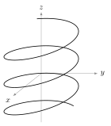
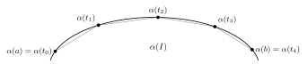
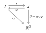
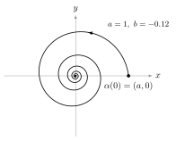
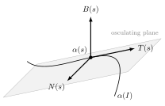
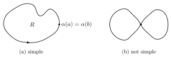
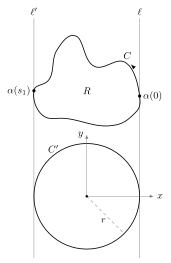

Differential GeometryChapter 1

# Chapter 1 — Curves { .part-title }

do Carmo, Chapter 1 · Lectures 1–3 · Handwritten notes: <a href="../originals/lec02.pdf">Lecture 2</a>, <a href="../originals/lec03.pdf">Lecture 3</a> · <a class="pdf-link" href="notes.pdf" download="Differential-Geometry-Chapter-1.pdf">Download this chapter as PDF</a>

!!! quote "Conventions used in this chapter."
    - *Smooth* means $C^\infty$. Intervals $I = (a, b) \subset \mathbb{R}$ are open unless stated otherwise.
    - A curve is a smooth map $\alpha : I \to \mathbb{R}^3$. A prime means a derivative with respect to the curve's parameter: $\alpha'(t) = d\alpha/dt$, or $d\alpha/ds$ once the curve is parametrized by arc length.
    - $\langle u, v\rangle$ is the Euclidean inner product, $|u| = \langle u, u\rangle^{1/2}$ the norm, $d(p, q) = |p - q|$ the distance, and $u \wedge v$ the vector product in $\mathbb{R}^3$. $A^t$ is the transpose of a matrix $A$.
    - Fixed (constant) vectors are written in bold: $\mathbf{v}, \mathbf{v}_0, \mathbf{c}$.
    - $L_a^b(\alpha)$ is the length of $\alpha$ on $[a, b]$. "p.a.l." means *parametrized by arc length*, i.e. $|\alpha'| \equiv 1$; the arc-length parameter is $s$.
    - *Frenet frame.* $T = \alpha'$, $\;N = T'/k$, $\;B = T \wedge N$, with curvature $k = |T'|$ and torsion $\tau$ defined by $B' = \tau N$. With these signs,

        $$
        T' = kN, \qquad N' = -kT - \tau B, \qquad B' = \tau N .
        $$

    Numbering follows the sections of do Carmo: **Theorem 1.5.3** is the third numbered item of §1.5.

---

## 1.1 Introduction

The differential geometry of curves asks which properties of a curve in space can be computed from derivatives and do not depend on how the curve is parametrized or where it sits. The chapter answers this in three steps. A curve is first defined as a smooth map, and its length is defined and shown to be invariant (§1.2–1.3). Along a curve parametrized by arc length, two functions, the curvature and the torsion, are then attached, and they turn out to determine the curve up to a rigid motion (§1.5). Finally, the first global result about closed plane curves, the isoperimetric inequality, is proved (§1.7).

---

## 1.2 Parametrized Curves

Lecture 1

### Definitions

!!! note "Definition 1.2.1"
    1. A **differentiable curve** ($C^\infty$) is a $C^\infty$ map $\alpha : I \to \mathbb{R}^3$, $\;I = (a, b) \subset \mathbb{R}$,

        $$
        \alpha(t) = \big(x(t), y(t), z(t)\big), \qquad x, y, z \text{ are } C^\infty \text{ functions.}
        $$

    2. The vector $\alpha'(t) = \big(x'(t), y'(t), z'(t)\big)$ is called the **tangent vector** of $\alpha$ at $\alpha(t)$.
    3. $\alpha$ is called **planar** if there exists a plane $P \subset \mathbb{R}^3$ such that $\alpha(I) \subset P$. By a rigid motion we may take $P = \{z = 0\}$, so that $\alpha(t) = \big(x(t), y(t), 0\big)$.

### What a smooth curve can look like

The map $\alpha$ is smooth, but its image $\alpha(I)$ need not be.

!!! info "Remark 1.2.2 — corners"
    $\alpha(I)$ could have corners. For example, $\alpha(t) = (t^2, t^3)$ is smooth, but its image is the curve $y^2 = x^3$ (equivalently $x = y^{2/3}$), which has a **cusp** at the origin.

    <figure markdown>
      { .tex-fig width="230" }
      <figcaption markdown="span">Figure 1.1. The image of $\alpha(t) = (t^2, t^3)$.</figcaption>
    </figure>

!!! info "Remark — where the corner comes from"
    At the cusp the tangent vector vanishes: $\alpha'(t) = (2t, 3t^2)$, so $\alpha'(0) = 0$. A curve can only turn a sharp corner by stopping there. Curves with $\alpha' \neq 0$ everywhere, the *regular* curves of §1.3, cannot do this.

!!! info "Remark 1.2.3 — injective is not enough"
    Even if $\alpha$ is injective, $\alpha$ could fail to be a homeomorphism onto its image. For example, the **folium of Descartes**

    $$
    \alpha : (-1, \infty) \to \mathbb{R}^2, \qquad
    \alpha(t) = \left( \frac{3t}{1+t^3},\; \frac{3t^2}{1+t^3} \right),
    $$

    whose image lies on the curve $3xy = x^3 + y^3$.

    <figure markdown>
      { .tex-fig width="330" }
      <figcaption markdown="span">Figure 1.2. The folium of Descartes, $t \in (-1, \infty)$.</figcaption>
    </figure>

!!! info "Remark — why the folium fails"
    $\alpha$ is injective, but $\alpha(t) \to (0, 0) = \alpha(0)$ as $t \to \infty$. So points $\alpha(t)$ with $t$ very large are close to $\alpha(0)$ in the image while $t$ is far from $0$: the inverse map $\alpha(I) \to (-1, \infty)$ is not continuous at the origin.

### Examples

!!! example "Example 1.2.4 (Lines)"
    $\alpha(t) = t\,\mathbf{v} + \mathbf{v}_0$, $\quad \mathbf{v}, \mathbf{v}_0 \in \mathbb{R}^3$, $\; t \in \mathbb{R}$.

!!! example "Example 1.2.5 (Circles)"
    $\alpha(t) = \mathbf{c} + r\left(\cos\tfrac{t}{r},\, \sin\tfrac{t}{r}\right)$, $\quad \mathbf{c} \in \mathbb{R}^2$, $\; r > 0$, $\; t \in \mathbb{R}$.

!!! example "Example 1.2.6 (Helices)"
    $$
    \alpha(t) = \left( a\cos\frac{t}{\sqrt{a^2+b^2}},\; a\sin\frac{t}{\sqrt{a^2+b^2}},\; \frac{b\,t}{\sqrt{a^2+b^2}} \right),
    \qquad a, b \neq 0, \quad t \in \mathbb{R}.
    $$

    <figure markdown>
      { .tex-fig width="260" }
      <figcaption markdown="span">Figure 1.3. A helix winding around the $z$-axis.</figcaption>
    </figure>

!!! info "Remark — the odd-looking parameters"
    The factors $1/r$ and $1/\sqrt{a^2+b^2}$ are chosen so that $|\alpha'(t)| = 1$: for the helix, $|\alpha'|^2 = \frac{a^2 + b^2}{a^2+b^2} = 1$. All three examples are parametrized by arc length, in the sense of §1.3.

---

## 1.3 Regular Curves; Arc Length

Lectures 1–2

### Length

Given $\alpha : I \to \mathbb{R}^3$ and $[a, b] \subset I$, what is the length $L\big(\alpha([a, b])\big)$?

Take a partition of $[a, b]$, i.e. a choice

$$
P = \{\, t_0 = a < t_1 < \dots < t_n = b \,\},
$$

and set

$$
L_a^b(\alpha, P) = \sum_{i=1}^{n} |\alpha(t_i) - \alpha(t_{i-1})|,
\qquad
|P| = \max_{1 \le i \le n} |t_i - t_{i-1}| .
$$

$L_a^b(\alpha, P)$ is the length of the polygon inscribed in the curve, and $|P|$ is the mesh of the partition.

<figure markdown>
  { .tex-fig width="540" }
  <figcaption markdown="span">Figure 1.4. The polygon with vertices $\alpha(t_0), \dots, \alpha(t_n)$.</figcaption>
</figure>

!!! abstract "Theorem 1.3.1"
    For every $\varepsilon > 0$ there is $\delta > 0$ such that

    $$
    |P| < \delta \;\Longrightarrow\; \left| L_a^b(\alpha, P) - \int_a^b |\alpha'(t)|\, dt \right| < \varepsilon .
    $$

!!! note "Definition 1.3.2 (Length)"
    $$
    L_a^b(\alpha) = \int_a^b |\alpha'(t)|\, dt .
    $$

!!! success "Proof"
    *(of Theorem 1.3.1)* Define

    $$
    f : I \times I \times I \to \mathbb{R}, \qquad
    (t_1, t_2, t_3) \mapsto \sqrt{x'(t_1)^2 + y'(t_2)^2 + z'(t_3)^2} .
    $$

    $f$ is continuous, hence uniformly continuous on $[a, b]^3$. So for every $\varepsilon > 0$ there is $\delta > 0$ such that, for $(t_1, t_2, t_3), (s_1, s_2, s_3) \in [a, b]^3$,

    $$
    |t_1 - s_1| < \delta,\;\; |t_2 - s_2| < \delta,\;\; |t_3 - s_3| < \delta
    \;\Longrightarrow\;
    |f(t_1, t_2, t_3) - f(s_1, s_2, s_3)| < \frac{\varepsilon}{b - a} .
    $$

    By the Mean Value Theorem, applied to $x$, $y$ and $z$ separately,

    $$
    |\alpha(t_i) - \alpha(t_{i-1})| = f(\beta_i, \gamma_i, \eta_i)\,(t_i - t_{i-1})
    \quad\text{for some } \beta_i, \gamma_i, \eta_i \in [t_{i-1}, t_i],
    $$

    so (the third point is written $\delta_i$ on the board)

    $$
    L_a^b(\alpha, P) = \sum_{i=1}^{n} f(\beta_i, \gamma_i, \eta_i)\,(t_i - t_{i-1}) .
    $$

    But, by the Mean Value Theorem for integrals,

    $$
    \int_a^b |\alpha'(t)|\, dt = \sum_{i=1}^{n} \int_{t_{i-1}}^{t_i} |\alpha'(t)|\, dt
    = \sum_{i=1}^{n} |\alpha'(\xi_i)|\,(t_i - t_{i-1})
    = \sum_{i=1}^{n} f(\xi_i, \xi_i, \xi_i)\,(t_i - t_{i-1})
    $$

    for some $\xi_i \in [t_{i-1}, t_i]$. If $|P| < \delta$, then $t_i - t_{i-1} < \delta$ for all $i$, so

    $$
    |\beta_i - \xi_i| < \delta, \qquad |\gamma_i - \xi_i| < \delta, \qquad |\eta_i - \xi_i| < \delta .
    $$

    Hence

    $$
    \left| L_a^b(\alpha, P) - \int_a^b |\alpha'| \right|
    \le \sum_{i=1}^{n} \big| f(\beta_i, \gamma_i, \eta_i) - f(\xi_i, \xi_i, \xi_i) \big|\,(t_i - t_{i-1})
    < \frac{\varepsilon}{b - a} \sum_{i=1}^{n} (t_i - t_{i-1}) = \varepsilon . \qquad \square
    $$

!!! info "Remark — why three different points"
    The Mean Value Theorem has to be applied to each coordinate on its own, and each gives its own intermediate point. That is why $f$ takes three arguments instead of one, and why uniform continuity of $f$ is needed to bring the three points together.

### Invariance under isometries

!!! note "Definition 1.3.3 (Isometry)"
    An **isometry** of $\mathbb{R}^3$ is a transformation $\varphi$ of $\mathbb{R}^3$ such that $d(p, q) = d\big(\varphi(p), \varphi(q)\big)$ for all $p, q$.

    It follows that $\varphi$ is, up to a translation, a linear map whose associated matrix $A$ satisfies $A A^t = \mathrm{Id}$.

!!! abstract "Proposition 1.3.4 (Invariance under isometries)"
    If $\varphi$ is an isometry of $\mathbb{R}^3$ and $\alpha : I \to \mathbb{R}^3$ a curve, then $L_a^b(\varphi \circ \alpha) = L_a^b(\alpha)$.

!!! success "Proof"
    Write $\varphi(p) = A p + \mathbf{q}$ with $A A^t = \mathrm{Id}$. Then $(\varphi \circ \alpha)'(t) = A\, \alpha'(t)$, and an orthogonal matrix preserves norms, $|A u|^2 = \langle A u, A u\rangle = \langle u, A^t A u\rangle = |u|^2$. So the integrands agree:

    $$
    L_a^b(\varphi \circ \alpha) = \int_a^b |A\, \alpha'(t)|\, dt = \int_a^b |\alpha'(t)|\, dt = L_a^b(\alpha). \qquad \square
    $$

### Lines as minima

!!! example "Example 1.3.5 (Lines as minima)"
    Let $\alpha : I \to \mathbb{R}^3$ and $[a, b] \subset I$. Then

    $$
    |\alpha(b) - \alpha(a)| \le L_a^b(\alpha) .
    $$

    <figure markdown>
      { .tex-fig width="300" }
      <figcaption markdown="span">Figure 1.5. The segment is no longer than any curve with the same endpoints.</figcaption>
    </figure>

!!! success "Proof"
    By the fundamental theorem of calculus and the triangle inequality for integrals,

    $$
    |\alpha(b) - \alpha(a)| = \left| \int_a^b \alpha'(t)\, dt \right| \le \int_a^b |\alpha'(t)|\, dt = L_a^b(\alpha). \qquad \square
    $$

    Equivalently, $|\alpha(b) - \alpha(a)| = L_a^b(\alpha, \{a, b\})$, and refining a partition can only increase $L_a^b(\alpha, P)$, by the triangle inequality.

### Reparametrization

!!! note "Definition 1.3.6 (Diffeomorphism, reparametrization)"
    A **diffeomorphism** $\varphi : J \to I$ ($I, J$ open intervals) is a map which is $C^\infty$ and invertible with $C^\infty$ inverse.

    Given $\alpha : I \to \mathbb{R}^3$ we can construct a *new* curve $\beta : J \to \mathbb{R}^3$ as $\beta = \alpha \circ \varphi$. $\beta$ is called a **reparametrization** of $\alpha$.

!!! abstract "Proposition 1.3.7"
    Let $\varphi : J \to I$ be a diffeomorphism, $\alpha : I \to \mathbb{R}^3$, $[a, b] \subset J$ and $\varphi([a, b]) = [c, d]$. Then

    $$
    L_a^b(\alpha \circ \varphi) = L_c^d(\alpha).
    $$

!!! success "Proof"
    $$
    |(\alpha \circ \varphi)'(t)| = |\alpha'(\varphi(t))|\, |\varphi'(t)| .
    $$

    $\varphi$ is a diffeomorphism, so $\varphi' > 0$ everywhere or $\varphi' < 0$ everywhere. Suppose $\varphi' > 0$ and call $s = \varphi(t)$. Then

    $$
    \int_a^b |(\alpha \circ \varphi)'(t)|\, dt
    = \int_a^b |\alpha'(\varphi(t))|\, \varphi'(t)\, dt
    = \int_c^d \left| \frac{d}{ds}\alpha(s) \right| ds = L_c^d(\alpha).
    $$

    If $\varphi' < 0$, then $|\varphi'| = -\varphi'$ and $\varphi$ sends $a \mapsto d$, $b \mapsto c$, so the substitution gives $-\int_d^c = \int_c^d$, the same result. $\square$

!!! info "Remark — why $\varphi'$ never vanishes"
    Differentiating $\varphi^{-1}(\varphi(t)) = t$ gives $(\varphi^{-1})'(\varphi(t))\, \varphi'(t) = 1$, so $\varphi'(t) \neq 0$. A continuous function that never vanishes on an interval has constant sign, by the intermediate value theorem.

Lecture 2

### The arc-length function

Let $\alpha : I \to \mathbb{R}^3$ be a smooth curve and fix $t_0 \in I$. Define

$$
s : I \to \mathbb{R}, \qquad s(t) = \int_{t_0}^{t} |\alpha'(u)|\, du = L_{t_0}^{t}(\alpha),
$$

the length of $\alpha$ between $t_0$ and $t$.

The function $u \mapsto |\alpha'(u)|$ is in general just continuous, so $s$ is just $C^1$, with

$$
s'(t) = |\alpha'(t)|.
$$

In particular, $s$ is **not** in general a diffeomorphism.

!!! info "Remark — where smoothness is lost"
    $\alpha'$ itself is smooth; what fails is the norm $x \mapsto |x|$, which is not differentiable at $x = 0$. So $|\alpha'|$ can only lose smoothness at points where $\alpha'$ vanishes.

If $|\alpha'(t)| \neq 0$ for all $t$, then $s$ is indeed a diffeomorphism between $I$ and $s(I)$: $|\alpha'|$ is now smooth, so $s$ is $C^\infty$, and $s' > 0$.

!!! note "Definition 1.3.8 (Regular curve)"
    A curve $\alpha : I \to \mathbb{R}^3$ with $\alpha'(t) \neq 0$ for all $t \in I$ is called **regular**. For a regular curve, $s$ is $C^\infty$.

Call $J = s(I)$, let $\varphi : J \to I$ be the inverse of $s$, and define

$$
\beta(s) = \alpha \circ \varphi \,(s) : J \to \mathbb{R}^3 .
$$

<figure markdown>
  { .tex-fig width="230" }
  <figcaption markdown="span">Figure 1.6. Reparametrizing by arc length.</figcaption>
</figure>

By the chain rule, and since $\varphi'(s) = 1 / s'(\varphi(s)) = 1/|\alpha'(\varphi(s))|$,

$$
\beta'(s) = \alpha'(\varphi(s))\, \varphi'(s) = \frac{\alpha'(\varphi(s))}{|\alpha'(\varphi(s))|},
\qquad\text{so}\qquad
|\beta'(s)| = 1 \quad \forall s \in J .
$$

!!! note "Definition 1.3.9 (Arc-length parametrization)"
    $\alpha : I \to \mathbb{R}^3$ is **parametrized by arc length** (p.a.l.) if $|\alpha'(t)| = 1$ for all $t$.

!!! abstract "Theorem 1.3.10"
    Every regular curve can be reparametrized by arc length.

!!! info "Remark"
    The arc-length parameter $s$ is not unique: it depends on the choice of $t_0$, i.e. on a constant of integration.

### Examples of arc length

!!! example "Example 1.3.11 (Lines)"
    $\alpha(t) = t\,\mathbf{v} + \mathbf{v}_0$, $\;t \in \mathbb{R}$, $\;\mathbf{v} \neq 0$, $\;t_0 = 0$. Then $\alpha'(t) = \mathbf{v}$ and

    $$
    s(t) = \int_0^t |\mathbf{v}|\, du = t\,|\mathbf{v}|,
    \qquad
    \varphi(s) = \frac{s}{|\mathbf{v}|},
    \qquad
    \beta(s) = \frac{s}{|\mathbf{v}|}\,\mathbf{v} + \mathbf{v}_0 .
    $$

!!! example "Example 1.3.12 (Logarithmic spiral)"
    $\alpha : \mathbb{R} \to \mathbb{R}^2$, $\quad t \mapsto \left(a e^{bt}\cos t,\; a e^{bt}\sin t\right)$, $\quad a > 0,\; b < 0,\; t_0 = 0$.

    $$
    \begin{aligned}
    s(t) &= \int_0^t |\alpha'(t)|\, dt \\
    &= \int_0^t \Big|\Big(a\big(b e^{bt}\cos t - e^{bt}\sin t\big),\; a\big(b e^{bt}\sin t + e^{bt}\cos t\big)\Big)\Big|\, dt \\
    &= \int_0^t a e^{bt}\left(b^2\cos^2 t + \sin^2 t + b^2\sin^2 t + \cos^2 t\right)^{1/2} dt \\
    &= \int_0^t a e^{bt}\,(b^2+1)^{1/2}\, dt
    \;=\; \frac{e^{bt}-1}{b}\; a\,(b^2+1)^{1/2} .
    \end{aligned}
    $$

    (In the third line the cross terms $\mp 2b\sin t\cos t$ cancel.)

    <figure markdown>
      { .tex-fig width="380" }
      <figcaption markdown="span">Figure 1.7. The logarithmic spiral for $a = 1$, $b = -0.12$.</figcaption>
    </figure>

!!! info "Remark — a finite spiral"
    Because $b < 0$, $e^{bt} \to 0$ as $t \to \infty$, so $s(t) \to a\sqrt{1+b^2}\,/\,|b|$. The spiral winds around the origin infinitely many times but has finite total length.

---

## 1.4 The Vector Product in $\mathbb{R}^3$ { data-toc-label="1.4 The Vector Product in R³" #14-the-vector-product }

This section was not covered in the lectures and is skipped in these notes. The vector product $u \wedge v$ is used in §1.5 to define the binormal $B = T \wedge N$; the facts needed there are that $\{u, v, u \wedge v\}$ is a positive orthonormal basis when $\{u, v\}$ is orthonormal, that $u \wedge u = 0$, and the product rule $(u \wedge v)' = u' \wedge v + u \wedge v'$.

---

## 1.5 The Local Theory of Curves Parametrized by Arc Length

Lecture 2

### Curvature and the Frenet trihedron

From now on, $\alpha$ is p.a.l.

<figure markdown>
  { .tex-fig width="400" }
  <figcaption markdown="span">Figure 1.8. The Frenet trihedron at $\alpha(s)$. $T$ and $N$ span the osculating plane.</figcaption>
</figure>

Set

$$
T(s) := \alpha'(s), \qquad |T(s)| = 1 \quad \forall s .
$$

Taking the derivative of $\langle T(s), T(s)\rangle = 1$:

$$
\langle T'(s), T(s)\rangle + \langle T(s), T'(s)\rangle = 0
\quad\Longrightarrow\quad
\langle T'(s), T(s)\rangle = 0 .
$$

So $T'$ is always orthogonal to $T$.

!!! note "Definition 1.5.1"
    1. $k(s) = |T'(s)|$ is called the **curvature** of $\alpha$ at $s$.
       This is only continuous; it is $C^\infty$ if $T'(s) \neq 0$ for all $s$.
       *From now on we assume $k(s) > 0$ for all $s$.*
    2. $\displaystyle N(s) = \frac{T'(s)}{|T'(s)|} = \frac{T'(s)}{k(s)}$ is called the **normal vector** to $\alpha$ at $s$.
    3. $B(s) := T(s) \wedge N(s)$ is called the **binormal vector** to $\alpha$ at $s$.
    4. $\{T(s), N(s), B(s)\}$ is called the **Frenet trihedron**.

### Torsion

By the definition of $N$,

$$
T'(s) = k(s)\, N(s).
$$

Differentiating $B = T \wedge N$:

$$
B'(s) = T'(s) \wedge N(s) + T(s) \wedge N'(s) = T(s) \wedge N'(s),
$$

since $T' \wedge N = k\, N \wedge N = 0$. Now

- $\langle B', T\rangle = 0$, because $B' = T \wedge N'$ is orthogonal to $T$;
- $\langle B', B\rangle = 0$, from differentiating $\langle B, B\rangle = 1$.

So $B'$ is orthogonal to both $T$ and $B$, hence parallel to $N$:

$$
B'(s) = \tau(s)\, N(s).
$$

!!! note "Definition 1.5.2 (Torsion)"
    $\tau(s)$ is called the **torsion** of $\alpha$ at $s$. Since $\tau = \langle B', N\rangle$, it is smooth.

!!! warning "Caution — sign of the torsion"
    These notes use $B' = \tau N$ (as in do Carmo). Many other books define torsion by $B' = -\tau N$, which flips the sign of $\tau$ and of the $\tau B$ term in $N'$ below. Check the convention before copying a formula across books.

### The Frenet formulas

So far:

$$
T' \rightsquigarrow k, \qquad B' \rightsquigarrow \tau, \qquad N' \rightsquigarrow \;?
$$

Differentiate the orthogonality relations involving $N$:

$$
\begin{aligned}
\langle N, T\rangle = 0 &\;\Longrightarrow\; \langle N', T\rangle + \langle N, T'\rangle = 0 \;\Longrightarrow\; \langle N', T\rangle + k(s) = 0, \\
\langle N, B\rangle = 0 &\;\Longrightarrow\; \langle N', B\rangle + \langle N, B'\rangle = 0 \;\Longrightarrow\; \langle N', B\rangle + \tau(s) = 0 .
\end{aligned}
$$

Together with $\langle N', N\rangle = 0$ (since $|N| = 1$), expanding $N'$ in the orthonormal basis $\{T, N, B\}$ gives $N' = -kT - \tau B$.

!!! abstract "Theorem 1.5.3 (Frenet's formulas)"
    Let $\alpha : I \to \mathbb{R}^3$ be p.a.l. with $k > 0$. Then

    $$
    \begin{cases}
    T' = k N \\
    N' = -k T - \tau B \\
    B' = \tau N
    \end{cases}
    $$

!!! info "Remark — matrix form"
    $$
    \frac{d}{ds}\begin{pmatrix} T \\ N \\ B \end{pmatrix}
    = \begin{pmatrix} 0 & k & 0 \\ -k & 0 & -\tau \\ 0 & \tau & 0 \end{pmatrix}
    \begin{pmatrix} T \\ N \\ B \end{pmatrix}.
    $$

    The matrix is antisymmetric. That is no accident: it is the derivative of an orthonormal frame.

### Examples of the Frenet frame

!!! example "Example 1.5.4 (Line)"
    $\alpha(t) = t\,\mathbf{v} + \mathbf{v}_0$ with $|\mathbf{v}| = 1$. Then

    $$
    T(t) = \mathbf{v}, \qquad T' = 0, \qquad k(t) = 0 .
    $$

!!! example "Example 1.5.5 (Circle)"
    $\alpha(t) = r\left(\cos\tfrac{t}{r},\, \sin\tfrac{t}{r},\, 0\right) + \mathbf{c}$.

    $$
    \alpha'(t) = r\left(-\tfrac{1}{r}\sin\tfrac{t}{r},\, \tfrac{1}{r}\cos\tfrac{t}{r},\, 0\right) = \left(-\sin\tfrac{t}{r},\, \cos\tfrac{t}{r},\, 0\right),
    $$

    so $t$ is arc length and $T = \alpha'$. Then

    $$
    T' = \left(-\tfrac{1}{r}\cos\tfrac{t}{r},\, -\tfrac{1}{r}\sin\tfrac{t}{r},\, 0\right) \;\Longrightarrow\; k(t) = \frac{1}{r} \;(\neq 0),
    $$

    $$
    N = \left(-\cos\tfrac{t}{r},\, -\sin\tfrac{t}{r},\, 0\right), \qquad
    B(t) = (0, 0, 1) \;\Longrightarrow\; B' = 0 \;\Longrightarrow\; \tau = 0 .
    $$

    <figure markdown>
      { .tex-fig width="340" }
      <figcaption markdown="span">Figure 1.9. On a circle, $N$ points to the centre and $B$ points out of the page.</figcaption>
    </figure>

### Lines and plane curves

!!! abstract "Theorem 1.5.6"
    Let $\alpha : I \to \mathbb{R}^3$ be p.a.l. Then $k \equiv 0$ if and only if $\alpha$ is a piece of a line.

!!! success "Proof"
    ($\Leftarrow$) Done in Example 1.5.4.

    ($\Rightarrow$) $k \equiv 0 \Rightarrow T' = 0 \Rightarrow T(s) = \alpha'(s) = \mathbf{v}$, a constant vector. Integrating, $\alpha(s) = s\,\mathbf{v} + \mathbf{v}_0$. $\square$

!!! abstract "Theorem 1.5.7"
    Let $\alpha : I \to \mathbb{R}^3$ be p.a.l. with $k > 0$. Then $\alpha$ is planar if and only if $\tau \equiv 0$.

!!! success "Proof"
    ($\Leftarrow$) Suppose $\tau \equiv 0$. Then $B' = 0$, so $B(s) = \mathbf{v}$ is a constant vector with $|\mathbf{v}| = 1$, and

    $$
    \big(\langle \alpha(s), \mathbf{v}\rangle\big)' = \langle T, \mathbf{v}\rangle = 0
    \quad\Longrightarrow\quad
    \langle \alpha(s), \mathbf{v}\rangle = a, \quad a \in \mathbb{R},
    $$

    which is the equation of a plane in $\mathbb{R}^3$. $\square$

!!! info "Remark — the other direction"
    The handwritten notes prove only ($\Leftarrow$). For ($\Rightarrow$): if $\alpha$ lies in a plane $\langle x, \mathbf{v}\rangle = a$ with $|\mathbf{v}| = 1$, differentiating twice gives $\langle T, \mathbf{v}\rangle = 0$ and $\langle T', \mathbf{v}\rangle = 0$, so $\langle N, \mathbf{v}\rangle = 0$. Then $B$ is a unit vector orthogonal to both $T$ and $N$, as is $\mathbf{v}$, so $B = \pm\mathbf{v}$. By continuity the sign is constant, so $B$ is constant, $B' = 0$, and $\tau = 0$. $\square$

### The fundamental theorem of the local theory of curves

Lecture 3

Let $\alpha : I \to \mathbb{R}^3$ be p.a.l. with $k > 0$, and regard the Frenet frame as a single point of $\mathbb{R}^9$:

$$
s \longmapsto \begin{pmatrix} T(s) \\ N(s) \\ B(s) \end{pmatrix} \in \mathbb{R}^9 .
$$

Writing $0_3$ and $\mathrm{Id}_3$ for the $3 \times 3$ zero and identity matrices, the Frenet formulas say that this point solves a linear system:

$$
\begin{pmatrix} T' \\ N' \\ B' \end{pmatrix}
= \begin{pmatrix} kN \\ -kT - \tau B \\ \tau N \end{pmatrix}
= \begin{pmatrix} 0_3 & k\,\mathrm{Id}_3 & 0_3 \\ -k\,\mathrm{Id}_3 & 0_3 & -\tau\,\mathrm{Id}_3 \\ 0_3 & \tau\,\mathrm{Id}_3 & 0_3 \end{pmatrix}
\begin{pmatrix} T \\ N \\ B \end{pmatrix}.
$$

So the curvature and torsion determine the frame through a linear ODE, and the frame determines the curve by integration. That is the content of the next theorem.

!!! abstract "Theorem 1.5.8 (Fundamental theorem of the local theory of curves)"
    Given $C^\infty$ functions $k_0, \tau_0 : I \to \mathbb{R}$ with $k_0 > 0$, there exists a curve $\alpha : I \to \mathbb{R}^3$, parametrized by arc length, such that $k(s) = k_0(s)$ and $\tau(s) = \tau_0(s)$.

    Moreover, $\alpha$ is unique up to direct isometries of $\mathbb{R}^3$.

!!! success "Proof"
    *Existence.* Look at the linear system

    $$
    x'(s) = A_0(s)\, x(s), \qquad
    A_0(s) = \begin{pmatrix} 0_3 & k_0(s)\,\mathrm{Id}_3 & 0_3 \\ -k_0(s)\,\mathrm{Id}_3 & 0_3 & -\tau_0(s)\,\mathrm{Id}_3 \\ 0_3 & \tau_0(s)\,\mathrm{Id}_3 & 0_3 \end{pmatrix},
    \qquad x(s) \in \mathbb{R}^9 . \tag{$*$}
    $$

    Fix $s_0 \in I$ and choose $a \in \mathbb{R}^9$ such that

    $$
    \mathbf{t}_0 = (a_1, a_2, a_3), \qquad \mathbf{n}_0 = (a_4, a_5, a_6), \qquad \mathbf{b}_0 = (a_7, a_8, a_9)
    $$

    form a positive orthonormal basis of $\mathbb{R}^3$. Let $f : I \to \mathbb{R}^9$ be the solution of $(*)$ with $f(s_0) = a$, and define

    $$
    \mathbf{t} = (f_1, f_2, f_3), \qquad \mathbf{n} = (f_4, f_5, f_6), \qquad \mathbf{b} = (f_7, f_8, f_9).
    $$

    We want to prove that $\{\mathbf{t}, \mathbf{n}, \mathbf{b}\}$ is a positive orthonormal basis of $\mathbb{R}^3$ for every $s \in I$. Look at the matrix of inner products

    $$
    M(s) = \begin{pmatrix}
    \langle \mathbf{t}, \mathbf{t}\rangle & \langle \mathbf{t}, \mathbf{n}\rangle & \langle \mathbf{t}, \mathbf{b}\rangle \\
    \langle \mathbf{t}, \mathbf{n}\rangle & \langle \mathbf{n}, \mathbf{n}\rangle & \langle \mathbf{n}, \mathbf{b}\rangle \\
    \langle \mathbf{t}, \mathbf{b}\rangle & \langle \mathbf{n}, \mathbf{b}\rangle & \langle \mathbf{b}, \mathbf{b}\rangle
    \end{pmatrix}.
    $$

    If $F(s)$ is the $3 \times 3$ matrix with rows $\mathbf{t}, \mathbf{n}, \mathbf{b}$, then $M = F F^t$, and $(*)$ says $F' = A F$ with

    $$
    A(s) = \begin{pmatrix} 0 & k_0 & 0 \\ -k_0 & 0 & -\tau_0 \\ 0 & \tau_0 & 0 \end{pmatrix}(s), \qquad A^t = -A .
    $$

    Hence

    $$
    M' = F' F^t + F (F')^t = A M + M A^t = A M - M A, \qquad M(s_0) = \mathrm{Id}_3 .
    $$

    This is again a linear system, now for $M$, so its solution with a given initial value is unique. But $M(s) = \mathrm{Id}_3$ for all $s$ is a solution, since $A\,\mathrm{Id}_3 - \mathrm{Id}_3\,A = 0$. Therefore $M \equiv \mathrm{Id}_3$, and $\{\mathbf{t}, \mathbf{n}, \mathbf{b}\}$ is orthonormal for every $s$. Its determinant is continuous, equals $\pm 1$, and is $+1$ at $s_0$, so the basis is positive for every $s$.

    Now define

    $$
    \alpha : I \to \mathbb{R}^3, \qquad \alpha(s) = \int_{s_0}^{s} \mathbf{t}(u)\, du .
    $$

    Then $\alpha' = \mathbf{t}$ has unit length, so $\alpha$ is p.a.l. and $T = \mathbf{t}$. Next $T' = \mathbf{t}' = k_0\, \mathbf{n}$ with $k_0 > 0$ and $|\mathbf{n}| = 1$, so $k = k_0$ and $N = \mathbf{n}$. Since $\{\mathbf{t}, \mathbf{n}, \mathbf{b}\}$ is positive orthonormal, $B = \mathbf{t} \wedge \mathbf{n} = \mathbf{b}$. Finally $B' = \mathbf{b}' = \tau_0\, \mathbf{n} = \tau_0 N$, so $\tau = \tau_0$.

    *Uniqueness.* Arc length, curvature and torsion are unchanged by a direct isometry (Proposition 1.3.4 for the first; the others are built from inner and vector products of derivatives). Let $\alpha$ and $\bar\alpha$ both have curvature $k_0$ and torsion $\tau_0$. After a direct isometry we may assume $\bar\alpha(s_0) = \alpha(s_0)$ and that the two Frenet frames agree at $s_0$. By the Frenet formulas,

    $$
    \frac{1}{2}\frac{d}{ds}\Big( |T - \bar T|^2 + |N - \bar N|^2 + |B - \bar B|^2 \Big)
    = k\langle T - \bar T, N - \bar N\rangle + \tau\langle B - \bar B, N - \bar N\rangle
    - k\langle N - \bar N, T - \bar T\rangle - \tau\langle N - \bar N, B - \bar B\rangle = 0 .
    $$

    The bracket is constant and vanishes at $s_0$, so $T = \bar T$ on $I$. Then $(\alpha - \bar\alpha)' = 0$, and $\alpha - \bar\alpha$ is a constant that vanishes at $s_0$. $\square$

!!! info "Remark — why only direct isometries"
    A reflection reverses orientation and so changes $B = T \wedge N$ to $-B$, which flips the sign of $\tau$. Curves related by a reflection therefore have the same curvature but opposite torsion, and the theorem cannot identify them.

---

## 1.6 The Local Canonical Form

This section was not covered in the lectures and is skipped in these notes. In do Carmo it writes a curve near a point in the coordinates of its Frenet frame, as a Taylor expansion in $s$ whose coefficients involve $k$, $k'$ and $\tau$.

---

## 1.7 Global Properties of Plane Curves

Lecture 3

The results so far were local: they concern a curve near one point. A global theorem says something about the curve as a whole.

!!! note "Definition 1.7.1 (Simple closed curve)"
    A **closed plane curve** is a regular curve $\alpha : [a, b] \to \mathbb{R}^2$ with $\alpha(a) = \alpha(b)$ (and all derivatives agreeing at $a$ and $b$). It is **simple** if it has no further self-intersections: $\alpha(t_1) \neq \alpha(t_2)$ for $t_1 \neq t_2$ in $[a, b)$.

<figure markdown>
  { .tex-fig width="460" }
  <figcaption markdown="span">Figure 1.10. A simple closed curve bounding a region $R$, and a closed curve that is not simple.</figcaption>
</figure>

A simple closed curve $C$ bounds a region $R$ of the plane, its interior (this is part of the Jordan curve theorem). We orient $C$ so that $R$ stays on the left as the parameter increases.

### A. The isoperimetric inequality

!!! question "Isoperimetric problem"
    Among all planar simple closed curves of length $L$, which one bounds the region of largest area?

!!! abstract "Theorem 1.7.2 (Green)"
    Let $f(x, y), g(x, y) \in C^1(\mathbb{R}^2)$ and let $R$ be the bounded region inside a positively oriented simple closed curve $C$. Then

    $$
    \int_R \left( \frac{\partial g}{\partial x} - \frac{\partial f}{\partial y} \right) dx\, dy
    = \int_C \left( f\,\frac{dx}{dt} + g\,\frac{dy}{dt} \right) dt .
    $$

Take $f = -y$ and $g = x$. Then $\partial g/\partial x - \partial f/\partial y = 2$, and for $C$ parametrized by $\alpha(t) = (x(t), y(t))$, $t \in [a, b]$,

$$
2\,\mathrm{Area}(R) = \int_a^b \left( x(t)\,\frac{dy}{dt} - y(t)\,\frac{dx}{dt} \right) dt .
$$

Integrating by parts, using that $C$ is closed,

$$
\int_a^b x' y \, dt = \big[\, x y \,\big]_a^b - \int_a^b x y' \, dt = -\int_a^b x y' \, dt ,
$$

so the two halves of the integrand contribute equally:

$$
\mathrm{Area}(R) = \int_a^b x\, y'\, dt = -\int_a^b y\, x'\, dt . \tag{1}
$$

!!! abstract "Theorem 1.7.3 (Isoperimetric inequality)"
    Let $C$ be a simple closed plane curve of length $L$ bounding a region $R$. Then

    $$
    L^2 \ge 4\pi\, \mathrm{Area}(R).
    $$

    Moreover, $L^2 = 4\pi\, \mathrm{Area}(R)$ if and only if $C$ is a circle.

<figure markdown>
  { .tex-fig width="270" }
  <figcaption markdown="span">Figure 1.11. $C$ between two parallel tangent lines $\ell, \ell'$, and the circle $C'$ tangent to both.</figcaption>
</figure>

!!! success "Proof"
    Take two parallel lines $\ell, \ell'$ that touch $C$ with $C$ between them, and a circle $C'$ of radius $r$ tangent to both lines and disjoint from $C$, so that $2r$ is the distance between $\ell$ and $\ell'$. Put the origin at the centre of $C'$ with the $x$-axis perpendicular to the lines (Figure 1.11).

    Parametrize $C$ by arc length as $\alpha(s) = (x(s), y(s))$, $s \in [0, L]$, positively oriented, with $\alpha(0) \in \ell$ and $\alpha(s_1) \in \ell'$. Every vertical line between $\ell'$ and $\ell$ meets $C'$, so we can choose a parametrization of $C'$ with the same first coordinate,

    $$
    \beta(s) = \big(x(s), \bar y(s)\big), \qquad s \in [0, L].
    $$

    By (1),

    $$
    \mathrm{Area}(R) = \int_0^L x\, y'\, ds, \qquad
    \mathrm{Area}(\text{interior of } C') = \pi r^2 = -\int_0^L x'\, \bar y\, ds .
    $$

    Adding, and using the Cauchy–Schwarz inequality $(x y' - \bar y x')^2 \le (x^2 + \bar y^2)(x'^2 + y'^2)$,

    $$
    \mathrm{Area}(R) + \pi r^2 = \int_0^L (x y' - x' \bar y)\, ds
    \le \int_0^L \sqrt{(x y' - \bar y x')^2}\, ds
    \le \int_0^L \sqrt{(x^2 + \bar y^2)(x'^2 + y'^2)}\, ds
    = \int_0^L \sqrt{x^2 + \bar y^2}\, ds = L r ,
    $$

    since $x'^2 + y'^2 = 1$ and $\beta(s)$ lies on the circle of radius $r$. The geometric mean is at most the arithmetic mean, so

    $$
    \sqrt{\mathrm{Area}(R)}\,\sqrt{\pi r^2} \le \frac{1}{2}\big(\mathrm{Area}(R) + \pi r^2\big) \le \frac{L r}{2} .
    $$

    Squaring gives $4\pi r^2\, \mathrm{Area}(R) \le L^2 r^2$, that is, $L^2 \ge 4\pi\, \mathrm{Area}(R)$.

    *Equality.* (Left as an exercise in the lecture; this is do Carmo's argument.) If $L^2 = 4\pi\,\mathrm{Area}(R)$, every inequality above is an equality. Equality of the means gives $\mathrm{Area}(R) = \pi r^2$, so $L = 2\pi r$, and $r$ does not depend on the direction chosen for $\ell$. Equality in Cauchy–Schwarz gives $(x, \bar y) = \lambda\,(y', -x')$ with $|\lambda| = r$, so $x = \pm r\, y'$. Since $r$ is the same for every direction, the same argument with the roles of $x$ and $y$ exchanged gives $y = \pm r\, x'$. Hence $x^2 + y^2 = r^2(x'^2 + y'^2) = r^2$, and $C$ is a circle. Conversely a circle of radius $r$ has $L^2 = 4\pi^2 r^2 = 4\pi \cdot \pi r^2$. $\square$

!!! info "Remark — what the inequality says"
    For a fixed length $L$, $\mathrm{Area}(R) \le L^2 / 4\pi$, and the bound is reached only by the circle of circumference $L$. So the circle is the unique solution of the isoperimetric problem.
