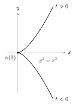
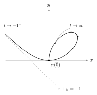

Differential GeometryLecture 1

# Lecture 1 — Curves and Their Length { .part-title }

Source: blackboard notes from the lecture · <a class="pdf-link" href="notes.pdf" download="Differential-Geometry-Lecture-01.pdf">Download this lecture as PDF</a>

**In this lecture.** A curve is a smooth map from an interval into space. Smoothness of the map does not make the image look smooth, and an injective map can still fail to be a homeomorphism onto its image. The length of a curve is defined as the limit of the lengths of inscribed polygons, which turns out to be the integral of the speed. This length does not change under rigid motions or reparametrizations, and no curve between two points is shorter than the straight segment.

!!! quote "Conventions used in this lecture."
    - *Smooth* means $C^\infty$. Intervals $I = (a, b) \subset \mathbb{R}$ are open.
    - $|u|$ is the Euclidean norm on $\mathbb{R}^3$ and $d(p, q) = |p - q|$ the Euclidean distance.
    - Fixed (constant) vectors are written in bold: $\mathbf{v}, \mathbf{v}_0, \mathbf{c}$.
    - $L_a^b(\alpha)$ is the length of $\alpha$ restricted to $[a, b]$, and $A^t$ is the transpose of a matrix $A$.

---

## 1.1 Parametrized curves

!!! note "Definition 1.1"
    1. A **differentiable curve** ($C^\infty$) is a $C^\infty$ map $\alpha : I \to \mathbb{R}^3$, $\;I = (a, b) \subset \mathbb{R}$,

        $$
        \alpha(t) = \big(x(t), y(t), z(t)\big), \qquad x, y, z \text{ are } C^\infty \text{ functions.}
        $$

    2. The vector $\alpha'(t) = \big(x'(t), y'(t), z'(t)\big)$ is called the **tangent vector** of $\alpha$ at $\alpha(t)$.
    3. $\alpha$ is called **planar** if there exists a plane $P \subset \mathbb{R}^3$ such that $\alpha(I) \subset P$. By a rigid motion we may take $P = \{z = 0\}$, so that $\alpha(t) = \big(x(t), y(t), 0\big)$.

---

## 1.2 What a smooth curve can look like

The map $\alpha$ is smooth, but its image $\alpha(I)$ need not be.

!!! info "Remark 1.2 — corners"
    $\alpha(I)$ could have corners. For example, $\alpha(t) = (t^2, t^3)$ is smooth, but its image is the curve $y^2 = x^3$ (equivalently $x = y^{2/3}$), which has a **cusp** at the origin.

    <figure markdown>
      { .tex-fig width="230" }
      <figcaption markdown="span">Figure 1.1. The image of $\alpha(t) = (t^2, t^3)$.</figcaption>
    </figure>

!!! info "Remark — where the corner comes from"
    At the cusp the tangent vector vanishes: $\alpha'(t) = (2t, 3t^2)$, so $\alpha'(0) = 0$. A curve can only turn a sharp corner by stopping there. Curves with $\alpha' \neq 0$ everywhere, the *regular* curves of Lecture 2, cannot do this.

!!! info "Remark 1.3 — injective is not enough"
    Even if $\alpha$ is injective, $\alpha$ could fail to be a homeomorphism onto its image. For example, the **folium of Descartes**

    $$
    \alpha : (-1, \infty) \to \mathbb{R}^2, \qquad
    \alpha(t) = \left( \frac{3t}{1+t^3},\; \frac{3t^2}{1+t^3} \right),
    $$

    whose image lies on the curve $3xy = x^3 + y^3$.

    <figure markdown>
      { .tex-fig width="330" }
      <figcaption markdown="span">Figure 1.2. The folium of Descartes, $t \in (-1, \infty)$.</figcaption>
    </figure>

!!! info "Remark — why the folium fails"
    $\alpha$ is injective, but $\alpha(t) \to (0, 0) = \alpha(0)$ as $t \to \infty$. So points $\alpha(t)$ with $t$ very large are close to $\alpha(0)$ in the image while $t$ is far from $0$: the inverse map $\alpha(I) \to (-1, \infty)$ is not continuous at the origin.

---

## 1.3 Examples

!!! example "Example 1.4 (Lines)"
    $\alpha(t) = t\,\mathbf{v} + \mathbf{v}_0$, $\quad \mathbf{v}, \mathbf{v}_0 \in \mathbb{R}^3$, $\; t \in \mathbb{R}$.

!!! example "Example 1.5 (Circles)"
    $\alpha(t) = \mathbf{c} + r\left(\cos\tfrac{t}{r},\, \sin\tfrac{t}{r}\right)$, $\quad \mathbf{c} \in \mathbb{R}^2$, $\; r > 0$, $\; t \in \mathbb{R}$.

!!! example "Example 1.6 (Helices)"
    $$
    \alpha(t) = \left( a\cos\frac{t}{\sqrt{a^2+b^2}},\; a\sin\frac{t}{\sqrt{a^2+b^2}},\; \frac{b\,t}{\sqrt{a^2+b^2}} \right),
    \qquad a, b \neq 0, \quad t \in \mathbb{R}.
    $$

    <figure markdown>
      { .tex-fig width="260" }
      <figcaption markdown="span">Figure 1.3. A helix winding around the $z$-axis.</figcaption>
    </figure>

!!! info "Remark — the odd-looking parameters"
    The factors $1/r$ and $1/\sqrt{a^2+b^2}$ are chosen so that $|\alpha'(t)| = 1$: for the helix, $|\alpha'|^2 = \frac{a^2 + b^2}{a^2+b^2} = 1$. All three examples are parametrized by arc length, in the sense of Lecture 2.

---

## 1.4 Length

Given $\alpha : I \to \mathbb{R}^3$ and $[a, b] \subset I$, what is the length $L\big(\alpha([a, b])\big)$?

Take a partition of $[a, b]$, i.e. a choice

$$
P = \{\, t_0 = a < t_1 < \dots < t_n = b \,\},
$$

and set

$$
L_a^b(\alpha, P) = \sum_{i=1}^{n} |\alpha(t_i) - \alpha(t_{i-1})|,
\qquad
|P| = \max_{1 \le i \le n} |t_i - t_{i-1}| .
$$

$L_a^b(\alpha, P)$ is the length of the polygon inscribed in the curve, and $|P|$ is the mesh of the partition.

<figure markdown>
  { .tex-fig width="540" }
  <figcaption markdown="span">Figure 1.4. The polygon with vertices $\alpha(t_0), \dots, \alpha(t_n)$.</figcaption>
</figure>

!!! abstract "Theorem 1.7"
    For every $\varepsilon > 0$ there is $\delta > 0$ such that

    $$
    |P| < \delta \;\Longrightarrow\; \left| L_a^b(\alpha, P) - \int_a^b |\alpha'(t)|\, dt \right| < \varepsilon .
    $$

!!! note "Definition 1.8 (Length)"
    $$
    L_a^b(\alpha) = \int_a^b |\alpha'(t)|\, dt .
    $$

!!! success "Proof"
    *(of Theorem 1.7)* Define

    $$
    f : I \times I \times I \to \mathbb{R}, \qquad
    (t_1, t_2, t_3) \mapsto \sqrt{x'(t_1)^2 + y'(t_2)^2 + z'(t_3)^2} .
    $$

    $f$ is continuous, hence uniformly continuous on $[a, b]^3$. So for every $\varepsilon > 0$ there is $\delta > 0$ such that, for $(t_1, t_2, t_3), (s_1, s_2, s_3) \in [a, b]^3$,

    $$
    |t_1 - s_1| < \delta,\;\; |t_2 - s_2| < \delta,\;\; |t_3 - s_3| < \delta
    \;\Longrightarrow\;
    |f(t_1, t_2, t_3) - f(s_1, s_2, s_3)| < \frac{\varepsilon}{b - a} .
    $$

    By the Mean Value Theorem, applied to $x$, $y$ and $z$ separately,

    $$
    |\alpha(t_i) - \alpha(t_{i-1})| = f(\beta_i, \gamma_i, \eta_i)\,(t_i - t_{i-1})
    \quad\text{for some } \beta_i, \gamma_i, \eta_i \in [t_{i-1}, t_i],
    $$

    so (the third point is written $\delta_i$ on the board)

    $$
    L_a^b(\alpha, P) = \sum_{i=1}^{n} f(\beta_i, \gamma_i, \eta_i)\,(t_i - t_{i-1}) .
    $$

    But, by the Mean Value Theorem for integrals,

    $$
    \int_a^b |\alpha'(t)|\, dt = \sum_{i=1}^{n} \int_{t_{i-1}}^{t_i} |\alpha'(t)|\, dt
    = \sum_{i=1}^{n} |\alpha'(\xi_i)|\,(t_i - t_{i-1})
    = \sum_{i=1}^{n} f(\xi_i, \xi_i, \xi_i)\,(t_i - t_{i-1})
    $$

    for some $\xi_i \in [t_{i-1}, t_i]$. If $|P| < \delta$, then $t_i - t_{i-1} < \delta$ for all $i$, so

    $$
    |\beta_i - \xi_i| < \delta, \qquad |\gamma_i - \xi_i| < \delta, \qquad |\eta_i - \xi_i| < \delta .
    $$

    Hence

    $$
    \left| L_a^b(\alpha, P) - \int_a^b |\alpha'| \right|
    \le \sum_{i=1}^{n} \big| f(\beta_i, \gamma_i, \eta_i) - f(\xi_i, \xi_i, \xi_i) \big|\,(t_i - t_{i-1})
    < \frac{\varepsilon}{b - a} \sum_{i=1}^{n} (t_i - t_{i-1}) = \varepsilon . \qquad \square
    $$

!!! info "Remark — why three different points"
    The Mean Value Theorem has to be applied to each coordinate on its own, and each gives its own intermediate point. That is why $f$ takes three arguments instead of one, and why uniform continuity of $f$ is needed to bring the three points together.

---

## 1.5 Invariance under isometries

!!! note "Definition 1.9 (Isometry)"
    An **isometry** of $\mathbb{R}^3$ is a transformation $\varphi$ of $\mathbb{R}^3$ such that $d(p, q) = d\big(\varphi(p), \varphi(q)\big)$ for all $p, q$.

    It follows that $\varphi$ is, up to a translation, a linear map whose associated matrix $A$ satisfies $A A^t = \mathrm{Id}$.

!!! abstract "Proposition 1.10 (Invariance under isometries)"
    If $\varphi$ is an isometry of $\mathbb{R}^3$ and $\alpha : I \to \mathbb{R}^3$ a curve, then $L_a^b(\varphi \circ \alpha) = L_a^b(\alpha)$.

!!! success "Proof"
    Write $\varphi(p) = A p + \mathbf{q}$ with $A A^t = \mathrm{Id}$. Then $(\varphi \circ \alpha)'(t) = A\, \alpha'(t)$, and an orthogonal matrix preserves norms, $|A u|^2 = \langle A u, A u\rangle = \langle u, A^t A u\rangle = |u|^2$. So the integrands agree:

    $$
    L_a^b(\varphi \circ \alpha) = \int_a^b |A\, \alpha'(t)|\, dt = \int_a^b |\alpha'(t)|\, dt = L_a^b(\alpha). \qquad \square
    $$

---

## 1.6 Lines as minima

!!! example "Example 1.11 (Lines as minima)"
    Let $\alpha : I \to \mathbb{R}^3$ and $[a, b] \subset I$. Then

    $$
    |\alpha(b) - \alpha(a)| \le L_a^b(\alpha) .
    $$

    <figure markdown>
      { .tex-fig width="300" }
      <figcaption markdown="span">Figure 1.5. The segment is no longer than any curve with the same endpoints.</figcaption>
    </figure>

!!! success "Proof"
    By the fundamental theorem of calculus and the triangle inequality for integrals,

    $$
    |\alpha(b) - \alpha(a)| = \left| \int_a^b \alpha'(t)\, dt \right| \le \int_a^b |\alpha'(t)|\, dt = L_a^b(\alpha). \qquad \square
    $$

    Equivalently, $|\alpha(b) - \alpha(a)| = L_a^b(\alpha, \{a, b\})$, and refining a partition can only increase $L_a^b(\alpha, P)$, by the triangle inequality.

---

## 1.7 Reparametrization

!!! note "Definition 1.12 (Diffeomorphism, reparametrization)"
    A **diffeomorphism** $\varphi : J \to I$ ($I, J$ open intervals) is a map which is $C^\infty$ and invertible with $C^\infty$ inverse.

    Given $\alpha : I \to \mathbb{R}^3$ we can construct a *new* curve $\beta : J \to \mathbb{R}^3$ as $\beta = \alpha \circ \varphi$. $\beta$ is called a **reparametrization** of $\alpha$.

!!! abstract "Proposition 1.13"
    Let $\varphi : J \to I$ be a diffeomorphism, $\alpha : I \to \mathbb{R}^3$, $[a, b] \subset J$ and $\varphi([a, b]) = [c, d]$. Then

    $$
    L_a^b(\alpha \circ \varphi) = L_c^d(\alpha).
    $$

!!! success "Proof"
    $$
    |(\alpha \circ \varphi)'(t)| = |\alpha'(\varphi(t))|\, |\varphi'(t)| .
    $$

    $\varphi$ is a diffeomorphism, so $\varphi' > 0$ everywhere or $\varphi' < 0$ everywhere. Suppose $\varphi' > 0$ and call $s = \varphi(t)$. Then

    $$
    \int_a^b |(\alpha \circ \varphi)'(t)|\, dt
    = \int_a^b |\alpha'(\varphi(t))|\, \varphi'(t)\, dt
    = \int_c^d \left| \frac{d}{ds}\alpha(s) \right| ds = L_c^d(\alpha).
    $$

    If $\varphi' < 0$, then $|\varphi'| = -\varphi'$ and $\varphi$ sends $a \mapsto d$, $b \mapsto c$, so the substitution gives $-\int_d^c = \int_c^d$, the same result. $\square$

!!! info "Remark — why $\varphi'$ never vanishes"
    Differentiating $\varphi^{-1}(\varphi(t)) = t$ gives $(\varphi^{-1})'(\varphi(t))\, \varphi'(t) = 1$, so $\varphi'(t) \neq 0$. A continuous function that never vanishes on an interval has constant sign, by the intermediate value theorem.
