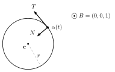

Differential GeometryLecture 2

# Lecture 2 — Arc Length and the Frenet Frame { .part-title }

Original handwritten notes: <a href="../originals/lec02.pdf">lec02.pdf</a>

**In this lecture.** A regular curve can be reparametrized so that it moves at unit speed. Along such a curve we attach a moving orthonormal frame $\{T, N, B\}$ and read off two functions, the curvature $k$ and the torsion $\tau$. Differentiating the frame closes up into the Frenet formulas, and the two functions turn out to detect lines ($k \equiv 0$) and plane curves ($\tau \equiv 0$).

---

## 2.1 The arc-length function

Let $\alpha : I \to \mathbb{R}^3$ be a smooth curve and fix $t_0 \in I$. Define

$$
s : I \to \mathbb{R}, \qquad s(t) = \int_{t_0}^{t} |\alpha'(u)|\, du = L_{t_0}^{t}(\alpha),
$$

the length of $\alpha$ between $t_0$ and $t$.

The function $u \mapsto |\alpha'(u)|$ is in general just continuous, so $s$ is just $C^1$, with

$$
s'(t) = |\alpha'(t)|.
$$

In particular, $s$ is **not** in general a diffeomorphism.

!!! info "Remark (added) — where smoothness is lost"
    $\alpha'$ itself is smooth; what fails is the norm $x \mapsto |x|$, which is not differentiable at $x = 0$. So $|\alpha'|$ can only lose smoothness at points where $\alpha'$ vanishes.

If $|\alpha'(t)| \neq 0$ for all $t$, then $s$ is indeed a diffeomorphism between $I$ and $s(I)$: $|\alpha'|$ is now smooth, so $s$ is $C^\infty$, and $s' > 0$.

!!! note "Definition 2.1 (Regular curve)"
    A curve $\alpha : I \to \mathbb{R}^3$ with $\alpha'(t) \neq 0$ for all $t \in I$ is called **regular**. For a regular curve, $s$ is $C^\infty$.

Call $J = s(I)$, let $\varphi : J \to I$ be the inverse of $s$, and define

$$
\beta(s) = \alpha \circ \varphi \,(s) : J \to \mathbb{R}^3 .
$$

<figure markdown>
  { .tex-fig width="230" }
  <figcaption markdown="span">Figure 2.1. Reparametrizing by arc length.</figcaption>
</figure>

By the chain rule, and since $\varphi'(s) = 1 / s'(\varphi(s)) = 1/|\alpha'(\varphi(s))|$,

$$
\beta'(s) = \alpha'(\varphi(s))\, \varphi'(s) = \frac{\alpha'(\varphi(s))}{|\alpha'(\varphi(s))|},
\qquad\text{so}\qquad
|\beta'(s)| = 1 \quad \forall s \in J .
$$

!!! note "Definition 2.2 (Arc-length parametrization)"
    $\alpha : I \to \mathbb{R}^3$ is **parametrized by arc length** (p.a.l.) if $|\alpha'(t)| = 1$ for all $t$.

!!! abstract "Theorem 2.3"
    Every regular curve can be reparametrized by arc length.

!!! info "Remark"
    The arc-length parameter $s$ is not unique: it depends on the choice of $t_0$, i.e. on a constant of integration.

---

## 2.2 Examples of arc length

!!! example "Example 2.4 (Lines)"
    $\alpha(t) = t\,\mathbf{v} + \mathbf{v}_0$, $\;t \in \mathbb{R}$, $\;\mathbf{v} \neq 0$, $\;t_0 = 0$. Then $\alpha'(t) = \mathbf{v}$ and

    $$
    s(t) = \int_0^t |\mathbf{v}|\, du = t\,|\mathbf{v}|,
    \qquad
    \varphi(s) = \frac{s}{|\mathbf{v}|},
    \qquad
    \beta(s) = \frac{s}{|\mathbf{v}|}\,\mathbf{v} + \mathbf{v}_0 .
    $$

!!! example "Example 2.5 (Logarithmic spiral)"
    $\alpha : \mathbb{R} \to \mathbb{R}^2$, $\quad t \mapsto \left(a e^{bt}\cos t,\; a e^{bt}\sin t\right)$, $\quad a > 0,\; b < 0,\; t_0 = 0$.

    $$
    \begin{aligned}
    s(t) &= \int_0^t |\alpha'(t)|\, dt \\
    &= \int_0^t \Big|\Big(a\big(b e^{bt}\cos t - e^{bt}\sin t\big),\; a\big(b e^{bt}\sin t + e^{bt}\cos t\big)\Big)\Big|\, dt \\
    &= \int_0^t a e^{bt}\left(b^2\cos^2 t + \sin^2 t + b^2\sin^2 t + \cos^2 t\right)^{1/2} dt \\
    &= \int_0^t a e^{bt}\,(b^2+1)^{1/2}\, dt
    \;=\; \frac{e^{bt}-1}{b}\; a\,(b^2+1)^{1/2} .
    \end{aligned}
    $$

    (In the third line the cross terms $\mp 2b\sin t\cos t$ cancel.)

    <figure markdown>
      { .tex-fig width="380" }
      <figcaption markdown="span">Figure 2.2. The logarithmic spiral for $a = 1$, $b = -0.12$.</figcaption>
    </figure>

!!! info "Remark (added) — a finite spiral"
    Because $b < 0$, $e^{bt} \to 0$ as $t \to \infty$, so $s(t) \to a\sqrt{1+b^2}\,/\,|b|$. The spiral winds around the origin infinitely many times but has finite total length.

---

## 2.3 Curvature and the Frenet trihedron

From now on, $\alpha$ is p.a.l.

<figure markdown>
  { .tex-fig width="400" }
  <figcaption markdown="span">Figure 2.3. The Frenet trihedron at $\alpha(s)$. $T$ and $N$ span the osculating plane.</figcaption>
</figure>

Set

$$
T(s) := \alpha'(s), \qquad |T(s)| = 1 \quad \forall s .
$$

Taking the derivative of $\langle T(s), T(s)\rangle = 1$:

$$
\langle T'(s), T(s)\rangle + \langle T(s), T'(s)\rangle = 0
\quad\Longrightarrow\quad
\langle T'(s), T(s)\rangle = 0 .
$$

So $T'$ is always orthogonal to $T$.

!!! note "Definition 2.6"
    1. $k(s) = |T'(s)|$ is called the **curvature** of $\alpha$ at $s$.
       This is only continuous; it is $C^\infty$ if $T'(s) \neq 0$ for all $s$.
       *From now on we assume $k(s) > 0$ for all $s$.*
    2. $\displaystyle N(s) = \frac{T'(s)}{|T'(s)|} = \frac{T'(s)}{k(s)}$ is called the **normal vector** to $\alpha$ at $s$.
    3. $B(s) := T(s) \wedge N(s)$ is called the **binormal vector** to $\alpha$ at $s$.
    4. $\{T(s), N(s), B(s)\}$ is called the **Frenet trihedron**.

---

## 2.4 Torsion

By the definition of $N$,

$$
T'(s) = k(s)\, N(s).
$$

Differentiating $B = T \wedge N$:

$$
B'(s) = T'(s) \wedge N(s) + T(s) \wedge N'(s) = T(s) \wedge N'(s),
$$

since $T' \wedge N = k\, N \wedge N = 0$. Now

- $\langle B', T\rangle = 0$, because $B' = T \wedge N'$ is orthogonal to $T$;
- $\langle B', B\rangle = 0$, from differentiating $\langle B, B\rangle = 1$.

So $B'$ is orthogonal to both $T$ and $B$, hence parallel to $N$:

$$
B'(s) = \tau(s)\, N(s).
$$

!!! note "Definition 2.7 (Torsion)"
    $\tau(s)$ is called the **torsion** of $\alpha$ at $s$. Since $\tau = \langle B', N\rangle$, it is smooth.

!!! warning "Caution — sign of the torsion"
    These notes use $B' = \tau N$ (as in do Carmo). Many other books define torsion by $B' = -\tau N$, which flips the sign of $\tau$ and of the $\tau B$ term in $N'$ below. Check the convention before copying a formula across books.

---

## 2.5 The Frenet formulas

So far:

$$
T' \rightsquigarrow k, \qquad B' \rightsquigarrow \tau, \qquad N' \rightsquigarrow \;?
$$

Differentiate the orthogonality relations involving $N$:

$$
\begin{aligned}
\langle N, T\rangle = 0 &\;\Longrightarrow\; \langle N', T\rangle + \langle N, T'\rangle = 0 \;\Longrightarrow\; \langle N', T\rangle + k(s) = 0, \\
\langle N, B\rangle = 0 &\;\Longrightarrow\; \langle N', B\rangle + \langle N, B'\rangle = 0 \;\Longrightarrow\; \langle N', B\rangle + \tau(s) = 0 .
\end{aligned}
$$

Together with $\langle N', N\rangle = 0$ (since $|N| = 1$), expanding $N'$ in the orthonormal basis $\{T, N, B\}$ gives $N' = -kT - \tau B$.

!!! abstract "Theorem 2.8 (Frenet's formulas)"
    Let $\alpha : I \to \mathbb{R}^3$ be p.a.l. with $k > 0$. Then

    $$
    \begin{cases}
    T' = k N \\
    N' = -k T - \tau B \\
    B' = \tau N
    \end{cases}
    $$

!!! info "Remark (added) — matrix form"
    $$
    \frac{d}{ds}\begin{pmatrix} T \\ N \\ B \end{pmatrix}
    = \begin{pmatrix} 0 & k & 0 \\ -k & 0 & -\tau \\ 0 & \tau & 0 \end{pmatrix}
    \begin{pmatrix} T \\ N \\ B \end{pmatrix}.
    $$
    The matrix is antisymmetric. That is no accident: it is the derivative of an orthonormal frame.

---

## 2.6 Examples of the Frenet frame

!!! example "Example 2.9 (Line)"
    $\alpha(t) = t\,\mathbf{v} + \mathbf{v}_0$ with $|\mathbf{v}| = 1$. Then

    $$
    T(t) = \mathbf{v}, \qquad T' = 0, \qquad k(t) = 0 .
    $$

!!! example "Example 2.10 (Circle)"
    $\alpha(t) = r\left(\cos\tfrac{t}{r},\, \sin\tfrac{t}{r},\, 0\right) + \mathbf{c}$.

    $$
    \alpha'(t) = r\left(-\tfrac{1}{r}\sin\tfrac{t}{r},\, \tfrac{1}{r}\cos\tfrac{t}{r},\, 0\right) = \left(-\sin\tfrac{t}{r},\, \cos\tfrac{t}{r},\, 0\right),
    $$

    so $t$ is arc length and $T = \alpha'$. Then

    $$
    T' = \left(-\tfrac{1}{r}\cos\tfrac{t}{r},\, -\tfrac{1}{r}\sin\tfrac{t}{r},\, 0\right) \;\Longrightarrow\; k(t) = \frac{1}{r} \;(\neq 0),
    $$

    $$
    N = \left(-\cos\tfrac{t}{r},\, -\sin\tfrac{t}{r},\, 0\right), \qquad
    B(t) = (0, 0, 1) \;\Longrightarrow\; B' = 0 \;\Longrightarrow\; \tau = 0 .
    $$

    <figure markdown>
      { .tex-fig width="340" }
      <figcaption markdown="span">Figure 2.4. On a circle, $N$ points to the centre and $B$ points out of the page.</figcaption>
    </figure>

---

## 2.7 Lines and plane curves

!!! abstract "Theorem 2.11"
    Let $\alpha : I \to \mathbb{R}^3$ be p.a.l. Then $k \equiv 0$ if and only if $\alpha$ is a piece of a line.

!!! success "Proof"
    ($\Leftarrow$) Done in Example 2.9.

    ($\Rightarrow$) $k \equiv 0 \Rightarrow T' = 0 \Rightarrow T(s) = \alpha'(s) = \mathbf{v}$, a constant vector. Integrating, $\alpha(s) = s\,\mathbf{v} + \mathbf{v}_0$. $\square$

!!! abstract "Theorem 2.12"
    Let $\alpha : I \to \mathbb{R}^3$ be p.a.l. with $k > 0$. Then $\alpha$ is planar if and only if $\tau \equiv 0$.

!!! success "Proof"
    ($\Leftarrow$) Suppose $\tau \equiv 0$. Then $B' = 0$, so $B(s) = \mathbf{v}$ is a constant vector with $|\mathbf{v}| = 1$, and

    $$
    \big(\langle \alpha(s), \mathbf{v}\rangle\big)' = \langle T, \mathbf{v}\rangle = 0
    \quad\Longrightarrow\quad
    \langle \alpha(s), \mathbf{v}\rangle = a, \quad a \in \mathbb{R},
    $$

    which is the equation of a plane in $\mathbb{R}^3$. $\square$

!!! info "Remark (added) — the other direction"
    The handwritten notes prove only ($\Leftarrow$). For ($\Rightarrow$): if $\alpha$ lies in a plane $\langle x, \mathbf{v}\rangle = a$ with $|\mathbf{v}| = 1$, differentiating twice gives $\langle T, \mathbf{v}\rangle = 0$ and $\langle T', \mathbf{v}\rangle = 0$, so $\langle N, \mathbf{v}\rangle = 0$. Then $B$ is a unit vector orthogonal to both $T$ and $N$, as is $\mathbf{v}$, so $B = \pm\mathbf{v}$. By continuity the sign is constant, so $B$ is constant, $B' = 0$, and $\tau = 0$. $\square$
