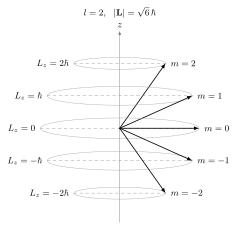
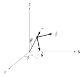

<a href="../quantum/">English</a><a class="on">한국어</a>

현대물리학1부 · 양자

# 1부 — 3차원 양자역학 { .part-title #part-i-quantum-mechanics-in-three-dimensions }

6장 수소 원자의 양자론, 앞 장의 배경 내용 포함 · <a class="pdf-link" href="notes.pdf" download="현대물리학-1부-양자.pdf">이 부를 PDF로 보기</a>

**이 부에서는.** 수소 원자의 슈뢰딩거 방정식은 구면좌표에서 변수분리된다. 각도 부분은 르장드르 방정식과 버금 르장드르 방정식으로 이어지고, 잘 행동하는 해는 정수 $l \ge 0$과 $|m| \le l$일 때만 존재한다. 이를 규격화하면 구면조화함수를 얻는다. 같은 양자수가 교환자와 사다리 연산자를 이용한 각운동량의 순수 대수적 취급에서도 나오는데, 여기서는 반정수 값도 허용된다. 두 방법은 각운동량 연산자를 구면좌표로 쓸 때 만난다.

!!! quote "이 부에서 쓰는 규약."
    - $\hbar = h/2\pi$. 전자의 질량은 $m_e$로 써서, $m$은 자기 양자수로 남겨 둔다.
    - 필요한 곳에서는 연산자에 모자를 씌운다($\hat x, \hat p, \hat H$). 벡터식에서 $\hat x, \hat y, \hat z, \hat r, \hat\theta, \hat\phi$의 모자는 단위벡터를 뜻한다.
    - 구면좌표 $(r, \theta, \phi)$: $\theta$는 $z$축에서, $\phi$는 $xy$평면에서 $x$축으로부터 잰다(그림 6.2).
    - $\langle f | g\rangle = \int f^* g$ (전 공간), $\langle Q\rangle = \langle \Psi | \hat Q \Psi\rangle$.
    - 버금 르장드르 함수는 수업에서처럼 콘던–쇼틀리 위상 **없이** 쓴다: $P_l^m(x) = (1-x^2)^{m/2} \left(\frac{d}{dx}\right)^m P_l(x)$.

---

## 배경: 브라-켓 표기법과 기본 원리 { #background-bra-ket-notation-and-basic-principles }

앞 장에서

### 브라-켓 표기법 { #bra-ket-notation }

!!! note "정의 0.1 (브라와 켓)"
    $$
    \langle \Phi | \Psi\rangle = \int_{-\infty}^{+\infty} \Phi^* \Psi \, dx, \qquad
    \langle \Psi | \hat Q \Psi\rangle = \int_{-\infty}^{+\infty} \Psi^* \hat Q \Psi \, dx .
    $$

    $\langle \Phi|$를 **브라**(행벡터), $|\Psi\rangle$를 **켓**(열벡터)이라 한다. 브라와 켓은 추상적인 상태벡터이며, 파동함수로 나타낼 수 있다.

- *단점.* 이 표기는 명시적인 함수가 아니므로, 입자가 특정 구간에 있을 확률을 바로 읽어 내기 어렵다.
- *장점.* 간결하고(적분 기호나 $dx$가 없고, $\frac{\hbar}{i}\nabla$ 같은 연산자도 그냥 $\hat p$이다), 추상적인 기저를 드러내 준다. 파동함수는 원리적으로 무한히 많은 기저 방향을 가질 수 있다.

!!! info "참고 — 양자역학이 주로 묻는 것"
    양자역학의 물리적 질문은 대부분 특정 위치에 있을 확률보다는 상태 전체나 특정 양자수를 차지할 확률에 관한 것이다. 브라-켓 표기법은 이런 질문을 위해 만들어졌다.

**힐베르트 공간.** 보통 공간의 기저 방향이 $x, y, z$(또는 $r, \theta, \phi$)인 것처럼, 고유함수 $\psi_1, \psi_2, \dots$를 기저 방향으로 하는 공간이다. $\Psi = c_1\psi_1 + c_2\psi_2 + c_3\psi_3$이면

$$
\int_{-\infty}^{+\infty} \Psi^*\Psi\, dx = \int (c_1^*\psi_1^* + c_2^*\psi_2^* + c_3^*\psi_3^*)(c_1\psi_1 + c_2\psi_2 + c_3\psi_3)\, dx = |c_1|^2 + |c_2|^2 + |c_3|^2
= \begin{pmatrix} c_1^* & c_2^* & c_3^* \end{pmatrix}\begin{pmatrix} c_1 \\ c_2 \\ c_3 \end{pmatrix}.
$$

서로 다른 고유함수는 직교하므로 교차항은 사라지고, 각 고유함수는 규격화되어 있다. 즉 고유함수들은 **정규직교 기저벡터**처럼 행동한다: $\langle \psi_i | \psi_j\rangle = \delta_{ij}$.

!!! example "예제 0.2 (무한 퍼텐셜 우물의 해밀토니안 행렬)"
    무한 퍼텐셜 우물에서 $E_n = n^2 E_1$이고 $\hat H\psi_n = E_n\psi_n$이다. $\Psi = c_1\psi_1 + c_2\psi_2 + c_3\psi_3$이면

    $$
    \langle H\rangle = \langle \Psi | \hat H \Psi\rangle
    = \begin{pmatrix} c_1^* & c_2^* & c_3^* \end{pmatrix}
    \begin{pmatrix} E_1 & 0 & 0 \\ 0 & 4E_1 & 0 \\ 0 & 0 & 9E_1 \end{pmatrix}
    \begin{pmatrix} c_1 \\ c_2 \\ c_3 \end{pmatrix}
    = E_1\left(|c_1|^2 + 4|c_2|^2 + 9|c_3|^2\right).
    $$

    자기 고유함수로 이루어진 기저에서 해밀토니안은 대각행렬이며, 대각성분이 에너지이다.

### 에르미트 연산자 { #hermitian-operators }

!!! note "정의 0.3 (에르미트 연산자)"
    관측가능량(고윳값과 고유함수를 가지는, 측정 가능한 양)은 **에르미트** 연산자 $\hat Q$로 나타낸다.

    $$
    \langle f | \hat Q g\rangle = \langle \hat Q f | g\rangle \qquad \text{모든 } f, g \text{ 에 대해}.
    $$

!!! example "예제 0.4 ($\hat p$는 에르미트이다)"
    $\pm\infty$에서 $f, g \to 0$이므로 부분적분하면

    $$
    \langle f | \hat p g\rangle = \int_{-\infty}^{\infty} f^* \frac{\hbar}{i}\frac{dg}{dx}\, dx
    = \Big[ f^* \tfrac{\hbar}{i} g \Big]_{-\infty}^{\infty} - \int_{-\infty}^{\infty} \frac{\hbar}{i}\frac{df^*}{dx}\, g\, dx
    = \int_{-\infty}^{\infty} \left(\frac{\hbar}{i}\frac{df}{dx}\right)^{\!*} g\, dx = \langle \hat p f | g\rangle .
    $$

!!! example "예제 0.5 ($\hat a_+$는 에르미트가 아니다)"
    조화진동자에서 $\int f^*(\hat a_\pm g)\, dx = \int (\hat a_\mp f)^* g\, dx$이다(숙제). 따라서

    $$
    \langle f | \hat a_\pm g\rangle = \langle \hat a_\mp f | g\rangle \neq \langle \hat a_\pm f | g\rangle
    $$

    이고, $\hat a_+$는 에르미트가 아니다. 그 수반연산자는 $\hat a_-$이다.

### 불확정성 원리 { #the-uncertainty-principle }

관측가능량의 분산은 두 가지로 쓸 수 있고, 둘은 같다.

$$
\sigma_A^2 = \langle (\hat A - \langle A\rangle)^2\rangle = \langle A^2\rangle - 2\langle A\rangle^2 + \langle A\rangle^2 = \langle A^2\rangle - \langle A\rangle^2 .
$$

!!! abstract "정리 0.6 (슈바르츠 부등식)"
    $$
    \left| \int_a^b f(x)^* g(x)\, dx \right| \le \sqrt{\int_a^b f^* f\, dx \int_a^b g^* g\, dx},
    \qquad\text{즉}\qquad |\langle f | g\rangle|^2 \le \langle f | f\rangle\langle g | g\rangle .
    $$

!!! info "참고 — 그 뒤에 있는 그림"
    $\mathbb{R}^3$에서 $\vec A \cdot \vec B = A_x B_x + A_y B_y + A_z B_z = |A||B|\cos\theta$이므로 $|\vec A\cdot\vec B| \le |A||B|$이다. 계수가 실수인 세 기저함수 $\psi_1, \psi_2, \psi_3$로 만든 파동함수에서도 같은 계산으로 $\langle \Psi | \Phi\rangle = \sqrt{\langle\Psi|\Psi\rangle}\sqrt{\langle\Phi|\Phi\rangle}\cos\theta$가 되어 부등식이 나온다. (일반적인 증명은 이 과목의 범위를 넘으므로, 진술만 있으면 된다.)

!!! abstract "정리 0.7 (일반화된 불확정성 원리)"
    관측가능량 $\hat A$, $\hat B$에 대해

    $$
    \sigma_A^2\,\sigma_B^2 \ge \left( \frac{1}{2i}\langle [\hat A, \hat B]\rangle \right)^2 .
    $$

!!! success "증명"
    $f = (\hat A - \langle A\rangle)\Psi$, $g = (\hat B - \langle B\rangle)\Psi$라 하자. $\hat A - \langle A\rangle$는 에르미트이므로

    $$
    \sigma_A^2 = \langle \Psi | (\hat A - \langle A\rangle)^2 \Psi\rangle = \langle (\hat A - \langle A\rangle)\Psi | (\hat A - \langle A\rangle)\Psi\rangle = \langle f | f\rangle ,
    \qquad \sigma_B^2 = \langle g | g\rangle .
    $$

    슈바르츠 부등식에 의해 $\sigma_A^2\sigma_B^2 = \langle f|f\rangle\langle g|g\rangle \ge |\langle f | g\rangle|^2$이다. $z = \langle f | g\rangle$라 두면 $\langle g | f\rangle = z^*$이다. 임의의 복소수 $z = a + ib$에 대해

    $$
    |z|^2 = a^2 + b^2 \ge b^2 = \left( \frac{z - z^*}{2i} \right)^2 ,
    \qquad\text{따라서}\qquad
    \sigma_A^2\sigma_B^2 \ge \left( \frac{\langle f|g\rangle - \langle g|f\rangle}{2i} \right)^2 .
    $$

    이제

    $$
    \langle f | g\rangle = \langle (\hat A - \langle A\rangle)\Psi | (\hat B - \langle B\rangle)\Psi\rangle
    = \langle \hat A\hat B\rangle - \langle B\rangle\langle A\rangle - \langle A\rangle\langle B\rangle + \langle A\rangle\langle B\rangle
    = \langle \hat A\hat B\rangle - \langle A\rangle\langle B\rangle
    $$

    이고, 마찬가지로 $\langle g | f\rangle = \langle \hat B\hat A\rangle - \langle A\rangle\langle B\rangle$이다. 따라서

    $$
    \langle f|g\rangle - \langle g|f\rangle = \langle \hat A\hat B - \hat B\hat A\rangle = \langle [\hat A, \hat B]\rangle . \qquad \square
    $$

!!! example "예제 0.8 (위치와 운동량)"
    $[\hat x, \hat p]f = x\frac{\hbar}{i}f' - \frac{\hbar}{i}(xf)' = -\frac{\hbar}{i} f = i\hbar f$이므로 $[\hat x, \hat p] = i\hbar$이고

    $$
    \sigma_x^2\sigma_p^2 \ge \left(\frac{1}{2i}\, i\hbar\right)^2 = \left(\frac{\hbar}{2}\right)^2 ,
    \qquad \sigma_x\sigma_p \ge \frac{\hbar}{2} .
    $$

### 교환자와 공통 고유함수 { #commutators-and-shared-eigenfunctions }

$[\hat A, \hat B] = 0$이면 두 연산자는 **공통 고유함수 집합**을 가질 수 있으므로, 두 양을 동시에 정확히 측정할 수 있다. $[\hat A, \hat B] \neq 0$이면 일반적으로 정리 0.7이 이를 금지한다.

### 에렌페스트 정리 { #ehrenfests-theorem }

!!! abstract "정리 0.9 (에렌페스트)"
    기댓값은 고전역학처럼 보이는 운동방정식을 따른다.

    $$
    \frac{d}{dt}\langle Q\rangle = \frac{i}{\hbar}\langle [\hat H, \hat Q]\rangle + \left\langle \frac{\partial \hat Q}{\partial t} \right\rangle .
    $$

!!! success "증명"
    곱의 미분법에 의해

    $$
    \frac{d}{dt}\langle \Psi | \hat Q\Psi\rangle
    = \left\langle \frac{\partial\Psi}{\partial t} \middle| \hat Q\Psi\right\rangle
    + \left\langle \Psi \middle| \frac{\partial \hat Q}{\partial t}\Psi\right\rangle
    + \left\langle \Psi \middle| \hat Q\frac{\partial\Psi}{\partial t}\right\rangle .
    $$

    슈뢰딩거 방정식 $i\hbar\,\partial_t\Psi = \hat H\Psi$에서 $\partial_t\Psi = \frac{1}{i\hbar}\hat H\Psi$이다. 상수를 브라 밖으로 꺼내면 켤레복소수가 되어 $\frac{1}{i\hbar} \to -\frac{1}{i\hbar}$이므로

    $$
    \frac{d}{dt}\langle Q\rangle
    = -\frac{1}{i\hbar}\langle \hat H\Psi | \hat Q\Psi\rangle + \frac{1}{i\hbar}\langle \Psi | \hat Q\hat H\Psi\rangle + \left\langle \frac{\partial\hat Q}{\partial t}\right\rangle .
    $$

    $\hat H$는 에르미트이므로 $\langle \hat H\Psi | \hat Q\Psi\rangle = \langle \Psi | \hat H\hat Q\Psi\rangle$이고, 처음 두 항은 합쳐져 $-\frac{1}{i\hbar}\langle[\hat H, \hat Q]\rangle = \frac{i}{\hbar}\langle [\hat H, \hat Q]\rangle$가 된다. $\square$

!!! example "예제 0.10 ($d\langle x\rangle/dt = \langle p\rangle/m_e$)"
    $\hat H = \frac{\hat p^2}{2m_e} + V(x)$이면 $[V, \hat x] = 0$이고

    $$
    [\hat H, \hat x] = \frac{1}{2m_e}\big(\hat p[\hat p, \hat x] + [\hat p, \hat x]\hat p\big) = \frac{1}{2m_e}(-2i\hbar\,\hat p) = -\frac{i\hbar}{m_e}\hat p .
    $$

    $\hat x$는 시간에 명시적으로 의존하지 않으므로 $\dfrac{d\langle x\rangle}{dt} = \dfrac{i}{\hbar}\left(-\dfrac{i\hbar}{m_e}\right)\langle p\rangle = \dfrac{\langle p\rangle}{m_e}$이다.

!!! example "예제 0.11 (에너지 보존)"
    $[\hat H, \hat H] = 0$이므로, $\hat H$가 시간에 명시적으로 의존하지 않으면 $\dfrac{d\langle H\rangle}{dt} = \left\langle \dfrac{\partial\hat H}{\partial t}\right\rangle = 0$이다. 에너지 보존은 양자역학에서 평균 에너지에 대한 진술로 살아남는다.

---

## 6.0 수학적 도구: 해석적 방법 { #60-mathematical-tools-the-analytic-method }

6장

### 무한급수의 수렴 { #convergence-of-an-infinite-series }

$f = a_1 + a_2 + \dots + a_n + \cdots$에 대해:

1. 급수가 수렴하면 $\lim_{n\to\infty} a_n = 0$이다.
2. **비율 판정법.** $\rho_n = \left|\dfrac{a_{n+1}}{a_n}\right|$이라 하면, $\lim \rho_n < 1$이면 수렴, $\lim\rho_n = 1$이면 판정 불가(추가 판정 필요), $\lim\rho_n > 1$이면 발산.

!!! example "예제 6.0.1"
    $\sum \frac{1}{n!}$에서는 $\rho_n = \frac{1}{n+1} \to 0$이므로 수렴한다($e - 1$로). $\sum \frac{1}{n}$에서는 $\rho_n = \frac{n}{n+1} \to 1$이라 판정할 수 없는데, 조화급수는 실제로 발산한다.

### 1. 르장드르 방정식 { #1-the-legendre-equation }

$$
(1-x^2)\,y'' - 2x\,y' + l(l+1)\,y = 0 .
$$

멱급수 $y = \sum_n a_n x^n$을 대입하면 $y' = \sum n a_n x^{n-1}$, $y'' = \sum n(n-1)a_n x^{n-2}$이다. 각 항에서 $x^n$의 계수를 모으면

| | $x^n$의 계수 |
|---|---|
| $y''$ | $(n+2)(n+1)\,a_{n+2}$ |
| $-x^2 y''$ | $-n(n-1)\,a_n$ |
| $-2xy'$ | $-2n\,a_n$ |
| $l(l+1)y$ | $l(l+1)\,a_n$ |

합이 모든 $n$에 대해 0이어야 하고 $l(l+1) - n(n+1) = (l-n)(l+n+1)$이므로

$$
a_{n+2} = -\frac{(l-n)(l+n+1)}{(n+2)(n+1)}\, a_n . \tag{6.1}
$$

이 점화식은 짝수 계수를 $a_0$에, 홀수 계수를 $a_1$에 연결한다.

$$
y = a_0\left[ 1 - \frac{l(l+1)}{2!}x^2 + \frac{l(l+1)(l-2)(l+3)}{4!}x^4 - \cdots \right]
+ a_1\left[ x - \frac{(l-1)(l+2)}{3!}x^3 + \frac{(l-1)(l+2)(l-3)(l+4)}{5!}x^5 - \cdots \right].
$$

**수렴.** 각 괄호에서 $\rho_n = \left| \dfrac{(l-n)(l+n+1)}{(n+2)(n+1)} x^2 \right| \to x^2$이므로 $x^2 < 1$에서 급수가 수렴한다. $x = \pm 1$에서는 판정이 안 되는데, 무한급수는 실제로 발산한다. 따라서 $x = \pm 1$에서 유한한 해는 다항식이어야 하고, 이는 한 괄호가 끊길 때만 일어난다.

- $l = 0, 2, 4, \dots$: $a_0$ 괄호가 끊긴다(유한). $a_1$ 괄호는 발산한다.
- $l = 1, 3, 5, \dots$: $a_1$ 괄호가 끊긴다. $a_0$ 괄호는 발산한다.
- $l$이 정수가 아니면: 두 괄호 모두 발산한다.

!!! info "참고 — 왜 $x = \pm 1$이 중요한가"
    아래에서 $x = \cos\theta$이고 $y$는 파동함수의 각도 부분이다. $x = \pm 1$은 북극과 남극이며, 물리적인 파동함수는 거기서 유한해야 한다.

!!! note "정의 6.0.2 (르장드르 함수)"
    끊기는 부분을 **제1종 르장드르 함수** $P_l(x)$, 발산하는 부분을 **제2종 르장드르 함수** $Q_l(x)$라 한다. 일반해는

    $$
    y = c_1 P_l(x) + c_2 Q_l(x)
    $$

    이며, $l = 0$ 또는 짝수이면 $a_0 = c_1$, $a_1 = c_2$이고, $l$이 홀수이면 $a_0 = c_2$, $a_1 = c_1$이다. 음의 정수 $l$은 ($l(l+1)$이 변하지 않으므로) $-l-1$과 같은 방정식을 준다. 예: $P_{-2}(x) = P_1(x)$.

$Q_l$은 버리고 $P_l(1) = 1$로 규격화를 정한다. 수렴하는 부분만으로도 르장드르 방정식의 해가 되고, 그것만 파동함수가 될 수 있다.

!!! example "예제 6.0.3 (처음 몇 개의 르장드르 다항식)"
    $$
    P_0(x) = 1, \qquad P_1(x) = x, \qquad P_2(x) = \tfrac{1}{2}(3x^2 - 1), \qquad P_3(x) = \tfrac{1}{2}(5x^3 - 3x).
    $$

    $P_3$: $l = 3$은 홀수이므로 $a_1$ 괄호 $x - \frac{2\cdot 5}{6}x^3 = x - \frac{5}{3}x^3$을 잡고, $x = 1$에서의 값이 $1$이 되도록 $-\frac{3}{2}$을 곱한다.

!!! abstract "정리 6.0.4 (로드리게스 공식)"
    $$
    P_l(x) = \frac{1}{2^l\, l!}\left(\frac{d}{dx}\right)^{l} (x^2 - 1)^l .
    $$

### 2. 버금 르장드르 방정식 { #2-the-associated-legendre-equation }

$$
(1-x^2)\,y'' - 2x\,y' + \left[ l(l+1) - \frac{m^2}{1-x^2} \right] y = 0 .
$$

$y = (1-x^2)^{m/2}\,u$ ①로 놓고 대입하면

$$
(1-x^2)\,u'' - 2(m+1)\,x\,u' + \big[ l(l+1) - m(m+1) \big] u = 0 . \tag{②}
$$

②를 한 번 미분하면

$$
(1-x^2)\,u''' - 2(m+2)\,x\,u'' + \big[ l(l+1) - (m+1)(m+2) \big] u' = 0 \tag{③}
$$

인데, 이것은 ②에서 $m \to m+1$, $u \to u'$로 바꾼 것이다. ②를 $n$번 미분해도 같은 방식으로

$$
(1-x^2)\,u^{(n+2)} - 2(m+1+n)\,x\,u^{(n+1)} + \big[ l(l+1) - (m+n)(m+n+1) \big] u^{(n)} = 0 .
$$

즉 $u$가 $m$에 대한 ②의 해이면 $u'$는 $m+1$에 대한 해이다.

- $m = 0$: ②는 르장드르 방정식이므로 $u = P_l(x)$, $y = P_l(x)$.
- $m = 1$: ③에 의해 $u = \frac{d}{dx}P_l(x)$.
- $m = 2$: $u = \left(\frac{d}{dx}\right)^2 P_l(x)$. 모든 $m$에 대해 마찬가지.

!!! note "정의 6.0.5 (버금 르장드르 함수)"
    $$
    P_l^m(x) = (1-x^2)^{m/2}\left(\frac{d}{dx}\right)^{m} P_l(x)
    = \frac{1}{2^l\, l!}(1-x^2)^{m/2}\left(\frac{d}{dx}\right)^{l+m}(x^2-1)^l .
    $$

**$m$의 범위.** $P_l$은 $l$차 다항식이므로 $m > l$이면 $\left(\frac{d}{dx}\right)^m P_l = 0$이다. 로드리게스 형태로 말하면, $(x^2-1)^l$은 $2l$차이므로 $2l$번보다 많이 미분하면 0이 되어 $l + m \le 2l$이어야 한다. 따라서 $m \le l$이다.

$m < 0$이면 방정식은 ($m^2$만 나오므로) 변하지 않지만 공식은 바뀌어야 한다.

$$
P_l^{-m}(x) = (-1)^m \frac{(l-m)!}{(l+m)!}\, P_l^m(x)
$$

로 두면 음의 $m$에 대한 로드리게스 형태와 일치한다. 합치면 $-l \le m \le l$이다.

!!! info "참고 — 같은 방정식, 다른 해?"
    $P_l$과 $P_l^m$은 상수배를 해도 여전히 해이다. $P_l^{-m}$과 $P_l^{m}$은 상수배만 다르며, 그 상수는 로드리게스 공식이 계속 성립하도록 고른 것이다. 물리에서는 어차피 마지막에 파동함수를 규격화하여 전체 상수를 정한다.

!!! example "예제 6.0.6"
    $$
    P_1^1(x) = \sqrt{1-x^2}, \qquad
    P_1^{-1}(x) = -\tfrac{1}{2}\sqrt{1-x^2}, \qquad
    P_2^1(x) = 3x\sqrt{1-x^2}, \qquad
    P_3^1(x) = \tfrac{3}{2}(5x^2 - 1)\sqrt{1-x^2} .
    $$

    $P_1^{-1}$: $(-1)^1\frac{0!}{2!}P_1^1 = -\frac12\sqrt{1-x^2}$이고, 로드리게스 공식에서 $l + m = 0$으로 바로 계산해도 $\frac{1}{2}(1-x^2)^{-1/2}(x^2-1) = -\frac12\sqrt{1-x^2}$이다.

### 3. 버금 르장드르 함수의 규격화 { #3-normalization-of-the-associated-legendre-functions }

!!! abstract "정리 6.0.7"
    $$
    \int_{-1}^{1} P_l^m(x)\, P_{l'}^{m}(x)\, dx = \frac{2}{2l+1}\,\frac{(l+m)!}{(l-m)!}\,\delta_{ll'} .
    $$

!!! success "증명"
    *($l = l'$인 경우.)* 로드리게스 공식을 $P_l^m = \frac{(-1)^{m/2}}{2^l l!}(x^2-1)^{m/2}\left(\frac{d}{dx}\right)^{l+m}(x^2-1)^l$ 꼴로 쓰면

    $$
    \int_{-1}^1 (P_l^m)^2\, dx = C \int_{-1}^1 \left[\left(\tfrac{d}{dx}\right)^{l+m} X^l\right] g \, dx,
    \qquad C = \frac{(-1)^m}{2^{2l}(l!)^2},\quad X = x^2 - 1,\quad g = X^m\left(\tfrac{d}{dx}\right)^{l+m}X^l .
    $$

    부분적분을 반복하여 첫째 인자의 도함수를 하나씩 $g$로 옮긴다. 경계항에는 $k < l$인 $\left(\frac{d}{dx}\right)^{k}X^l$이 들어 있는데, 이것은 아직 $(x^2-1)$ 인자를 가지므로 $x = \pm 1$에서 0이다. $l+m$번 옮기면

    $$
    \int_{-1}^1 (P_l^m)^2\, dx = \frac{(-1)^{l+2m}}{2^{2l}(l!)^2}\int_{-1}^1 (x^2-1)^l \left(\tfrac{d}{dx}\right)^{l+m}\Big[ \underbrace{(x^2-1)^m}_{①} \underbrace{\left(\tfrac{d}{dx}\right)^{l+m}(x^2-1)^l}_{②} \Big] dx .
    $$

    괄호 안은 $2m + (2l - l - m) = l + m$차 다항식이고, $l+m$번 미분하면 최고차항만 남는다. 오른쪽부터 최고차항을 읽으면

    $$
    \left(\tfrac{d}{dx}\right)^{l+m}x^{2l} = \frac{(2l)!}{(l-m)!}x^{l-m} + \cdots, \qquad
    (x^2-1)^m x^{l-m} = x^{l+m} + \cdots, \qquad
    \left(\tfrac{d}{dx}\right)^{l+m}x^{l+m} = (l+m)!
    $$

    이고, $(x^2-1)^l = (-1)^l(1-x^2)^l$이다. 상수를 모두 곱하면

    $$
    \int_{-1}^1 (P_l^m)^2\, dx = k\int_{-1}^1 (1-x^2)^l\, dx, \qquad
    k = \frac{(2l)!\,(l+m)!}{2^{2l}(l!)^2\,(l-m)!} .
    $$

    남은 적분은 보조정리 6.0.8에 의해 $I_l = \frac{2^{2l+1}(l!)^2}{(2l+1)!}$이므로, 곱은 $\frac{2(l+m)!}{(2l+1)(l-m)!}$이다. $\square$

!!! abstract "보조정리 6.0.8"
    $$
    I_l = \int_{-1}^1 (1-x^2)^l\, dx = \frac{2^{2l+1}(l!)^2}{(2l+1)!} .
    $$

!!! success "증명"
    인자 $1 - x^2$ 하나를 쪼개면

    $$
    I_l = \int_{-1}^1 (1-x^2)^{l-1}\, dx - \int_{-1}^1 x^2(1-x^2)^{l-1}\, dx = I_{l-1} - \int_{-1}^1 x\cdot x(1-x^2)^{l-1}\, dx .
    $$

    $f = x$, $dg = x(1-x^2)^{l-1}dx$로 부분적분한다. $t = 1 - x^2$, $dt = -2x\,dx$로 치환하면 $g = -\frac{1}{2l}(1-x^2)^l$이다. 경계항은 $\pm 1$에서 0이므로

    $$
    \int_{-1}^1 x^2(1-x^2)^{l-1}\, dx = \frac{1}{2l}\int_{-1}^1 (1-x^2)^l\, dx = \frac{1}{2l}I_l .
    $$

    따라서 $I_l = I_{l-1} - \frac{1}{2l}I_l$, 즉

    $$
    I_l = \frac{2l}{2l+1}I_{l-1} = \frac{2l}{2l+1}\cdot\frac{2(l-1)}{2l-1}\cdots\frac{2}{3}\, I_0, \qquad I_0 = 2 .
    $$

    분자와 분모에 $2l(2l-2)\cdots 2 = 2^l l!$을 곱하면 분모가 $(2l+1)!$이 되어 공식을 얻는다. $\square$

---

## 6.1 수소 원자의 슈뢰딩거 방정식 { #61-the-schrodinger-equation-for-the-hydrogen-atom }

6장

### 3차원 방정식 { #the-equation-in-three-dimensions }

1차원과, 3차원 직교좌표에서의 시간에 무관한 슈뢰딩거 방정식:

$$
-\frac{\hbar^2}{2m_e}\frac{d^2\psi}{dx^2} + U\psi = E\psi, \qquad
-\frac{\hbar^2}{2m_e}\nabla^2\psi + U\psi = E\psi .
$$

구면좌표에서는

$$
\nabla^2 = \frac{1}{r^2}\frac{\partial}{\partial r}\left(r^2\frac{\partial}{\partial r}\right)
+ \frac{1}{r^2\sin\theta}\frac{\partial}{\partial\theta}\left(\sin\theta\frac{\partial}{\partial\theta}\right)
+ \frac{1}{r^2\sin^2\theta}\frac{\partial^2}{\partial\phi^2} .
$$

!!! info "참고 — 척도 인자"
    $r$은 길이 단위이지만 $\theta$와 $\phi$는 각이다. 부피요소는 $dV = (dr)(r\,d\theta)(r\sin\theta\, d\phi)$이다. 각 좌표의 변화를 길이로 바꿔 주는 인자 $1$, $r$, $r\sin\theta$를 **척도 인자**라 한다. 척도 인자가 위치에 의존하고 미분 안에 들어가 있기 때문에, 구면좌표에서 $\nabla^2$는 단순한 이계도함수의 합이 아니다.

### 변수분리 { #separation-of-variables }

맥스웰–볼츠만 분포가 $\rho(v) = f(v_x)g(v_y)h(v_z)$로 인수분해되는 것처럼

$$
\psi(r, \theta, \phi) = R(r)\,\Theta(\theta)\,\Phi(\phi) = R(r)\,Y(\theta, \phi)
$$

로 쓴다. 핵과 전자 사이의 퍼텐셜은 $U(r) = -\dfrac{ke^2}{r}$이다.

슈뢰딩거 방정식에 대입하고 $RY$로 나눈 뒤 $-2m_e r^2/\hbar^2$을 곱하면

$$
\frac{1}{R}\frac{d}{dr}\left(r^2\frac{dR}{dr}\right) - \frac{2m_e r^2}{\hbar^2}\left( -k\frac{e^2}{r} - E \right)
= -\frac{1}{Y}\left( \frac{1}{\sin\theta}\frac{\partial}{\partial\theta}\left(\sin\theta\frac{\partial Y}{\partial\theta}\right) + \frac{1}{\sin^2\theta}\frac{\partial^2 Y}{\partial\phi^2} \right) = C_1 .
$$

좌변은 $r$에만, 우변은 $\theta, \phi$에만 의존하므로 둘 다 상수 $C_1$과 같고, 이것은 $l(l+1)$로 밝혀진다. 각도 방정식에 $Y\sin^2\theta$를 곱하면

$$
-\sin\theta\frac{\partial}{\partial\theta}\left(\sin\theta\frac{\partial Y}{\partial\theta}\right) - \frac{\partial^2 Y}{\partial\phi^2} = C_1\, Y\sin^2\theta .
$$

$Y = \Theta(\theta)\Phi(\phi)$를 넣고 $\Theta\Phi$로 나누면

$$
-\frac{\sin\theta}{\Theta}\frac{d}{d\theta}\left(\sin\theta\frac{d\Theta}{d\theta}\right) - C_1\sin^2\theta = \frac{1}{\Phi}\frac{d^2\Phi}{d\phi^2} = C_2 .
$$

### 1. $\theta$와 $\phi$에 대한 방정식 { #1-the-equations-for-theta-and-phi }

$$
\begin{aligned}
\text{극각 } \theta: &\quad \frac{\sin\theta}{\Theta}\frac{d}{d\theta}\left(\sin\theta\frac{d\Theta}{d\theta}\right) + l(l+1)\sin^2\theta = -C_2 &&\to\ \text{궤도 양자수 } l, \\
\text{방위각 } \phi: &\quad \frac{1}{\Phi}\frac{d^2\Phi}{d\phi^2} = C_2 = -m_l^2 &&\to\ \text{자기 양자수 } m_l .
\end{aligned}
$$

여기서는 스핀을 고려하지 않으므로 이제부터 $m_l = m$이다. $\phi$ 방정식의 해는 $\Phi(\phi) = e^{im\phi}$이고, $\Phi(\phi + 2\pi) = \Phi(\phi)$이므로 $m$은 정수여야 한다.

!!! abstract "명제 6.1.1 ($\theta$ 방정식은 버금 르장드르 방정식이다)"
    $\theta$ 방정식에 $\Theta/\sin^2\theta$를 곱하면

    $$
    \frac{1}{\sin\theta}\frac{d}{d\theta}\left(\sin\theta\frac{d\Theta}{d\theta}\right) + \left( l(l+1) - \frac{m^2}{\sin^2\theta} \right)\Theta = 0
    $$

    이고, $x = \cos\theta$로 두면 이것은

    $$
    (1-x^2)\frac{d^2\Theta}{dx^2} - 2x\frac{d\Theta}{dx} + \left[ l(l+1) - \frac{m^2}{1-x^2} \right]\Theta = 0
    $$

    이 된다.

!!! success "증명"
    $dx = -\sin\theta\, d\theta$이므로 $\dfrac{d}{d\theta} = -\sin\theta\dfrac{d}{dx}$이고, $\sin^2\theta = 1 - x^2$이다. 그러면

    $$
    \frac{1}{\sin\theta}\frac{d}{d\theta}\left(\sin\theta\frac{d\Theta}{d\theta}\right)
    = \frac{1}{\sin\theta}\left(-\sin\theta\frac{d}{dx}\right)\left(-\sin^2\theta\frac{d\Theta}{dx}\right)
    = \frac{d}{dx}\left((1-x^2)\frac{d\Theta}{dx}\right)
    = (1-x^2)\Theta'' - 2x\Theta' .
    $$

    마지막 항의 $\sin^2\theta$를 $1 - x^2$로 바꾸면 버금 르장드르 방정식이 된다. $\square$

### 2. 규격화와 구면조화함수 { #2-normalization-and-the-spherical-harmonics }

따라서 $\Theta = A\,P_l^m(\cos\theta)$이고, 여기서 $P_l^m$은 $P_l(1) = 1$로 규격화한 $P_l$에서 나온 것이다.

!!! note "정의 6.1.2 (구면조화함수)"
    $$
    Y_l^m(\theta, \phi) = \Theta(\theta)\Phi(\phi) = A\,P_l^m(\cos\theta)\,e^{im\phi} .
    $$

파동함수는 규격화되어 있고, $\int \Psi^*\Psi\, dV = \int (R\Theta\Phi)^* R\Theta\Phi\; r^2\sin\theta\, dr\, d\theta\, d\phi = 1$이다. 각 인자를 따로 규격화하면

$$
\int_0^\infty R^* R\, r^2\, dr \int_0^{2\pi}\left( \int_0^\pi \Theta^*\Theta\sin\theta\, d\theta \right) e^{-im\phi}e^{im\phi}\, d\phi = 1
\quad\Longrightarrow\quad
2\pi\int_0^\pi \Theta^*\Theta\sin\theta\, d\theta = 1 .
$$

$x = \cos\theta$로 두면 $\sin\theta\, d\theta = -dx$이고 $\int_0^\pi \to \int_1^{-1}$이므로

$$
2\pi\int_{-1}^1 A^2 \big(P_l^m(x)\big)^2\, dx = 2\pi A^2\, \frac{2}{2l+1}\frac{(l+m)!}{(l-m)!} = 1 .
$$

!!! abstract "정리 6.1.3"
    $$
    \Theta(\theta) = \sqrt{\frac{(2l+1)(l-m)!}{4\pi\,(l+m)!}}\; P_l^m(\cos\theta),
    \qquad
    Y_l^m(\theta,\phi) = \sqrt{\frac{(2l+1)(l-m)!}{4\pi\,(l+m)!}}\; P_l^m(\cos\theta)\, e^{im\phi} .
    $$

!!! example "예제 6.1.4 ($Y_3^1$)"
    $P_3^1(\cos\theta) = \frac{3}{2}(5\cos^2\theta - 1)\sin\theta$(예제 6.0.6)이고, 상수는 $\sqrt{\frac{7\cdot 2!}{4\pi\cdot 4!}} = \sqrt{\frac{7}{48\pi}}$이다. $\frac{3}{2}\sqrt{\frac{7}{48\pi}} = \sqrt{\frac{63}{192\pi}} = \frac18\sqrt{\frac{21}{\pi}}$이므로

    $$
    Y_3^1(\theta,\phi) = \frac{1}{8}\sqrt{\frac{21}{\pi}}\,(5\cos^2\theta - 1)\sin\theta\, e^{i\phi} .
    $$

    (콘던–쇼틀리 위상을 포함하는 책에서는 부호가 하나 더 붙는다.)

---

## 6.2 대수적 방법: 각운동량 연산자 { #62-the-algebraic-method-angular-momentum-operators }

6장

### 1. 고전적 각운동량 { #1-classical-angular-momentum }

여기서 모자는 단위벡터이다. $\vec r = x\hat x + y\hat y + z\hat z$, $\vec p = p_x\hat x + p_y\hat y + p_z\hat z$이면

$$
\vec L = \vec r \times \vec p =
\begin{vmatrix} \hat x & \hat y & \hat z \\ x & y & z \\ p_x & p_y & p_z \end{vmatrix},
\qquad
L_x = y p_z - z p_y, \quad L_y = z p_x - x p_z, \quad L_z = x p_y - y p_x .
$$

양자역학에서도 $x, p_x, \dots$를 연산자로 읽으면 같은 식이 성립한다.

### 2. 교환자 대수 { #2-commutator-algebra }

!!! abstract "명제 6.2.1 (기본 규칙)"
    1. $-[A,B] = [A,-B] = [-A,B] = [B,A]$
    2. $[AB, C] = A[B,C] + [A,C]B$
    3. $[A, BC] = [A,B]C + B[A,C]$
    4. $[A, B \pm C] = [A,B] \pm [A,C]$
    5. $[AB, CD] = A\big([B,C]D + C[B,D]\big) + \big([A,C]D + C[A,D]\big)B$
    6. $[A \pm B, C \pm D] = [A,C] \pm [A,D] \pm [B,C] + [B,D]$

!!! abstract "명제 6.2.2 (정준 교환자)"
    $i, j \in \{x, y, z\}$에 대해

    $$
    [r_i, r_j] = 0, \qquad [p_i, p_j] = 0, \qquad [r_i, p_j] = 0 \ (i \ne j), \qquad [r_i, p_i] = i\hbar .
    $$

### 3. 각운동량 연산자 { #3-angular-momentum-operators }

!!! abstract "정리 6.2.3"
    $$
    [L_x, L_y] = i\hbar L_z, \qquad [L_y, L_z] = i\hbar L_x, \qquad [L_z, L_x] = i\hbar L_y .
    $$

!!! success "증명"
    $$
    [L_x, L_y] = [yp_z - zp_y,\ zp_x - xp_z] = [yp_z, zp_x] - [yp_z, xp_z] - [zp_y, zp_x] + [zp_y, xp_z] .
    $$

    규칙 5에 의해 각 항은 인자들의 네 교환자로 이루어지고, $[r_i, p_i] \ne 0$인 것만 살아남는다. 그래서 가운데 두 항은 0이고

    $$
    [yp_z, zp_x] = y[p_z, z]p_x = -i\hbar\, y p_x, \qquad
    [zp_y, xp_z] = x[z, p_z]p_y = i\hbar\, x p_y .
    $$

    따라서 $[L_x, L_y] = i\hbar(xp_y - yp_x) = i\hbar L_z$이다. 나머지 둘은 $x \to y \to z \to x$로 돌려서 얻는다. $\square$

$[L_i, L_j] \ne 0$이므로 서로 다른 두 성분은 공통 고유함수를 가질 수 없고, 동시에 측정할 수 없다.

### 4. 불확정성 원리와 공통 고유함수 { #4-the-uncertainty-principle-and-common-eigenfunctions }

정리 0.7에 의해

$$
\sigma_{L_x}^2\sigma_{L_y}^2 \ge \left( \frac{1}{2i}\langle [L_x, L_y]\rangle \right)^2 = \left( \frac{\hbar}{2}\langle L_z\rangle \right)^2 .
$$

!!! abstract "명제 6.2.4"
    $L^2 = L_x^2 + L_y^2 + L_z^2$이면 $i = x, y, z$에 대해 $[L^2, L_i] = 0$이다.

!!! success "증명"
    규칙 2와 3에 의해

    $$
    \begin{aligned}
    [L^2, L_z] &= [L_x^2, L_z] + [L_y^2, L_z] + [L_z^2, L_z] \\
    &= L_x[L_x, L_z] + [L_x, L_z]L_x + L_y[L_y, L_z] + [L_y, L_z]L_y + 0 \\
    &= -i\hbar(L_xL_y + L_yL_x) + i\hbar(L_yL_x + L_xL_y) = 0 .
    \end{aligned}
    $$

    $L_x$와 $L_y$에 대해서도 같은 계산이 된다. $\square$

따라서 $L^2$와 $L_z$(또는 $L^2$와 $L_x$, 또는 $L^2$와 $L_y$)는 공통 고유함수를 가질 수 있다.

!!! info "참고 — 학습지의 두 질문"
    *$[\hat A, \hat B] = 0$이면 $\hat A$의 모든 고유함수가 자동으로 $\hat B$의 고유함수인가?* 반드시 그렇지는 않다. 교환하는 연산자는 공통 고유함수 집합을 *가지도록 할 수* 있지만, $\hat A$의 한 고윳값을 여러 고유함수가 공유하면 그 일차결합 중에는 $\hat B$의 고유함수가 아닌 것이 있을 수 있다.

    *$L^2$가 $L_x$와 고유함수 $f$를, $L_z$와 고유함수 $g$를 공유한다. $f = g$일 수 있는가?* $l = 0$일 때만 가능하다. $L_x f = af$, $L_z f = bf$라 하자. 그러면 $i\hbar L_y f = [L_z, L_x]f = (ba - ab)f = 0$이므로 $L_y f = 0$이다. 다음으로 $i\hbar L_z f = [L_x, L_y]f = L_x(0) - L_y(af) = 0$이므로 $b = 0$이고, 마찬가지로 $a = 0$이다. 그러면 $L^2 f = 0$, 즉 $l = 0$이다.

---

## 6.3 수소 원자의 각운동량 { #63-angular-momentum-of-the-hydrogen-atom }

6장

### 1. $L^2$와 $L_z$ { #1-l2-and-l_z }

$f$를 $L^2$와 $L_z$의 공통 고유함수라 하자.

$$
L^2 f = \lambda f, \qquad L_z f = \mu f .
$$

### 2. 사다리 연산자 { #2-ladder-operators }

!!! note "정의 6.3.1 (사다리 연산자)"
    $$
    L_\pm = L_x \pm i L_y .
    $$

    $\hat H = \frac{1}{2m}\left[\hat p^2 + (m\omega x)^2\right]$을 $\hat a_\pm$로 인수분해했던 조화진동자와 비교하라.

!!! abstract "명제 6.3.2"
    $$
    [L^2, L_\pm] = 0, \qquad [L_z, L_\pm] = \pm\hbar L_\pm, \qquad [L_+, L_-] = 2\hbar L_z .
    $$

!!! success "증명"
    명제 6.2.4에 의해 $[L^2, L_\pm] = [L^2, L_x] \pm i[L^2, L_y] = 0$이다. 다음으로

    $$
    [L_z, L_\pm] = [L_z, L_x] \pm i[L_z, L_y] = i\hbar L_y \pm i(-i\hbar L_x) = \pm\hbar(L_x \pm iL_y) = \pm\hbar L_\pm .
    $$

    마지막으로 $[L_+, L_-] = [L_x + iL_y, L_x - iL_y] = -i[L_x, L_y] + i[L_y, L_x] = -i(i\hbar L_z) + i(-i\hbar L_z) = 2\hbar L_z$이다. $\square$

!!! abstract "정리 6.3.3"
    $f$가 고윳값 $\lambda, \mu$를 가지는 $L^2$와 $L_z$의 공통 고유함수이면 $L_\pm f$도 그렇다.

    $$
    L^2(L_\pm f) = \lambda\,(L_\pm f), \qquad L_z(L_\pm f) = (\mu \pm \hbar)(L_\pm f) .
    $$

!!! success "증명"
    $L^2(L_\pm f) = L_\pm(L^2 f) = L_\pm(\lambda f) = \lambda(L_\pm f)$이므로 $L^2$의 고윳값은 변하지 않는다. 그리고 $[L_z, L_\pm]f = \pm\hbar L_\pm f$에서

    $$
    L_z(L_\pm f) = L_\pm(L_z f) \pm \hbar L_\pm f = (\mu \pm \hbar)(L_\pm f)
    $$

    이므로 $L_z$의 고윳값은 $\pm\hbar$만큼 바뀐다. $\square$

따라서 한 고유함수에 사다리 연산자를 작용하면 다른 고유함수를 얻는다. $L^2$의 고윳값은 고정된 채 $L_z$의 고윳값이 $\hbar$씩 움직인다. 그러나 끝없이 커질 수는 없다: $\langle L_z^2\rangle \le \langle L^2\rangle = \lambda$. 조화진동자의 $\hat a_-\psi_0 = 0$처럼, 사다리에는 맨 위 칸과 맨 아래 칸이 있어야 한다.

### 3. 사다리로부터 얻는 고윳값 { #3-eigenvalues-from-the-ladder }

$f_t$(맨 위)와 $f_b$(맨 아래)가

$$
L_+ f_t = 0, \qquad L_- f_b = 0, \qquad L_z f_t = \hbar l\, f_t, \qquad L_z f_b = \hbar k\, f_b
$$

를 만족한다고 하자. 지금까지 $l$과 $k$는 그냥 실수이다. 전개하면

$$
L_\pm L_\mp = L_x^2 + L_y^2 \mp i[L_x, L_y] = L_x^2 + L_y^2 \pm \hbar L_z
\quad\Longrightarrow\quad
L^2 = L_\pm L_\mp + L_z^2 \mp \hbar L_z .
$$

$f_t$에는 아래 부호를, $f_b$에는 위 부호를 쓴다.

$$
\begin{aligned}
L^2 f_t &= (L_-L_+ + L_z^2 + \hbar L_z) f_t = (0 + \hbar^2 l^2 + \hbar^2 l) f_t = \hbar^2 l(l+1)\, f_t, \\
L^2 f_b &= (L_+L_- + L_z^2 - \hbar L_z) f_b = (0 + \hbar^2 k^2 - \hbar^2 k) f_b = \hbar^2 k(k-1)\, f_b .
\end{aligned}
$$

둘 다 같은 고윳값 $\lambda$이므로 $l(l+1) = k(k-1)$이다. 근은 $k = -l$과 $k = l + 1$인데, 둘째는 맨 아래가 맨 위보다 위에 오게 하므로 $k = -l$이다.

!!! abstract "정리 6.3.4"
    1. $L^2$의 고윳값은 $\hbar^2 l(l+1)$이므로 $|\vec L| = \sqrt{l(l+1)}\,\hbar$이다.
    2. $L_z$의 고윳값은 $m = -l, -l+1, \dots, l-1, l$에 대해 $m\hbar$이다. 최댓값은 $l\hbar$, 최솟값은 $-l\hbar$.
    3. $-l\hbar$에서 $l\hbar$까지 $\hbar$씩 가는 데 정수 $N$번이 걸리므로 $2l = N$, 즉 $l = 0, \frac12, 1, \frac32, \dots$

!!! info "참고 — 그래도 왜 해석적 방법인가"
    대수적 방법은 편리하다. 고유함수가 전혀 필요 없다. 그러나 해석적 방법보다 더 많은 것을 허용한다. $l = 2$이면 $L_z = -2\hbar, -\hbar, 0, \hbar, 2\hbar$이고, $l = 1.5$이면 $-1.5\hbar, -0.5\hbar, 0.5\hbar, 1.5\hbar$인데, 둘 다 위의 모든 조건을 만족한다. 해석적 방법은 반정수 $l$을 배제한다. $P_l^m$은 $m$번 미분해서 정의되므로 $m$과 $l$은 정수여야 하고, $e^{im\phi}$는 일가함수여야 한다.

    해석적 방법이 적용되지 않는 곳에서는 반정수 값이 실제로 나타난다. 슈뢰딩거 방정식에서 나오지 않는 **스핀** $\vec S$는 전자에서 $s = \frac12$이다. 은 원자 빔이 정확히 두 점으로 갈라지는 슈테른–게를라흐 실험은 반정수 양자수로만 설명할 수 있다. (페르미온–보손의 구분과 파울리 배타 원리도 마찬가지이다.)

<figure markdown>
  { .tex-fig width="400" }
  <figcaption markdown="span">그림 6.1. $l = 2$일 때 $\vec L$의 허용된 방향. 각 벡터는 자기 원뿔 위 어디에나 있을 수 있다.</figcaption>
</figure>

!!! info "참고 — 교과서가 원뿔을 그리는 이유"
    $[L^2, L_z] = 0$이므로 $|\vec L|$과 $L_z$는 동시에 알 수 있다. 그러나 $[L_z, L_x] = i\hbar L_y$이고 $[L_z, L_y] = -i\hbar L_x$이므로 $L_x$와 $L_y$는 $L_z$와 함께 알 수 없다. 그래서 벡터를 하나의 화살표로 그릴 수 없고, 길이 $\sqrt{l(l+1)}\hbar$와 사영 $m\hbar$만 정해져 원뿔이 남는다. 또 $m^2 \le l(l+1)$에서 $|m| \le l$이고, $l > 0$이면 $l^2 < l(l+1)$이므로 $\vec L$은 결코 정확히 $z$축 방향을 가리키지 않는다.

---

## 6.4 해석적 방법과 대수적 방법의 결합 { #64-combining-the-analytic-and-algebraic-methods }

6장

### 1. 구면좌표와 직교좌표 { #1-spherical-and-cartesian-coordinates }

<figure markdown>
  { .tex-fig width="330" }
  <figcaption markdown="span">그림 6.2. 구면좌표와 단위벡터 $\hat r, \hat\theta, \hat\phi$.</figcaption>
</figure>

$$
\nabla = \hat r\frac{\partial}{\partial r} + \hat\theta\,\frac{1}{r}\frac{\partial}{\partial\theta} + \hat\phi\,\frac{1}{r\sin\theta}\frac{\partial}{\partial\phi}
$$

는 각 방향으로 단위길이당 변화율이다. $\nabla^2$와 달리 간단하다. 운동량 연산자는 $\vec p = \frac{\hbar}{i}\nabla$이고

$$
\hat\theta = (\cos\theta\cos\phi)\,\hat x + (\cos\theta\sin\phi)\,\hat y - (\sin\theta)\,\hat z, \qquad
\hat\phi = -\sin\phi\,\hat x + \cos\phi\,\hat y .
$$

### 2. 구면좌표에서의 각운동량 연산자 { #2-angular-momentum-operators-in-spherical-coordinates }

$\vec r = r\hat r$이므로

$$
\vec L = \vec r \times \vec p = \frac{\hbar}{i}
\begin{vmatrix} \hat r & \hat\theta & \hat\phi \\ r & 0 & 0 \\ \frac{\partial}{\partial r} & \frac{1}{r}\frac{\partial}{\partial\theta} & \frac{1}{r\sin\theta}\frac{\partial}{\partial\phi} \end{vmatrix}
= \frac{\hbar}{i}\left[ \hat\phi\,\frac{\partial}{\partial\theta} - \hat\theta\,\frac{1}{\sin\theta}\frac{\partial}{\partial\phi} \right].
$$

$\hat\theta$와 $\hat\phi$를 대입하면

$$
\vec L = \frac{\hbar}{i}\left[ \left(-\sin\phi\frac{\partial}{\partial\theta} - \cos\phi\cot\theta\frac{\partial}{\partial\phi}\right)\hat x
+ \left(\cos\phi\frac{\partial}{\partial\theta} - \sin\phi\cot\theta\frac{\partial}{\partial\phi}\right)\hat y
+ \frac{\partial}{\partial\phi}\,\hat z \right].
$$

!!! abstract "명제 6.4.1"
    $$
    L_x = \frac{\hbar}{i}\left(-\sin\phi\frac{\partial}{\partial\theta} - \cos\phi\cot\theta\frac{\partial}{\partial\phi}\right), \qquad
    L_y = \frac{\hbar}{i}\left(\cos\phi\frac{\partial}{\partial\theta} - \sin\phi\cot\theta\frac{\partial}{\partial\phi}\right), \qquad
    L_z = \frac{\hbar}{i}\frac{\partial}{\partial\phi} ,
    $$

    이고

    $$
    L^2 = -\hbar^2\left[ \frac{1}{\sin\theta}\frac{\partial}{\partial\theta}\left(\sin\theta\frac{\partial}{\partial\theta}\right) + \frac{1}{\sin^2\theta}\frac{\partial^2}{\partial\phi^2} \right].
    $$

!!! info "참고 — 두 방법이 만나는 곳"
    $L^2$의 괄호는 정확히 $\nabla^2$의 각도 부분($r^2$배)이다. 그래서 §6.1의 각도 방정식은

    $$
    L^2\, Y_l^m = \hbar^2\, l(l+1)\, Y_l^m, \qquad L_z\, Y_l^m = \frac{\hbar}{i}\frac{\partial}{\partial\phi}\left(\cdots e^{im\phi}\right) = m\hbar\, Y_l^m
    $$

    이라는 뜻이다. 해석적 방법의 분리상수 $l(l+1)$과 정수 $m$은 §6.3에서 대수적으로 구한 고윳값이고, 구면조화함수는 $L^2$와 $L_z$의 공통 고유함수이다.

!!! example "예제 6.4.2 ($L_z$는 에르미트이다)"
    $\phi$의 함수들에 대해(모든 함수는 $\phi$에 대해 주기 $2\pi$이다)

    $$
    \langle f | L_z g\rangle = \int_0^{2\pi} f^*\,\frac{\hbar}{i}\frac{\partial g}{\partial\phi}\, d\phi
    = \Big[ f^*\tfrac{\hbar}{i}g \Big]_0^{2\pi} - \int_0^{2\pi} \frac{\hbar}{i}\frac{\partial f^*}{\partial\phi}\, g\, d\phi
    = \int_0^{2\pi} \left(\frac{\hbar}{i}\frac{\partial f}{\partial\phi}\right)^{\!*} g\, d\phi = \langle L_z f | g\rangle .
    $$

    경계항은 주기성 때문에 사라지고, $\left(\frac{\hbar}{i}\right)^* = -\frac{\hbar}{i}$가 음의 부호를 흡수한다.

!!! example "예제 6.4.3 ($L_z$와의 교환자)"
    $L_z = xp_y - yp_x$와 명제 6.2.2를 쓰면

    $$
    \begin{gathered}
    [L_z, x] = -y[p_x, x] = i\hbar\, y, \qquad [L_z, y] = x[p_y, y] = -i\hbar\, x, \qquad [L_z, z] = 0, \\
    [L_z, p_x] = [x, p_x]\,p_y = i\hbar\, p_y, \qquad [L_z, p_z] = 0, \\
    [L_z, x^2 + y^2 + z^2] = \big([L_z,x]x + x[L_z,x]\big) + \big([L_z,y]y + y[L_z,y]\big) = 2i\hbar\, xy - 2i\hbar\, yx = 0 .
    \end{gathered}
    $$

    마지막 식은 $L_z$가 $r$의 어떤 함수와도 교환한다는 뜻이다. $z$축에 대한 회전은 원점으로부터의 거리를 바꾸지 않는다.

---

## 기말에 자주 나오는 것 { #what-the-final-tends-to-ask }

2024년과 2025년 기말고사는 이 부에서 다음과 같이 출제했다. 그러니 직접 써 낼 수 있어야 할 유도는 이것들이다.

- **르장드르 다항식**: 급수나 규격화 $P_l(1) = 1$로 $P_l$ 구하기(예제 6.0.3), $(1-x^2)^{m/2}(d/dx)^m P_l$로 $P_l^m$ 구하기(예제 6.0.6).
- **변수분리**: $r$, $\theta$, $\phi$ 방정식을 쓰고 $\theta$ 방정식이 버금 르장드르 방정식임을 보이기(§6.1, 명제 6.1.1).
- **규격화**: 정리 6.0.7의 상수 $k$, 점화식 $I_l = I_{l-1} - \frac{1}{2l}I_l$(보조정리 6.0.8), 규격화된 $Y_l^m$(예제 6.1.4).
- **에르미트 연산자**: 브라-켓 조건과 $L_z$에 대한 증명(예제 6.4.2).
- **$m$의 범위**: $m^2\hbar^2 \le l(l+1)\hbar^2$에서, 그리고 로드리게스 공식에서(§6.0, §6.3).
- **교환자**: $[L_z, x]$, $[L_z, p_x]$, $[L_z, r^2]$, $[L_+, L_-]$(명제 6.3.2, 예제 6.4.3), $x, p$로 쓴 $L_x, L_y, L_z$.
- **해석**: 해석적 방법과 대수적 방법의 범위가 다른 이유와 그 예로서 슈테른–게를라흐 실험, 각운동량을 원뿔로 그리는 이유(§6.3의 참고).
