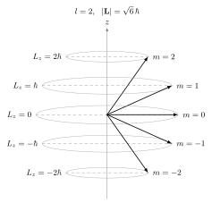
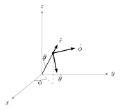

Modern PhysicsPart I · Quantum

# Part I — Quantum Mechanics in Three Dimensions { .part-title }

Chapter 6, Quantum Theory of the Hydrogen Atom, with background from the preceding chapter · <a class="pdf-link" href="notes.pdf" download="Modern-Physics-Part-I-Quantum.pdf">Download this part as PDF</a>

**In this part.** The Schrödinger equation for the hydrogen atom separates in spherical coordinates. The angular part leads to the Legendre and associated Legendre equations, whose well-behaved solutions exist only for integer $l \ge 0$ and $|m| \le l$; normalizing them gives the spherical harmonics. The same quantum numbers come out of a purely algebraic treatment of angular momentum with commutators and ladder operators, which allows half-integer values as well. The two approaches meet when the angular momentum operators are written in spherical coordinates.

!!! quote "Conventions used in this part."
    - $\hbar = h/2\pi$. The electron mass is written $m_e$, so that $m$ is free for the magnetic quantum number.
    - Operators carry hats where it matters ($\hat x, \hat p, \hat H$); $\hat{\phantom{x}}$ on $\hat x, \hat y, \hat z, \hat r, \hat\theta, \hat\phi$ in vector formulas means a unit vector.
    - Spherical coordinates $(r, \theta, \phi)$: $\theta$ is measured from the $z$-axis, $\phi$ in the $xy$-plane from the $x$-axis (Figure 6.2).
    - $\langle f | g\rangle = \int f^* g$ over all space; $\langle Q\rangle = \langle \Psi | \hat Q \Psi\rangle$.
    - Associated Legendre functions are used **without** the Condon–Shortley phase: $P_l^m(x) = (1-x^2)^{m/2} \left(\frac{d}{dx}\right)^m P_l(x)$, as in the course.

---

## Background: Bra-ket Notation and Basic Principles

From the preceding chapter

### Bra-ket notation

!!! note "Definition 0.1 (Bra and ket)"
    $$
    \langle \Phi | \Psi\rangle = \int_{-\infty}^{+\infty} \Phi^* \Psi \, dx, \qquad
    \langle \Psi | \hat Q \Psi\rangle = \int_{-\infty}^{+\infty} \Psi^* \hat Q \Psi \, dx .
    $$

    $\langle \Phi|$ is called a **bra** (a row vector) and $|\Psi\rangle$ a **ket** (a column vector). Bras and kets are abstract state vectors, which can be represented by wavefunctions.

- *Drawback.* The notation is not an explicit function, so it is hard to read off the probability of finding the particle in a given interval.
- *Advantages.* It is compact (no integral signs or $dx$; an operator such as $\frac{\hbar}{i}\nabla$ is just $\hat p$), and it makes the abstract basis visible: a wavefunction can in principle have infinitely many basis directions.

!!! info "Remark — what quantum mechanics usually asks"
    Most physical questions in quantum mechanics are about the state as a whole, or the probability of occupying a given quantum number, rather than the probability of being in a particular place. Bra-ket notation is built for these questions.

**Hilbert space.** The space whose basis directions are the eigenfunctions $\psi_1, \psi_2, \dots$, just as $x, y, z$ (or $r, \theta, \phi$) are the basis directions of ordinary space. For $\Psi = c_1\psi_1 + c_2\psi_2 + c_3\psi_3$,

$$
\int_{-\infty}^{+\infty} \Psi^*\Psi\, dx = \int (c_1^*\psi_1^* + c_2^*\psi_2^* + c_3^*\psi_3^*)(c_1\psi_1 + c_2\psi_2 + c_3\psi_3)\, dx = |c_1|^2 + |c_2|^2 + |c_3|^2
= \begin{pmatrix} c_1^* & c_2^* & c_3^* \end{pmatrix}\begin{pmatrix} c_1 \\ c_2 \\ c_3 \end{pmatrix}.
$$

The cross terms vanish because different eigenfunctions are orthogonal, and each eigenfunction is normalized: the eigenfunctions behave as **orthonormal basis vectors**, $\langle \psi_i | \psi_j\rangle = \delta_{ij}$.

!!! example "Example 0.2 (Hamiltonian of the infinite well as a matrix)"
    In the infinite square well $E_n = n^2 E_1$ and $\hat H\psi_n = E_n\psi_n$. For $\Psi = c_1\psi_1 + c_2\psi_2 + c_3\psi_3$,

    $$
    \langle H\rangle = \langle \Psi | \hat H \Psi\rangle
    = \begin{pmatrix} c_1^* & c_2^* & c_3^* \end{pmatrix}
    \begin{pmatrix} E_1 & 0 & 0 \\ 0 & 4E_1 & 0 \\ 0 & 0 & 9E_1 \end{pmatrix}
    \begin{pmatrix} c_1 \\ c_2 \\ c_3 \end{pmatrix}
    = E_1\left(|c_1|^2 + 4|c_2|^2 + 9|c_3|^2\right).
    $$

    In the basis of its own eigenfunctions the Hamiltonian is diagonal, with the energies on the diagonal.

### Hermitian operators

!!! note "Definition 0.3 (Hermitian operator)"
    An observable (a measurable quantity, with eigenvalues and eigenfunctions) is represented by a **Hermitian** operator $\hat Q$:

    $$
    \langle f | \hat Q g\rangle = \langle \hat Q f | g\rangle \qquad \text{for all } f, g .
    $$

!!! example "Example 0.4 ($\hat p$ is Hermitian)"
    Integrating by parts, with $f, g \to 0$ at $\pm\infty$,

    $$
    \langle f | \hat p g\rangle = \int_{-\infty}^{\infty} f^* \frac{\hbar}{i}\frac{dg}{dx}\, dx
    = \Big[ f^* \tfrac{\hbar}{i} g \Big]_{-\infty}^{\infty} - \int_{-\infty}^{\infty} \frac{\hbar}{i}\frac{df^*}{dx}\, g\, dx
    = \int_{-\infty}^{\infty} \left(\frac{\hbar}{i}\frac{df}{dx}\right)^{\!*} g\, dx = \langle \hat p f | g\rangle .
    $$

!!! example "Example 0.5 ($\hat a_+$ is not Hermitian)"
    For the harmonic oscillator, $\int f^*(\hat a_\pm g)\, dx = \int (\hat a_\mp f)^* g\, dx$ (homework). So

    $$
    \langle f | \hat a_\pm g\rangle = \langle \hat a_\mp f | g\rangle \neq \langle \hat a_\pm f | g\rangle ,
    $$

    and $\hat a_+$ is not Hermitian: its adjoint is $\hat a_-$.

### The uncertainty principle

The variance of an observable can be written in two ways, and they agree:

$$
\sigma_A^2 = \langle (\hat A - \langle A\rangle)^2\rangle = \langle A^2\rangle - 2\langle A\rangle^2 + \langle A\rangle^2 = \langle A^2\rangle - \langle A\rangle^2 .
$$

!!! abstract "Theorem 0.6 (Schwarz inequality)"
    $$
    \left| \int_a^b f(x)^* g(x)\, dx \right| \le \sqrt{\int_a^b f^* f\, dx \int_a^b g^* g\, dx},
    \qquad\text{i.e.}\qquad |\langle f | g\rangle|^2 \le \langle f | f\rangle\langle g | g\rangle .
    $$

!!! info "Remark — the picture behind it"
    In $\mathbb{R}^3$, $\vec A \cdot \vec B = A_x B_x + A_y B_y + A_z B_z = |A||B|\cos\theta$, so $|\vec A\cdot\vec B| \le |A||B|$. For wavefunctions built from three real-coefficient basis functions $\psi_1, \psi_2, \psi_3$ the same computation gives $\langle \Psi | \Phi\rangle = \sqrt{\langle\Psi|\Psi\rangle}\sqrt{\langle\Phi|\Phi\rangle}\cos\theta$, hence the inequality. (The general proof is beyond the course; only the statement is needed.)

!!! abstract "Theorem 0.7 (Generalized uncertainty principle)"
    For observables $\hat A$, $\hat B$,

    $$
    \sigma_A^2\,\sigma_B^2 \ge \left( \frac{1}{2i}\langle [\hat A, \hat B]\rangle \right)^2 .
    $$

!!! success "Proof"
    Let $f = (\hat A - \langle A\rangle)\Psi$ and $g = (\hat B - \langle B\rangle)\Psi$. Since $\hat A - \langle A\rangle$ is Hermitian,

    $$
    \sigma_A^2 = \langle \Psi | (\hat A - \langle A\rangle)^2 \Psi\rangle = \langle (\hat A - \langle A\rangle)\Psi | (\hat A - \langle A\rangle)\Psi\rangle = \langle f | f\rangle ,
    \qquad \sigma_B^2 = \langle g | g\rangle .
    $$

    By the Schwarz inequality, $\sigma_A^2\sigma_B^2 = \langle f|f\rangle\langle g|g\rangle \ge |\langle f | g\rangle|^2$. Put $z = \langle f | g\rangle$, so that $\langle g | f\rangle = z^*$. For any complex number $z = a + ib$,

    $$
    |z|^2 = a^2 + b^2 \ge b^2 = \left( \frac{z - z^*}{2i} \right)^2 ,
    \qquad\text{so}\qquad
    \sigma_A^2\sigma_B^2 \ge \left( \frac{\langle f|g\rangle - \langle g|f\rangle}{2i} \right)^2 .
    $$

    Now

    $$
    \langle f | g\rangle = \langle (\hat A - \langle A\rangle)\Psi | (\hat B - \langle B\rangle)\Psi\rangle
    = \langle \hat A\hat B\rangle - \langle B\rangle\langle A\rangle - \langle A\rangle\langle B\rangle + \langle A\rangle\langle B\rangle
    = \langle \hat A\hat B\rangle - \langle A\rangle\langle B\rangle ,
    $$

    and likewise $\langle g | f\rangle = \langle \hat B\hat A\rangle - \langle A\rangle\langle B\rangle$. Hence

    $$
    \langle f|g\rangle - \langle g|f\rangle = \langle \hat A\hat B - \hat B\hat A\rangle = \langle [\hat A, \hat B]\rangle . \qquad \square
    $$

!!! example "Example 0.8 (Position and momentum)"
    $[\hat x, \hat p]f = x\frac{\hbar}{i}f' - \frac{\hbar}{i}(xf)' = -\frac{\hbar}{i} f = i\hbar f$, so $[\hat x, \hat p] = i\hbar$ and

    $$
    \sigma_x^2\sigma_p^2 \ge \left(\frac{1}{2i}\, i\hbar\right)^2 = \left(\frac{\hbar}{2}\right)^2 ,
    \qquad \sigma_x\sigma_p \ge \frac{\hbar}{2} .
    $$

### Commutators and shared eigenfunctions

If $[\hat A, \hat B] = 0$, the two operators can have a **common set of eigenfunctions**, so both quantities can be measured sharply at the same time. If $[\hat A, \hat B] \neq 0$, Theorem 0.7 forbids this in general.

### Ehrenfest's theorem

!!! abstract "Theorem 0.9 (Ehrenfest)"
    Expectation values obey classical-looking equations of motion:

    $$
    \frac{d}{dt}\langle Q\rangle = \frac{i}{\hbar}\langle [\hat H, \hat Q]\rangle + \left\langle \frac{\partial \hat Q}{\partial t} \right\rangle .
    $$

!!! success "Proof"
    By the product rule,

    $$
    \frac{d}{dt}\langle \Psi | \hat Q\Psi\rangle
    = \left\langle \frac{\partial\Psi}{\partial t} \middle| \hat Q\Psi\right\rangle
    + \left\langle \Psi \middle| \frac{\partial \hat Q}{\partial t}\Psi\right\rangle
    + \left\langle \Psi \middle| \hat Q\frac{\partial\Psi}{\partial t}\right\rangle .
    $$

    The Schrödinger equation $i\hbar\,\partial_t\Psi = \hat H\Psi$ gives $\partial_t\Psi = \frac{1}{i\hbar}\hat H\Psi$. Moving the constant out of the bra produces a complex conjugate, $\frac{1}{i\hbar} \to -\frac{1}{i\hbar}$, so

    $$
    \frac{d}{dt}\langle Q\rangle
    = -\frac{1}{i\hbar}\langle \hat H\Psi | \hat Q\Psi\rangle + \frac{1}{i\hbar}\langle \Psi | \hat Q\hat H\Psi\rangle + \left\langle \frac{\partial\hat Q}{\partial t}\right\rangle .
    $$

    $\hat H$ is Hermitian, so $\langle \hat H\Psi | \hat Q\Psi\rangle = \langle \Psi | \hat H\hat Q\Psi\rangle$, and the first two terms combine to $-\frac{1}{i\hbar}\langle[\hat H, \hat Q]\rangle = \frac{i}{\hbar}\langle [\hat H, \hat Q]\rangle$. $\square$

!!! example "Example 0.10 ($d\langle x\rangle/dt = \langle p\rangle/m_e$)"
    With $\hat H = \frac{\hat p^2}{2m_e} + V(x)$, $[V, \hat x] = 0$ and

    $$
    [\hat H, \hat x] = \frac{1}{2m_e}\big(\hat p[\hat p, \hat x] + [\hat p, \hat x]\hat p\big) = \frac{1}{2m_e}(-2i\hbar\,\hat p) = -\frac{i\hbar}{m_e}\hat p .
    $$

    $\hat x$ has no explicit time dependence, so $\dfrac{d\langle x\rangle}{dt} = \dfrac{i}{\hbar}\left(-\dfrac{i\hbar}{m_e}\right)\langle p\rangle = \dfrac{\langle p\rangle}{m_e}$.

!!! example "Example 0.11 (Conservation of energy)"
    $[\hat H, \hat H] = 0$, so $\dfrac{d\langle H\rangle}{dt} = \left\langle \dfrac{\partial\hat H}{\partial t}\right\rangle = 0$ whenever $\hat H$ does not depend on time explicitly. Energy conservation survives in quantum mechanics as a statement about the average energy.

---

## 6.0 Mathematical Tools: the Analytic Method

Chapter 6

### Convergence of an infinite series

For $f = a_1 + a_2 + \dots + a_n + \cdots$:

1. If the series converges, then $\lim_{n\to\infty} a_n = 0$.
2. **Ratio test.** With $\rho_n = \left|\dfrac{a_{n+1}}{a_n}\right|$: $\lim \rho_n < 1$ converges; $\lim\rho_n = 1$ is inconclusive (test further); $\lim\rho_n > 1$ diverges.

!!! example "Example 6.0.1"
    For $\sum \frac{1}{n!}$, $\rho_n = \frac{1}{n+1} \to 0$: it converges (to $e - 1$). For $\sum \frac{1}{n}$, $\rho_n = \frac{n}{n+1} \to 1$: the test is inconclusive, and the harmonic series in fact diverges.

### 1. The Legendre equation

$$
(1-x^2)\,y'' - 2x\,y' + l(l+1)\,y = 0 .
$$

Substitute a power series $y = \sum_n a_n x^n$, so that $y' = \sum n a_n x^{n-1}$ and $y'' = \sum n(n-1)a_n x^{n-2}$. Collecting the coefficient of $x^n$ from each term,

| | $x^n$ coefficient |
|---|---|
| $y''$ | $(n+2)(n+1)\,a_{n+2}$ |
| $-x^2 y''$ | $-n(n-1)\,a_n$ |
| $-2xy'$ | $-2n\,a_n$ |
| $l(l+1)y$ | $l(l+1)\,a_n$ |

The total must vanish for every $n$, and $l(l+1) - n(n+1) = (l-n)(l+n+1)$, so

$$
a_{n+2} = -\frac{(l-n)(l+n+1)}{(n+2)(n+1)}\, a_n . \tag{6.1}
$$

The recursion links even coefficients to $a_0$ and odd ones to $a_1$:

$$
y = a_0\left[ 1 - \frac{l(l+1)}{2!}x^2 + \frac{l(l+1)(l-2)(l+3)}{4!}x^4 - \cdots \right]
+ a_1\left[ x - \frac{(l-1)(l+2)}{3!}x^3 + \frac{(l-1)(l+2)(l-3)(l+4)}{5!}x^5 - \cdots \right].
$$

**Convergence.** For each bracket, $\rho_n = \left| \dfrac{(l-n)(l+n+1)}{(n+2)(n+1)} x^2 \right| \to x^2$, so the series converge for $x^2 < 1$; at $x = \pm 1$ the test is inconclusive and the infinite series in fact diverge. A solution that stays finite at $x = \pm 1$ must therefore be a polynomial, which happens only when one bracket terminates:

- $l = 0, 2, 4, \dots$: the $a_0$ bracket terminates (finite); the $a_1$ bracket diverges.
- $l = 1, 3, 5, \dots$: the $a_1$ bracket terminates; the $a_0$ bracket diverges.
- $l$ not an integer: both brackets diverge.

!!! info "Remark — why $x = \pm 1$ matters"
    Below, $x = \cos\theta$ and $y$ is the angular part of a wavefunction. $x = \pm 1$ are the north and south poles, where a physical wavefunction must stay finite.

!!! note "Definition 6.0.2 (Legendre functions)"
    The terminating part is the **Legendre function of the first kind** $P_l(x)$, and the divergent part the **Legendre function of the second kind** $Q_l(x)$. The general solution is

    $$
    y = c_1 P_l(x) + c_2 Q_l(x),
    $$

    with $a_0 = c_1$, $a_1 = c_2$ for $l = 0$ or even, and $a_0 = c_2$, $a_1 = c_1$ for $l$ odd. A negative integer $l$ gives the same equation as $-l-1$ (since $l(l+1)$ is unchanged), e.g. $P_{-2}(x) = P_1(x)$.

We discard $Q_l$ and fix the normalization by $P_l(1) = 1$. The convergent part alone already solves the Legendre equation, and only it can be a wavefunction.

!!! example "Example 6.0.3 (First Legendre polynomials)"
    $$
    P_0(x) = 1, \qquad P_1(x) = x, \qquad P_2(x) = \tfrac{1}{2}(3x^2 - 1), \qquad P_3(x) = \tfrac{1}{2}(5x^3 - 3x).
    $$

    For $P_3$: $l = 3$ is odd, so take the $a_1$ bracket, $x - \frac{2\cdot 5}{6}x^3 = x - \frac{5}{3}x^3$, and scale it so that its value at $x = 1$ is $1$: multiply by $-\frac{3}{2}$.

!!! abstract "Theorem 6.0.4 (Rodrigues' formula)"
    $$
    P_l(x) = \frac{1}{2^l\, l!}\left(\frac{d}{dx}\right)^{l} (x^2 - 1)^l .
    $$

### 2. The associated Legendre equation

$$
(1-x^2)\,y'' - 2x\,y' + \left[ l(l+1) - \frac{m^2}{1-x^2} \right] y = 0 .
$$

Try $y = (1-x^2)^{m/2}\,u$ ①. Substituting gives

$$
(1-x^2)\,u'' - 2(m+1)\,x\,u' + \big[ l(l+1) - m(m+1) \big] u = 0 . \tag{②}
$$

Differentiating ② once,

$$
(1-x^2)\,u''' - 2(m+2)\,x\,u'' + \big[ l(l+1) - (m+1)(m+2) \big] u' = 0 , \tag{③}
$$

which is ② with $m \to m+1$ and $u \to u'$. Differentiating ② $n$ times gives, in the same way,

$$
(1-x^2)\,u^{(n+2)} - 2(m+1+n)\,x\,u^{(n+1)} + \big[ l(l+1) - (m+n)(m+n+1) \big] u^{(n)} = 0 .
$$

So: if $u$ solves ② for $m$, then $u'$ solves it for $m+1$.

- $m = 0$: ② is the Legendre equation, so $u = P_l(x)$ and $y = P_l(x)$.
- $m = 1$: by ③, $u = \frac{d}{dx}P_l(x)$.
- $m = 2$: $u = \left(\frac{d}{dx}\right)^2 P_l(x)$, and so on for every $m$.

!!! note "Definition 6.0.5 (Associated Legendre functions)"
    $$
    P_l^m(x) = (1-x^2)^{m/2}\left(\frac{d}{dx}\right)^{m} P_l(x)
    = \frac{1}{2^l\, l!}(1-x^2)^{m/2}\left(\frac{d}{dx}\right)^{l+m}(x^2-1)^l .
    $$

**Range of $m$.** $P_l$ is a polynomial of degree $l$, so $\left(\frac{d}{dx}\right)^m P_l = 0$ for $m > l$. Equivalently, in Rodrigues' form, $(x^2-1)^l$ has degree $2l$ and vanishes after more than $2l$ derivatives, so $l + m \le 2l$. Hence $m \le l$.

For $m < 0$ the equation does not change, since only $m^2$ appears, but the formula must: one sets

$$
P_l^{-m}(x) = (-1)^m \frac{(l-m)!}{(l+m)!}\, P_l^m(x),
$$

which agrees with Rodrigues' form for negative $m$. Together, $-l \le m \le l$.

!!! info "Remark — same equation, different solutions?"
    $P_l$ and $P_l^m$ solve their equations with any constant factor. $P_l^{-m}$ and $P_l^{m}$ differ only by a constant, chosen so that Rodrigues' formula keeps working. In physics the overall constant is fixed at the end anyway, by normalizing the wavefunction.

!!! example "Example 6.0.6"
    $$
    P_1^1(x) = \sqrt{1-x^2}, \qquad
    P_1^{-1}(x) = -\tfrac{1}{2}\sqrt{1-x^2}, \qquad
    P_2^1(x) = 3x\sqrt{1-x^2}, \qquad
    P_3^1(x) = \tfrac{3}{2}(5x^2 - 1)\sqrt{1-x^2} .
    $$

    For $P_1^{-1}$: $(-1)^1\frac{0!}{2!}P_1^1 = -\frac12\sqrt{1-x^2}$, or directly from Rodrigues with $l + m = 0$: $\frac{1}{2}(1-x^2)^{-1/2}(x^2-1) = -\frac12\sqrt{1-x^2}$.

### 3. Normalization of the associated Legendre functions

!!! abstract "Theorem 6.0.7"
    $$
    \int_{-1}^{1} P_l^m(x)\, P_{l'}^{m}(x)\, dx = \frac{2}{2l+1}\,\frac{(l+m)!}{(l-m)!}\,\delta_{ll'} .
    $$

!!! success "Proof"
    *(Case $l = l'$.)* By Rodrigues' formula in the form $P_l^m = \frac{(-1)^{m/2}}{2^l l!}(x^2-1)^{m/2}\left(\frac{d}{dx}\right)^{l+m}(x^2-1)^l$,

    $$
    \int_{-1}^1 (P_l^m)^2\, dx = C \int_{-1}^1 \left[\left(\tfrac{d}{dx}\right)^{l+m} X^l\right] g \, dx,
    \qquad C = \frac{(-1)^m}{2^{2l}(l!)^2},\quad X = x^2 - 1,\quad g = X^m\left(\tfrac{d}{dx}\right)^{l+m}X^l .
    $$

    Integrate by parts repeatedly, moving one derivative at a time from the first factor onto $g$. The boundary terms contain $\left(\frac{d}{dx}\right)^{k}X^l$ with $k < l$, which still has a factor $(x^2-1)$ and vanishes at $x = \pm 1$. After $l+m$ steps,

    $$
    \int_{-1}^1 (P_l^m)^2\, dx = \frac{(-1)^{l+2m}}{2^{2l}(l!)^2}\int_{-1}^1 (x^2-1)^l \left(\tfrac{d}{dx}\right)^{l+m}\Big[ \underbrace{(x^2-1)^m}_{①} \underbrace{\left(\tfrac{d}{dx}\right)^{l+m}(x^2-1)^l}_{②} \Big] dx .
    $$

    The bracket is a polynomial of degree $2m + (2l - l - m) = l + m$, and $l+m$ derivatives kill everything except its leading term. Reading off leading terms from the right:

    $$
    \left(\tfrac{d}{dx}\right)^{l+m}x^{2l} = \frac{(2l)!}{(l-m)!}x^{l-m} + \cdots, \qquad
    (x^2-1)^m x^{l-m} = x^{l+m} + \cdots, \qquad
    \left(\tfrac{d}{dx}\right)^{l+m}x^{l+m} = (l+m)! ,
    $$

    and $(x^2-1)^l = (-1)^l(1-x^2)^l$. Multiplying all constants,

    $$
    \int_{-1}^1 (P_l^m)^2\, dx = k\int_{-1}^1 (1-x^2)^l\, dx, \qquad
    k = \frac{(2l)!\,(l+m)!}{2^{2l}(l!)^2\,(l-m)!} .
    $$

    The remaining integral is $I_l = \frac{2^{2l+1}(l!)^2}{(2l+1)!}$ by Lemma 6.0.8, so the product is $\frac{2(l+m)!}{(2l+1)(l-m)!}$. $\square$

!!! abstract "Lemma 6.0.8"
    $$
    I_l = \int_{-1}^1 (1-x^2)^l\, dx = \frac{2^{2l+1}(l!)^2}{(2l+1)!} .
    $$

!!! success "Proof"
    Split one factor $1 - x^2$:

    $$
    I_l = \int_{-1}^1 (1-x^2)^{l-1}\, dx - \int_{-1}^1 x^2(1-x^2)^{l-1}\, dx = I_{l-1} - \int_{-1}^1 x\cdot x(1-x^2)^{l-1}\, dx .
    $$

    Integrate by parts with $f = x$ and $dg = x(1-x^2)^{l-1}dx$. Substituting $t = 1 - x^2$, $dt = -2x\,dx$, gives $g = -\frac{1}{2l}(1-x^2)^l$. The boundary term vanishes at $\pm 1$, so

    $$
    \int_{-1}^1 x^2(1-x^2)^{l-1}\, dx = \frac{1}{2l}\int_{-1}^1 (1-x^2)^l\, dx = \frac{1}{2l}I_l .
    $$

    Hence $I_l = I_{l-1} - \frac{1}{2l}I_l$, i.e.

    $$
    I_l = \frac{2l}{2l+1}I_{l-1} = \frac{2l}{2l+1}\cdot\frac{2(l-1)}{2l-1}\cdots\frac{2}{3}\, I_0, \qquad I_0 = 2 .
    $$

    Multiplying numerator and denominator by $2l(2l-2)\cdots 2 = 2^l l!$ turns the denominator into $(2l+1)!$, which gives the formula. $\square$

---

## 6.1 The Schrödinger Equation for the Hydrogen Atom

Chapter 6

### The equation in three dimensions

The time-independent Schrödinger equation in one dimension, and in three in Cartesian coordinates:

$$
-\frac{\hbar^2}{2m_e}\frac{d^2\psi}{dx^2} + U\psi = E\psi, \qquad
-\frac{\hbar^2}{2m_e}\nabla^2\psi + U\psi = E\psi .
$$

In spherical coordinates

$$
\nabla^2 = \frac{1}{r^2}\frac{\partial}{\partial r}\left(r^2\frac{\partial}{\partial r}\right)
+ \frac{1}{r^2\sin\theta}\frac{\partial}{\partial\theta}\left(\sin\theta\frac{\partial}{\partial\theta}\right)
+ \frac{1}{r^2\sin^2\theta}\frac{\partial^2}{\partial\phi^2} .
$$

!!! info "Remark — scale factors"
    $r$ has units of length, but $\theta$ and $\phi$ are angles. A volume element is $dV = (dr)(r\,d\theta)(r\sin\theta\, d\phi)$: the factors $1$, $r$, $r\sin\theta$ that turn each coordinate step into a length are the **scale factors**. Because they depend on position and sit inside the derivatives, $\nabla^2$ is not a simple sum of second derivatives in spherical coordinates.

### Separation of variables

Write

$$
\psi(r, \theta, \phi) = R(r)\,\Theta(\theta)\,\Phi(\phi) = R(r)\,Y(\theta, \phi),
$$

just as the Maxwell–Boltzmann distribution factors as $\rho(v) = f(v_x)g(v_y)h(v_z)$. The potential between nucleus and electron is $U(r) = -\dfrac{ke^2}{r}$.

Substitute into the Schrödinger equation, divide by $RY$ and multiply by $-2m_e r^2/\hbar^2$:

$$
\frac{1}{R}\frac{d}{dr}\left(r^2\frac{dR}{dr}\right) - \frac{2m_e r^2}{\hbar^2}\left( -k\frac{e^2}{r} - E \right)
= -\frac{1}{Y}\left( \frac{1}{\sin\theta}\frac{\partial}{\partial\theta}\left(\sin\theta\frac{\partial Y}{\partial\theta}\right) + \frac{1}{\sin^2\theta}\frac{\partial^2 Y}{\partial\phi^2} \right) = C_1 .
$$

The left side depends only on $r$ and the right side only on $\theta, \phi$, so both equal a constant $C_1$, which will turn out to be $l(l+1)$. Multiplying the angular equation by $Y\sin^2\theta$:

$$
-\sin\theta\frac{\partial}{\partial\theta}\left(\sin\theta\frac{\partial Y}{\partial\theta}\right) - \frac{\partial^2 Y}{\partial\phi^2} = C_1\, Y\sin^2\theta .
$$

Put $Y = \Theta(\theta)\Phi(\phi)$ and divide by $\Theta\Phi$:

$$
-\frac{\sin\theta}{\Theta}\frac{d}{d\theta}\left(\sin\theta\frac{d\Theta}{d\theta}\right) - C_1\sin^2\theta = \frac{1}{\Phi}\frac{d^2\Phi}{d\phi^2} = C_2 .
$$

### 1. The equations for $\theta$ and $\phi$

$$
\begin{aligned}
\text{polar angle } \theta: &\quad \frac{\sin\theta}{\Theta}\frac{d}{d\theta}\left(\sin\theta\frac{d\Theta}{d\theta}\right) + l(l+1)\sin^2\theta = -C_2 &&\to\ \text{orbital quantum number } l, \\
\text{azimuth } \phi: &\quad \frac{1}{\Phi}\frac{d^2\Phi}{d\phi^2} = C_2 = -m_l^2 &&\to\ \text{magnetic quantum number } m_l .
\end{aligned}
$$

Spin is not considered here, so from now on $m_l = m$. The $\phi$ equation gives $\Phi(\phi) = e^{im\phi}$, and $\Phi(\phi + 2\pi) = \Phi(\phi)$ forces $m$ to be an integer.

!!! abstract "Proposition 6.1.1 (The $\theta$ equation is the associated Legendre equation)"
    Multiplying the $\theta$ equation by $\Theta/\sin^2\theta$,

    $$
    \frac{1}{\sin\theta}\frac{d}{d\theta}\left(\sin\theta\frac{d\Theta}{d\theta}\right) + \left( l(l+1) - \frac{m^2}{\sin^2\theta} \right)\Theta = 0 ,
    $$

    and with $x = \cos\theta$ this becomes

    $$
    (1-x^2)\frac{d^2\Theta}{dx^2} - 2x\frac{d\Theta}{dx} + \left[ l(l+1) - \frac{m^2}{1-x^2} \right]\Theta = 0 .
    $$

!!! success "Proof"
    $dx = -\sin\theta\, d\theta$, so $\dfrac{d}{d\theta} = -\sin\theta\dfrac{d}{dx}$, and $\sin^2\theta = 1 - x^2$. Then

    $$
    \frac{1}{\sin\theta}\frac{d}{d\theta}\left(\sin\theta\frac{d\Theta}{d\theta}\right)
    = \frac{1}{\sin\theta}\left(-\sin\theta\frac{d}{dx}\right)\left(-\sin^2\theta\frac{d\Theta}{dx}\right)
    = \frac{d}{dx}\left((1-x^2)\frac{d\Theta}{dx}\right)
    = (1-x^2)\Theta'' - 2x\Theta' .
    $$

    Replacing $\sin^2\theta$ by $1 - x^2$ in the last term gives the associated Legendre equation. $\square$

### 2. Normalization and the spherical harmonics

So $\Theta = A\,P_l^m(\cos\theta)$, where $P_l^m$ comes from the $P_l$ normalized by $P_l(1) = 1$.

!!! note "Definition 6.1.2 (Spherical harmonics)"
    $$
    Y_l^m(\theta, \phi) = \Theta(\theta)\Phi(\phi) = A\,P_l^m(\cos\theta)\,e^{im\phi} .
    $$

The wavefunction is normalized, $\int \Psi^*\Psi\, dV = \int (R\Theta\Phi)^* R\Theta\Phi\; r^2\sin\theta\, dr\, d\theta\, d\phi = 1$, and we normalize each factor separately:

$$
\int_0^\infty R^* R\, r^2\, dr \int_0^{2\pi}\left( \int_0^\pi \Theta^*\Theta\sin\theta\, d\theta \right) e^{-im\phi}e^{im\phi}\, d\phi = 1
\quad\Longrightarrow\quad
2\pi\int_0^\pi \Theta^*\Theta\sin\theta\, d\theta = 1 .
$$

With $x = \cos\theta$, $\sin\theta\, d\theta = -dx$ and $\int_0^\pi \to \int_1^{-1}$:

$$
2\pi\int_{-1}^1 A^2 \big(P_l^m(x)\big)^2\, dx = 2\pi A^2\, \frac{2}{2l+1}\frac{(l+m)!}{(l-m)!} = 1 .
$$

!!! abstract "Theorem 6.1.3"
    $$
    \Theta(\theta) = \sqrt{\frac{(2l+1)(l-m)!}{4\pi\,(l+m)!}}\; P_l^m(\cos\theta),
    \qquad
    Y_l^m(\theta,\phi) = \sqrt{\frac{(2l+1)(l-m)!}{4\pi\,(l+m)!}}\; P_l^m(\cos\theta)\, e^{im\phi} .
    $$

!!! example "Example 6.1.4 ($Y_3^1$)"
    $P_3^1(\cos\theta) = \frac{3}{2}(5\cos^2\theta - 1)\sin\theta$ (Example 6.0.6), and the constant is $\sqrt{\frac{7\cdot 2!}{4\pi\cdot 4!}} = \sqrt{\frac{7}{48\pi}}$. Since $\frac{3}{2}\sqrt{\frac{7}{48\pi}} = \sqrt{\frac{63}{192\pi}} = \frac18\sqrt{\frac{21}{\pi}}$,

    $$
    Y_3^1(\theta,\phi) = \frac{1}{8}\sqrt{\frac{21}{\pi}}\,(5\cos^2\theta - 1)\sin\theta\, e^{i\phi} .
    $$

    (Books that include the Condon–Shortley phase have an extra minus sign.)

---

## 6.2 The Algebraic Method: Angular Momentum Operators

Chapter 6

### 1. Classical angular momentum

Here hats are unit vectors. With $\vec r = x\hat x + y\hat y + z\hat z$ and $\vec p = p_x\hat x + p_y\hat y + p_z\hat z$,

$$
\vec L = \vec r \times \vec p =
\begin{vmatrix} \hat x & \hat y & \hat z \\ x & y & z \\ p_x & p_y & p_z \end{vmatrix},
\qquad
L_x = y p_z - z p_y, \quad L_y = z p_x - x p_z, \quad L_z = x p_y - y p_x .
$$

In quantum mechanics the same formulas hold with $x, p_x, \dots$ read as operators.

### 2. Commutator algebra

!!! abstract "Proposition 6.2.1 (Basic rules)"
    1. $-[A,B] = [A,-B] = [-A,B] = [B,A]$
    2. $[AB, C] = A[B,C] + [A,C]B$
    3. $[A, BC] = [A,B]C + B[A,C]$
    4. $[A, B \pm C] = [A,B] \pm [A,C]$
    5. $[AB, CD] = A\big([B,C]D + C[B,D]\big) + \big([A,C]D + C[A,D]\big)B$
    6. $[A \pm B, C \pm D] = [A,C] \pm [A,D] \pm [B,C] + [B,D]$

!!! abstract "Proposition 6.2.2 (Canonical commutators)"
    For $i, j \in \{x, y, z\}$:

    $$
    [r_i, r_j] = 0, \qquad [p_i, p_j] = 0, \qquad [r_i, p_j] = 0 \ (i \ne j), \qquad [r_i, p_i] = i\hbar .
    $$

### 3. Angular momentum operators

!!! abstract "Theorem 6.2.3"
    $$
    [L_x, L_y] = i\hbar L_z, \qquad [L_y, L_z] = i\hbar L_x, \qquad [L_z, L_x] = i\hbar L_y .
    $$

!!! success "Proof"
    $$
    [L_x, L_y] = [yp_z - zp_y,\ zp_x - xp_z] = [yp_z, zp_x] - [yp_z, xp_z] - [zp_y, zp_x] + [zp_y, xp_z] .
    $$

    By rule 5, each term is built from the four commutators of its factors, and only $[r_i, p_i] \ne 0$ survives. So the middle two terms vanish, and

    $$
    [yp_z, zp_x] = y[p_z, z]p_x = -i\hbar\, y p_x, \qquad
    [zp_y, xp_z] = x[z, p_z]p_y = i\hbar\, x p_y .
    $$

    Hence $[L_x, L_y] = i\hbar(xp_y - yp_x) = i\hbar L_z$. The other two follow by cycling $x \to y \to z \to x$. $\square$

Since $[L_i, L_j] \ne 0$, two different components cannot have common eigenfunctions: they cannot be measured simultaneously.

### 4. The uncertainty principle and common eigenfunctions

By Theorem 0.7,

$$
\sigma_{L_x}^2\sigma_{L_y}^2 \ge \left( \frac{1}{2i}\langle [L_x, L_y]\rangle \right)^2 = \left( \frac{\hbar}{2}\langle L_z\rangle \right)^2 .
$$

!!! abstract "Proposition 6.2.4"
    With $L^2 = L_x^2 + L_y^2 + L_z^2$, $\quad [L^2, L_i] = 0$ for $i = x, y, z$.

!!! success "Proof"
    By rules 2 and 3,

    $$
    \begin{aligned}
    [L^2, L_z] &= [L_x^2, L_z] + [L_y^2, L_z] + [L_z^2, L_z] \\
    &= L_x[L_x, L_z] + [L_x, L_z]L_x + L_y[L_y, L_z] + [L_y, L_z]L_y + 0 \\
    &= -i\hbar(L_xL_y + L_yL_x) + i\hbar(L_yL_x + L_xL_y) = 0 .
    \end{aligned}
    $$

    The same computation works for $L_x$ and $L_y$. $\square$

So $L^2$ and $L_z$ (or $L^2$ and $L_x$, or $L^2$ and $L_y$) can have common eigenfunctions.

!!! info "Remark — two questions from the worksheet"
    *If $[\hat A, \hat B] = 0$, is every eigenfunction of $\hat A$ automatically one of $\hat B$?* Not necessarily: commuting operators *can* be given a common set of eigenfunctions, but an eigenvalue of $\hat A$ shared by several eigenfunctions leaves room for combinations that are not eigenfunctions of $\hat B$.

    *$L^2$ shares eigenfunctions $f$ with $L_x$ and $g$ with $L_z$. Can $f = g$?* Only when $l = 0$. Suppose $L_x f = af$ and $L_z f = bf$. Then $i\hbar L_y f = [L_z, L_x]f = (ba - ab)f = 0$, so $L_y f = 0$. Next $i\hbar L_z f = [L_x, L_y]f = L_x(0) - L_y(af) = 0$, so $b = 0$, and likewise $a = 0$. Then $L^2 f = 0$, i.e. $l = 0$.

---

## 6.3 Angular Momentum of the Hydrogen Atom

Chapter 6

### 1. $L^2$ and $L_z$

Let $f$ be a common eigenfunction of $L^2$ and $L_z$:

$$
L^2 f = \lambda f, \qquad L_z f = \mu f .
$$

### 2. Ladder operators

!!! note "Definition 6.3.1 (Ladder operators)"
    $$
    L_\pm = L_x \pm i L_y .
    $$

    Compare the harmonic oscillator, $\hat H = \frac{1}{2m}\left[\hat p^2 + (m\omega x)^2\right]$, which was factored into $\hat a_\pm$.

!!! abstract "Proposition 6.3.2"
    $$
    [L^2, L_\pm] = 0, \qquad [L_z, L_\pm] = \pm\hbar L_\pm, \qquad [L_+, L_-] = 2\hbar L_z .
    $$

!!! success "Proof"
    $[L^2, L_\pm] = [L^2, L_x] \pm i[L^2, L_y] = 0$ by Proposition 6.2.4. Next,

    $$
    [L_z, L_\pm] = [L_z, L_x] \pm i[L_z, L_y] = i\hbar L_y \pm i(-i\hbar L_x) = \pm\hbar(L_x \pm iL_y) = \pm\hbar L_\pm .
    $$

    Finally $[L_+, L_-] = [L_x + iL_y, L_x - iL_y] = -i[L_x, L_y] + i[L_y, L_x] = -i(i\hbar L_z) + i(-i\hbar L_z) = 2\hbar L_z$. $\square$

!!! abstract "Theorem 6.3.3"
    If $f$ is a common eigenfunction of $L^2$ and $L_z$ with eigenvalues $\lambda, \mu$, so is $L_\pm f$:

    $$
    L^2(L_\pm f) = \lambda\,(L_\pm f), \qquad L_z(L_\pm f) = (\mu \pm \hbar)(L_\pm f) .
    $$

!!! success "Proof"
    $L^2(L_\pm f) = L_\pm(L^2 f) = L_\pm(\lambda f) = \lambda(L_\pm f)$: the eigenvalue of $L^2$ does not change. And $[L_z, L_\pm]f = \pm\hbar L_\pm f$ gives

    $$
    L_z(L_\pm f) = L_\pm(L_z f) \pm \hbar L_\pm f = (\mu \pm \hbar)(L_\pm f) :
    $$

    the eigenvalue of $L_z$ changes by $\pm\hbar$. $\square$

So applying a ladder operator to one eigenfunction gives another. The eigenvalue of $L^2$ stays fixed while that of $L_z$ moves in steps of $\hbar$. It cannot grow forever: $\langle L_z^2\rangle \le \langle L^2\rangle = \lambda$. As with $\hat a_-\psi_0 = 0$ for the oscillator, there must be a top and a bottom rung.

### 3. Eigenvalues from the ladder

Let $f_t$ (top) and $f_b$ (bottom) satisfy

$$
L_+ f_t = 0, \qquad L_- f_b = 0, \qquad L_z f_t = \hbar l\, f_t, \qquad L_z f_b = \hbar k\, f_b,
$$

where so far $l$ and $k$ are just real numbers. Expanding,

$$
L_\pm L_\mp = L_x^2 + L_y^2 \mp i[L_x, L_y] = L_x^2 + L_y^2 \pm \hbar L_z
\quad\Longrightarrow\quad
L^2 = L_\pm L_\mp + L_z^2 \mp \hbar L_z .
$$

Use the lower sign on $f_t$ and the upper sign on $f_b$:

$$
\begin{aligned}
L^2 f_t &= (L_-L_+ + L_z^2 + \hbar L_z) f_t = (0 + \hbar^2 l^2 + \hbar^2 l) f_t = \hbar^2 l(l+1)\, f_t, \\
L^2 f_b &= (L_+L_- + L_z^2 - \hbar L_z) f_b = (0 + \hbar^2 k^2 - \hbar^2 k) f_b = \hbar^2 k(k-1)\, f_b .
\end{aligned}
$$

Both are the same eigenvalue $\lambda$, so $l(l+1) = k(k-1)$. Its roots are $k = -l$ and $k = l + 1$; the second would put the bottom above the top, so $k = -l$.

!!! abstract "Theorem 6.3.4"
    1. The eigenvalues of $L^2$ are $\hbar^2 l(l+1)$, so $|\vec L| = \sqrt{l(l+1)}\,\hbar$.
    2. The eigenvalues of $L_z$ are $m\hbar$ with $m = -l, -l+1, \dots, l-1, l$: maximum $l\hbar$, minimum $-l\hbar$.
    3. Going from $-l\hbar$ to $l\hbar$ in steps of $\hbar$ takes an integer number $N$ of steps, $2l = N$, so $l = 0, \frac12, 1, \frac32, \dots$

!!! info "Remark — why still the analytic method?"
    The algebraic method is convenient: it never needs the eigenfunctions. But it allows more than the analytic one. $l = 2$ gives $L_z = -2\hbar, -\hbar, 0, \hbar, 2\hbar$, and $l = 1.5$ gives $-1.5\hbar, -0.5\hbar, 0.5\hbar, 1.5\hbar$; both satisfy all the conditions above. The analytic method rules out half-integer $l$: $P_l^m$ is defined by differentiating $m$ times, so $m$ and $l$ must be integers, and $e^{im\phi}$ must be single-valued.

    Where the analytic method does not apply, half-integer values do occur. **Spin** $\vec S$, which does not come out of the Schrödinger equation, has $s = \frac12$ for the electron. The Stern–Gerlach experiment, in which a beam of silver atoms splits into exactly two spots, can only be explained by a half-integer quantum number. (So can the fermion–boson distinction and the Pauli exclusion principle.)

<figure markdown>
  { .tex-fig width="400" }
  <figcaption markdown="span">Figure 6.1. The allowed orientations of $\vec L$ for $l = 2$. Each vector can lie anywhere on its cone.</figcaption>
</figure>

!!! info "Remark — why textbooks draw cones"
    $[L^2, L_z] = 0$, so $|\vec L|$ and $L_z$ can be known at the same time. But $[L_z, L_x] = i\hbar L_y$ and $[L_z, L_y] = -i\hbar L_x$, so $L_x$ and $L_y$ cannot be known together with $L_z$. The vector therefore cannot be drawn as a single arrow; only its length $\sqrt{l(l+1)}\hbar$ and its projection $m\hbar$ are fixed, which leaves a cone. Note also $m^2 \le l(l+1)$ forces $|m| \le l$, and since $l^2 < l(l+1)$ for $l > 0$, $\vec L$ never points exactly along the $z$-axis.

---

## 6.4 Combining the Analytic and Algebraic Methods

Chapter 6

### 1. Spherical and Cartesian coordinates

<figure markdown>
  { .tex-fig width="330" }
  <figcaption markdown="span">Figure 6.2. Spherical coordinates and the unit vectors $\hat r, \hat\theta, \hat\phi$.</figcaption>
</figure>

$$
\nabla = \hat r\frac{\partial}{\partial r} + \hat\theta\,\frac{1}{r}\frac{\partial}{\partial\theta} + \hat\phi\,\frac{1}{r\sin\theta}\frac{\partial}{\partial\phi} ,
$$

the rate of change per unit length in each direction. Unlike $\nabla^2$, it is simple. The momentum operator is $\vec p = \frac{\hbar}{i}\nabla$, and

$$
\hat\theta = (\cos\theta\cos\phi)\,\hat x + (\cos\theta\sin\phi)\,\hat y - (\sin\theta)\,\hat z, \qquad
\hat\phi = -\sin\phi\,\hat x + \cos\phi\,\hat y .
$$

### 2. Angular momentum operators in spherical coordinates

With $\vec r = r\hat r$,

$$
\vec L = \vec r \times \vec p = \frac{\hbar}{i}
\begin{vmatrix} \hat r & \hat\theta & \hat\phi \\ r & 0 & 0 \\ \frac{\partial}{\partial r} & \frac{1}{r}\frac{\partial}{\partial\theta} & \frac{1}{r\sin\theta}\frac{\partial}{\partial\phi} \end{vmatrix}
= \frac{\hbar}{i}\left[ \hat\phi\,\frac{\partial}{\partial\theta} - \hat\theta\,\frac{1}{\sin\theta}\frac{\partial}{\partial\phi} \right].
$$

Substituting $\hat\theta$ and $\hat\phi$,

$$
\vec L = \frac{\hbar}{i}\left[ \left(-\sin\phi\frac{\partial}{\partial\theta} - \cos\phi\cot\theta\frac{\partial}{\partial\phi}\right)\hat x
+ \left(\cos\phi\frac{\partial}{\partial\theta} - \sin\phi\cot\theta\frac{\partial}{\partial\phi}\right)\hat y
+ \frac{\partial}{\partial\phi}\,\hat z \right].
$$

!!! abstract "Proposition 6.4.1"
    $$
    L_x = \frac{\hbar}{i}\left(-\sin\phi\frac{\partial}{\partial\theta} - \cos\phi\cot\theta\frac{\partial}{\partial\phi}\right), \qquad
    L_y = \frac{\hbar}{i}\left(\cos\phi\frac{\partial}{\partial\theta} - \sin\phi\cot\theta\frac{\partial}{\partial\phi}\right), \qquad
    L_z = \frac{\hbar}{i}\frac{\partial}{\partial\phi} ,
    $$

    and

    $$
    L^2 = -\hbar^2\left[ \frac{1}{\sin\theta}\frac{\partial}{\partial\theta}\left(\sin\theta\frac{\partial}{\partial\theta}\right) + \frac{1}{\sin^2\theta}\frac{\partial^2}{\partial\phi^2} \right].
    $$

!!! info "Remark — where the two methods meet"
    The bracket in $L^2$ is exactly the angular part of $\nabla^2$ (times $r^2$). So the angular equation of §6.1 says

    $$
    L^2\, Y_l^m = \hbar^2\, l(l+1)\, Y_l^m, \qquad L_z\, Y_l^m = \frac{\hbar}{i}\frac{\partial}{\partial\phi}\left(\cdots e^{im\phi}\right) = m\hbar\, Y_l^m .
    $$

    The separation constant $l(l+1)$ and the integer $m$ of the analytic method are the eigenvalues found algebraically in §6.3, and the spherical harmonics are the common eigenfunctions of $L^2$ and $L_z$.

!!! example "Example 6.4.2 ($L_z$ is Hermitian)"
    For functions of $\phi$ (all functions are $2\pi$-periodic in $\phi$),

    $$
    \langle f | L_z g\rangle = \int_0^{2\pi} f^*\,\frac{\hbar}{i}\frac{\partial g}{\partial\phi}\, d\phi
    = \Big[ f^*\tfrac{\hbar}{i}g \Big]_0^{2\pi} - \int_0^{2\pi} \frac{\hbar}{i}\frac{\partial f^*}{\partial\phi}\, g\, d\phi
    = \int_0^{2\pi} \left(\frac{\hbar}{i}\frac{\partial f}{\partial\phi}\right)^{\!*} g\, d\phi = \langle L_z f | g\rangle .
    $$

    The boundary term vanishes by periodicity, and $\left(\frac{\hbar}{i}\right)^* = -\frac{\hbar}{i}$ absorbs the minus sign.

!!! example "Example 6.4.3 (Commutators with $L_z$)"
    Using $L_z = xp_y - yp_x$ and Proposition 6.2.2:

    $$
    \begin{gathered}
    [L_z, x] = -y[p_x, x] = i\hbar\, y, \qquad [L_z, y] = x[p_y, y] = -i\hbar\, x, \qquad [L_z, z] = 0, \\
    [L_z, p_x] = [x, p_x]\,p_y = i\hbar\, p_y, \qquad [L_z, p_z] = 0, \\
    [L_z, x^2 + y^2 + z^2] = \big([L_z,x]x + x[L_z,x]\big) + \big([L_z,y]y + y[L_z,y]\big) = 2i\hbar\, xy - 2i\hbar\, yx = 0 .
    \end{gathered}
    $$

    The last one says that $L_z$ commutes with any function of $r$: rotations about the $z$-axis do not change the distance from the origin.

---

## What the Final Tends to Ask

The finals of 2024 and 2025 drew on this part as follows, so these are the derivations worth being able to write out.

- **Legendre polynomials**: computing $P_l$ from the series or the normalization $P_l(1) = 1$ (Example 6.0.3); $P_l^m$ from $(1-x^2)^{m/2}(d/dx)^m P_l$ (Example 6.0.6).
- **Separation of variables**: writing the $r$, $\theta$ and $\phi$ equations and showing the $\theta$ equation is the associated Legendre equation (§6.1, Proposition 6.1.1).
- **Normalization**: the constant $k$ in Theorem 6.0.7, the recursion $I_l = I_{l-1} - \frac{1}{2l}I_l$ (Lemma 6.0.8), and a normalized $Y_l^m$ (Example 6.1.4).
- **Hermitian operators**: the bra-ket condition and the proof for $L_z$ (Example 6.4.2).
- **Range of $m$**: from $m^2\hbar^2 \le l(l+1)\hbar^2$, and from Rodrigues' formula (§6.0, §6.3).
- **Commutators**: $[L_z, x]$, $[L_z, p_x]$, $[L_z, r^2]$, $[L_+, L_-]$ (Proposition 6.3.2, Example 6.4.3); $L_x, L_y, L_z$ in terms of $x, p$.
- **Interpretation**: why the analytic and algebraic ranges differ, with Stern–Gerlach as the example; why angular momentum is drawn as cones (§6.3 remarks).
