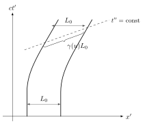

<a href="../relativity/">English</a><a class="on">한국어</a>

현대물리학2부 · 상대론

# 2부 — 특수상대론 { .part-title #part-ii-special-relativity }

지금까지의 수업 필기 · <a class="pdf-link" href="notes.pdf" download="현대물리학-2부-상대론.pdf">이 부를 PDF로 내려받기</a>

**이 부에서는.** 맥스웰 방정식은 $c = 1/\sqrt{\mu_0\varepsilon_0}$로 진행하는 전자기파를 예측하는데, 이 속력은 어떤 기준틀도 지정하지 않는다. 이것을 진지하게 받아들이면 속도의 상대론적 합성과 그 로렌츠 인자, 가속되는 물체의 길이 수축이 지닌 미묘함(벨의 우주선 역설), 그리고 전기장과 자기장이 하나의 장의 두 얼굴이라는 깨달음에 이른다. 관성계를 바꾸면 한쪽이 다른 쪽으로 바뀔 수 있지만 알짜힘은 그대로이다.

!!! quote "이 부에서 쓰는 규약."
    - $S$는 실험실 좌표계이다. 프라임 붙은 좌표계 $S'$는 $S$에 대해 $x$ 방향으로 속도 $v$로 움직인다. $\beta = v/c$.
    - $\gamma(v) = \gamma_v = \dfrac{1}{\sqrt{1 - v^2/c^2}}$.
    - $L_0$는 고유 길이(정지 상태에서 잰 길이)이다. $\lambda$는 선전하밀도이고 $\lambda_0$는 실험실에서의 값이다. $I = \lambda v$.
    - $\hat n$은 바깥 방향 단위법선, $d\tau$는 부피요소이다.

---

## 1 맥스웰 방정식과 빛의 속력 { #1-maxwells-equations-and-the-speed-of-light }

### 자기선속 { #magnetic-flux }

어떤 면을 지나는 자기선속은

$$
\Phi_B = \int \vec B\cdot\hat n\, dA .
$$

### 회전의 발산은 0이다 { #the-divergence-of-a-curl-vanishes }

<figure markdown>
  { .tex-fig width="300" }
  <figcaption markdown="span">그림 1.1. 경계가 같은 두 곡면 $S_1$, $S_2$는 함께 하나의 부피를 둘러싼다.</figcaption>
</figure>

그림 1.1처럼 $S_1$과 $S_2$가 경계곡선을 공유한다고 하자. 둘이 이루는 닫힌곡면의 바깥 법선을 쓰면, 스토크스 정리에 의해

$$
\iint_{S_1} (\nabla\times\vec A)\cdot\hat n_1\, dA_1 = \oint_{\partial S_1}\vec A\cdot d\vec l, \qquad
\iint_{S_2} (\nabla\times\vec A)\cdot\hat n_2\, dA_2 = -\oint_{\partial S_1}\vec A\cdot d\vec l
$$

이다. $S_2$의 바깥 법선은 공통 경계에 반대 방향을 주기 때문이다. 두 식을 더하고 둘러싸인 부피 $V$에 발산 정리를 쓰면

$$
\unicode{x222F}_{\partial V} (\nabla\times\vec A)\cdot\hat n\, dA = 0 = \iiint_V \nabla\cdot(\nabla\times\vec A)\, d\tau .
$$

이것이 모든 부피에서 성립하므로, 모든 벡터장 $\vec A$에 대해 $\nabla\cdot(\nabla\times\vec A) = 0$이다.

### 앙페르 법칙은 수정이 필요하다 { #amperes-law-needs-a-correction }

그러면 앙페르 법칙 $\nabla\times\vec B = \mu_0\vec J$는 $0 = \nabla\cdot(\mu_0\vec J)$를 강요한다. 그런데 전하 보존은 다르게 말한다. 닫힌곡면 밖으로 나가는 전류는 안의 전하가 줄어드는 비율과 같다.

$$
\iiint (\nabla\cdot\vec J)\, d\tau = \unicode{x222F}_{\partial V}\vec J\cdot\hat n\, dA = I = -\frac{dq}{dt}
\quad\Longrightarrow\quad
\nabla\cdot\vec J = -\frac{\partial\rho}{\partial t} .
$$

가우스 법칙 $\rho = \varepsilon_0\nabla\cdot\vec E$를 쓰면, 실제로 0이 되는 것은

$$
0 = \nabla\cdot\left( \mu_0\vec J + \mu_0\varepsilon_0\frac{\partial\vec E}{\partial t} \right),
\qquad\text{왜냐하면}\qquad
\nabla\cdot(\nabla\times\vec B) = \mu_0\left( \nabla\cdot\vec J + \varepsilon_0\frac{\partial(\nabla\cdot\vec E)}{\partial t} \right) = 0 .
$$

!!! abstract "앙페르–맥스웰 법칙"
    $$
    \nabla\times\vec B = \mu_0\left( \vec J + \varepsilon_0\frac{\partial\vec E}{\partial t} \right).
    $$

### 전자기파 { #electromagnetic-waves }

회전을 한 번 더 취하면

$$
\nabla\times(\nabla\times\vec B) = \mu_0\left( \nabla\times\vec J + \varepsilon_0\frac{\partial(\nabla\times\vec E)}{\partial t} \right)
= \nabla(\nabla\cdot\vec B) - \nabla^2\vec B
$$

이고, 여기서 $(\nabla^2\vec B)_x = \dfrac{\partial^2 B_x}{\partial x^2} + \dfrac{\partial^2 B_x}{\partial y^2} + \dfrac{\partial^2 B_x}{\partial z^2}$이며 다른 성분도 마찬가지이다. 진공에서는 $\rho = 0$, $\vec J = 0$이다. $\nabla\cdot\vec B = 0$과 패러데이 법칙 $\nabla\times\vec E = -\partial\vec B/\partial t$를 쓰면

$$
-\nabla^2\vec B = \mu_0\varepsilon_0\frac{\partial}{\partial t}\left( -\frac{\partial\vec B}{\partial t} \right)
\quad\Longrightarrow\quad
\nabla^2\vec B = \mu_0\varepsilon_0\frac{\partial^2\vec B}{\partial t^2} .
$$

!!! abstract "파동 방정식"
    진공에서 자기장은 속력이

    $$
    c = \frac{1}{\sqrt{\mu_0\varepsilon_0}}
    $$

    인 파동 방정식을 따른다. $\nabla\times\vec E = -\partial\vec B/\partial t$에서 출발해도 $\vec E$에 대한 같은 방정식이 나온다.

!!! info "참고 — 무엇의 속력, 무엇에 대한 속력?"
    $\mu_0$과 $\varepsilon_0$는 자연 상수이므로, 맥스웰 방정식은 어떤 기준틀도 지정하지 않고 빛의 속력을 정한다. 맥스웰 방정식이 모든 관성계에서 성립한다면 $c$는 모든 관성계에서 같다. 이것이 특수상대론의 출발점이다.

---

## 2 속도의 합성과 로렌츠 인자 { #2-composition-of-velocities-and-the-lorentz-factor }

$S'$가 $S$에 대해 속도 $v$로 움직이고, 어떤 물체가 $S'$에 대해 (같은 직선 위에서) 속도 $u$로 움직인다고 하자. $S$에서 이 물체의 속도는

$$
w = \frac{v + u}{1 + \dfrac{vu}{c^2}} .
$$

!!! abstract "명제 2.1"
    $$
    \gamma(w) = \gamma(v)\,\gamma(u)\left( 1 + \frac{vu}{c^2} \right).
    $$

!!! success "증명"
    $$
    \frac{1}{\gamma(w)^2} = 1 - \frac{w^2}{c^2}
    = \frac{\left(1 + \frac{vu}{c^2}\right)^2 - \frac{(v+u)^2}{c^2}}{\left(1 + \frac{vu}{c^2}\right)^2}
    = \frac{1 - \frac{u^2}{c^2} - \frac{v^2}{c^2}\left(1 - \frac{u^2}{c^2}\right)}{\left(1 + \frac{vu}{c^2}\right)^2}
    = \frac{\left(1 - \frac{u^2}{c^2}\right)\left(1 - \frac{v^2}{c^2}\right)}{\left(1 + \frac{vu}{c^2}\right)^2} .
    $$

    분자에서 교차항 $\pm 2vu/c^2$는 상쇄되고, $1 + \frac{v^2u^2}{c^4} - \frac{u^2}{c^2} - \frac{v^2}{c^2}$는 인수분해된다. 따라서 $\dfrac{1}{\gamma(w)^2} = \dfrac{1}{\big(\gamma(v)\gamma(u)(1 + vu/c^2)\big)^2}$이다. $\square$

!!! example "예제 2.2 (크기가 같고 방향이 반대인 두 속도)"
    $S'$가 $S$에 대해 $-v$로 움직이고 물체가 $S'$에 대해 $-v$로 움직이면 $w = -\dfrac{2v}{1 + \beta^2}$이고 $\gamma(w) = \gamma_v^2(1 + \beta^2)$이다. 이 경우는 §4에서 쓰인다.

---

## 3 길이 수축과 벨의 우주선 역설 { #3-length-contraction-and-bells-spaceship-paradox }

막대(또는 실로 이어진 두 우주선)가 $S'$에서 고유 길이 $L_0$를 가진다. $S'$가 $v$로 움직이는 $S$에서 그 길이는 $L_0/\gamma(v)$이다.

이제 양 끝이 같은 방식으로 **$S'$에서 동시에 가속**하여, 각각 $S'$에 대해 속력 $u$로 움직이게 되었다고 하자. 두 끝은 같은 $S'$ 시각에 정확히 같은 일을 하므로, $S'$에서 잰 둘 사이 거리는 내내 $L_0$이다.

<figure markdown>
  { .tex-fig width="380" }
  <figcaption markdown="span">그림 3.1. $S'$에서 본 양 끝의 세계선. $x'$ 간격은 $L_0$로 유지되지만, 새 정지 좌표계 $S''$의 동시선을 따라 재면 $\gamma(u)L_0$이다.</figcaption>
</figure>

**양 끝의 새 정지 좌표계 $S''$에서**: $S'$는 간격을 $L_0$로 보고, $S'$는 $S''$에 대해 $u$로 움직이므로, $S''$에서의 간격은 $\gamma(u)$배 더 길어야 한다.

$$
S'' \text{ 에서의 간격} = \gamma(u)L_0 .
$$

**$S$에서는** 양 끝이 $w = \dfrac{v+u}{1 + vu/c^2}$로 움직이므로, 간격은 정지 상태의 값 $\gamma(u)L_0$에서 수축한다.

$$
S \text{ 에서의 간격} = \frac{\gamma(u)L_0}{\gamma(w)} .
$$

두 우주선 사이에 묶은 고유 길이 $L_0$의 실은 $S''$에서 $L_0$, $S$에서 $L_0/\gamma(w)$의 길이를 가질 것이다.

| 좌표계 | 양 끝 사이의 간격 | 본래 길이의 실 |
|---|---|---|
| $S'$ (가속 전) | $L_0$ | $L_0$ |
| $S''$ (가속 후) | $\gamma(u)L_0$ | $L_0$ |
| $S$ (가속 후) | $\gamma(u)L_0/\gamma(w)$ | $L_0/\gamma(w)$ |

모든 좌표계에서 양 끝은 결국 실의 본래 길이보다 같은 인자 $\gamma(u)$만큼 더 멀어지므로, 실은 늘어나서 끊어진다. 모든 좌표계가 이 점에 동의하며, 당연히 그래야 한다.

!!! info "참고 — 무엇이 수축하는가"
    길이 수축은 독립적으로 움직이는 물체들 사이의 틈에 일어나는 일이 아니다. 어떤 물체를 그 물체의 정지 좌표계에서 잰 값에 대한 진술이다. 두 끝을 "동시에" 가속한다는 것은 $S'$에서만 동시이고, 양 끝의 새 정지 좌표계에서는 앞쪽 끝이 먼저 출발한 것이 되므로 둘 사이 간격이 늘어난다.

---

## 4 관성계에 따른 전기력과 자기력 { #4-electric-and-magnetic-forces-in-different-frames }

### 설정 { #setting }

<figure markdown>
  { .tex-fig width="500" }
  <figcaption markdown="span">그림 4.1. 거리 $d$만큼 떨어진 중성인 두 도선. 양이온은 $S$에서 정지해 있고, 전자는 도선 ⟨i⟩에서는 $v$로, 도선 ⟨ii⟩에서는 $-v$로 움직인다.</figcaption>
</figure>

실험실 좌표계 $S$에서 각 도선은 중성이다. 선밀도 $+\lambda_0$인 양이온은 정지해 있고, $-\lambda_0$인 전자는 움직인다. 전하들이 속력 $u$로 움직이는 좌표계에서 잰 선밀도는 **고유** 밀도(그 전하들의 정지 좌표계에서의 밀도)의 $\gamma(u)$배이다. 길이가 $\gamma(u)$배 수축하기 때문이다. 전류는 $I = \lambda v$이다.

$S$에서 (고유 밀도는 전하 자신의 정지 좌표계에서 잰 값):

| 도선 | 전하 | $S$에서의 밀도 | $S$에서의 전류 | 고유 밀도 |
|---|---|---|---|---|
| ⟨i⟩ | $(+)$ | $+\lambda_0$ | $0$ | $+\lambda_0$ |
| | $(-)$ | $-\lambda_0$ | $-\lambda_0 v$ | $-\lambda_0/\gamma_v$ |
| ⟨ii⟩ | $(+)$ | $+\lambda_0$ | $0$ | $+\lambda_0$ |
| | $(-)$ | $-\lambda_0$ | $-\lambda_0(-v) = +\lambda_0 v$ | $-\lambda_0/\gamma_v$ |

따라서 $S$에서는 전기력이 없고, 반대 방향의 전류 $I_1 = -\lambda_0 v$, $I_2 = \lambda_0 v$ 사이의 자기력만 있다. 단위길이당 힘은

$$
f = \frac{F}{L} = I_2 B_1 = \frac{\mu_0 I_1 I_2}{2\pi d} ,
\qquad |f| = \frac{\mu_0\lambda_0^2 v^2}{2\pi d}\ \text{(척력)} .
$$

### 전자의 좌표계에서 본 같은 도선 { #the-same-wires-in-the-electrons-frame }

$S'$가 도선 ⟨i⟩의 전자와 함께 속도 $v$로 움직인다고 하자. 거기서는 두 도선의 이온이 모두 $-v$로 움직이고, ⟨i⟩의 전자는 정지해 있으며, ⟨ii⟩의 전자는

$$
w = \frac{-v - v}{1 + v^2/c^2} = -\frac{2v}{1 + \beta^2}, \qquad \gamma(w) = \gamma_v^2(1 + \beta^2)
$$

로 움직인다(명제 2.1). 각 밀도는 $\gamma(S' \text{에서의 속력})$에 고유 밀도를 곱한 것이다.

| 도선 | 전하 | $S'$에서의 밀도 | $S'$에서의 전류 |
|---|---|---|---|
| ⟨i⟩ | $(+)$ | $\gamma_v\lambda_0$ | $\gamma_v\lambda_0(-v)$ |
| | $(-)$ | $-\lambda_0/\gamma_v$ | $0$ |
| ⟨ii⟩ | $(+)$ | $\gamma_v\lambda_0$ | $\gamma_v\lambda_0(-v)$ |
| | $(-)$ | $-\dfrac{\lambda_0}{\gamma_v}\gamma(w) = -\lambda_0\gamma_v(1+\beta^2)$ | $-\lambda_0\gamma_v(1+\beta^2)\,w = 2\lambda_0\gamma_v v$ |

**전기력.** 도선은 더 이상 중성이 아니다.

$$
\lambda_1' = \gamma_v\lambda_0 - \frac{\lambda_0}{\gamma_v} = \beta^2\gamma_v\lambda_0, \qquad
\lambda_2' = \gamma_v\lambda_0 - \lambda_0\gamma_v(1+\beta^2) = -\beta^2\gamma_v\lambda_0 ,
$$

여기서 $\gamma_v - 1/\gamma_v = \gamma_v(1 - 1/\gamma_v^2) = \gamma_v\beta^2$을 썼다. 선전하의 전기장으로부터

$$
f_E = \frac{1}{2\pi\varepsilon_0}\frac{\lambda_1'\lambda_2'}{d} = -\frac{\beta^4\gamma_v^2\lambda_0^2}{2\pi\varepsilon_0 d}
\quad\text{(인력)} .
$$

$\beta^2 = v^2/c^2$와 $c^2 = 1/(\mu_0\varepsilon_0)$을 쓰면 그 크기는

$$
|f_E| = \frac{\beta^2\gamma_v^2\lambda_0^2}{2\pi\varepsilon_0 d}\cdot\frac{v^2}{c^2} = \frac{\mu_0\gamma_v^2\lambda_0^2 v^2}{2\pi d}\,\beta^2 .
$$

**자기력.** 알짜 전류는

$$
I_1' = -\gamma_v\lambda_0 v, \qquad I_2' = -\gamma_v\lambda_0 v + 2\lambda_0\gamma_v v = \gamma_v\lambda_0 v
$$

로 방향이 반대이므로 힘은 척력이다.

$$
|f_B| = \frac{\mu_0\gamma_v^2\lambda_0^2 v^2}{2\pi d}\quad\text{(척력)} .
$$

**알짜힘.**

$$
S':\quad \sum f = \frac{\mu_0\gamma_v^2\lambda_0^2 v^2}{2\pi d}\,(1 - \beta^2) = \frac{\mu_0\lambda_0^2 v^2}{2\pi d}, \qquad
S:\quad \sum f = \frac{\mu_0 |I_1 I_2|}{2\pi d} = \frac{\mu_0\lambda_0^2 v^2}{2\pi d} ,
$$

$1 - \beta^2 = 1/\gamma_v^2$이기 때문이다. 둘 다 척력이고, 크기가 같다.

!!! abstract "결론"
    관성계를 바꾸면 원래 없던 전기장이나 자기장이 생길 수 있다. $S$에서는 힘이 순전히 자기력이고, $S'$에서는 일부가 전기력이다. **그러나 알짜힘은 변하지 않는다.** 전기장과 자기장은 하나의 전자기장이 기준틀에 따라 나뉜 부분이며, 자기는 정전기학에 길이 수축을 더한 상대론적 결과로 볼 수 있다.
