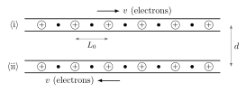

<a href="../relativity/">English</a><a class="on">한국어</a>

현대물리학2부 · 상대론

# 2부 — 특수상대론 { .part-title #part-ii-special-relativity }

전체 수업 필기 · <a class="pdf-link" href="notes.pdf" download="현대물리학-2부-상대론.pdf">이 부를 PDF로 내려받기</a>

**이 부에서는.** 로렌츠 변환은 허수 각을 가진 시공간의 회전이다. 여기서 동시성의 상대성과 인과율이 정하는 그 한계, 쌍둥이 역설, 그리고 크기의 제곱이 모든 좌표계에서 같은 4-벡터가 나온다. 충돌에서의 에너지–운동량 보존을 다룬 뒤, 맥스웰 방정식과 빛의 속력에서 출발해 속도의 합성, 벨의 우주선 역설, 기준틀에 따른 전기력과 자기력, 마지막으로 힘과 일정한 고유가속도 운동을 다룬다.

!!! quote "이 부에서 쓰는 규약."
    - $S$는 실험실 좌표계이다. 프라임 붙은 좌표계 $S'$는 $S$에 대해 $x$ 방향으로 속도 $v$로 움직인다. $\beta = v/c$.
    - $\gamma(v) = \gamma_v = \dfrac{1}{\sqrt{1 - v^2/c^2}}$.
    - $L_0$는 고유 길이(정지 상태에서 잰 길이)이다. $\lambda$는 선전하밀도이고 $\lambda_0$는 실험실에서의 값이다. $I = \lambda v$.
    - $\hat n$은 바깥 방향 단위법선, $d\tau$는 부피요소이다.

---

## 1 회전으로서의 로렌츠 변환 { #1-the-lorentz-transformation-as-a-rotation }

축을 $\theta$만큼 회전하면 $(x, y)$는

$$
\begin{pmatrix} x' \\ y' \end{pmatrix} = \begin{pmatrix} \cos\theta & \sin\theta \\ -\sin\theta & \cos\theta \end{pmatrix}\begin{pmatrix} x \\ y \end{pmatrix}
$$

로 바뀐다. 둘째 좌표를 허수 시간 $y \to ict$로 바꾸자. 속도 $v$로 움직이는 좌표계 $S'$의 $ct'$축은 $x = vt$를 따라 놓이며, 회전 그림에서는 $\tan\theta' = -x/(ict)$, 즉

$$
\theta' = \tan^{-1}\!\left(i\frac{v}{c}\right) = i\tanh^{-1}\beta \equiv i\phi
$$

이다.

!!! info "참고 — 쌍곡선 함수"
    $\cos\theta = \frac{e^{i\theta} + e^{-i\theta}}{2}$, $\sin\theta = \frac{e^{i\theta} - e^{-i\theta}}{2i}$에서

    $$
    \cos(i\phi) = \cosh\phi, \qquad \sin(i\phi) = i\sinh\phi, \qquad \cosh^2\phi - \sinh^2\phi = 1
    $$

    이고, $\tan^{-1}x = \frac{1}{2i}\ln\frac{1+ix}{1-ix}$, $\tanh^{-1}x = \frac12\ln\frac{1+x}{1-x}$이므로 $\tan^{-1}(ix) = i\tanh^{-1}x$이다.

$\beta = \tanh\phi$이면 $\cosh^2\phi = \dfrac{1}{1-\beta^2} = \gamma^2$이므로 $\cosh\phi = \gamma$, $\sinh\phi = \gamma\beta$이다. 회전은

$$
\begin{pmatrix} x' \\ ict' \end{pmatrix} = \begin{pmatrix} \cosh\phi & i\sinh\phi \\ -i\sinh\phi & \cosh\phi \end{pmatrix}\begin{pmatrix} x \\ ict \end{pmatrix}
= \begin{pmatrix} \gamma & i\gamma\beta \\ -i\gamma\beta & \gamma \end{pmatrix}\begin{pmatrix} x \\ ict \end{pmatrix}
$$

이 된다.

!!! abstract "로렌츠 변환"
    $$
    x' = \gamma(x - vt), \qquad t' = \gamma\left(t - \frac{v}{c^2}x\right).
    $$

매개변수 $\phi$를 **급속도(rapidity)**라 한다. 회전은 $x^2 + y^2$를 보존하고, $y = ict$이면 보존되는 양은 $x^2 - c^2t^2$이다.

---

## 2 인과율과 시공간 도표 { #2-causality-and-spacetime-diagrams }

$S$에서 한 사건(예: 신호를 보냄)이 $(x_1, t_1)$에서, 다른 사건이 $(x_2, t_2)$에서 일어났다고 하자. $S'$에서는

$$
\Delta t' = \frac{\Delta t - \frac{v}{c^2}\Delta x}{\sqrt{1 - v^2/c^2}} .
$$

$\Delta t < \frac{v}{c^2}\Delta x$, 즉 $\dfrac{c\Delta t}{\Delta x} < \dfrac{v}{c} < 1$이면 사건의 순서가 뒤바뀐다($\Delta t > 0$인데 $\Delta t' < 0$). 이를 위해서는 $c\Delta t < \Delta x$여야 한다.

- 두 사건이 인과관계로 연결되어 있으면(빛보다 빠르지 않은 신호가 한쪽에서 다른 쪽으로 갈 수 있으면) $c\Delta t \ge \Delta x$이고, 순서는 모든 좌표계에서 같다.
- 그렇지 않으면 $c\Delta t < \Delta x$일 수 있고, 좌표계에 따라 어느 쪽이 먼저인지가 달라질 수 있다.

시공간 도표($x$ 가로, $ct$ 세로)에서 직선 $x = \pm ct$는 **광원뿔**을 이룬다. 원점에 대해 광원뿔 안의 사건은 **시간꼴** 간격으로 인과관계가 있을 수 있고, 밖의 사건은 **공간꼴** 간격이다. $S'$의 축은 $ct'$축 $x = vt$와 $x'$축 $ct = \beta x$로, 빛의 선을 향해 대칭으로 기운다. $x'$축과 평행한 직선이 $S'$의 동시선이다.

!!! info "참고 — 동시성은 절대적이지 않다"
    $S'$의 동시선 위의 두 사건은 $S'$에서는 동시이지만 $S$에서는 아니다. 아래의 모든 역설은 결국 이것으로 귀결된다.

---

## 3 쌍둥이 역설 { #3-the-twin-paradox }

쌍둥이 한 명이 $v = 0.6c$로 $6$광년 떨어진 별까지 갔다가 돌아온다. $\gamma = 1/0.8 = 1.25$이다.

- **지구 좌표계 $S$.** 편도마다 $6/0.6 = 10$년 걸린다. 여행자는 사건 $(x, ct) = (6, 10)$에서 방향을 바꾸고 $ct = 20$에 돌아온다.
- **여행자.** 편도마다 거리가 $6 \times 0.8 = 4.8$광년으로 수축하고, $4.8/0.6 = 8$년 걸린다. 왕복은 $16$년이다.

여행자가 $4$년 더 젊다. 상황은 대칭이 아니다. 여행자는 반환점에서 관성계를 바꾼다.

**가는 좌표계 $S'$에서 본 모습.** $x' = \gamma(x - vt)$, $t' = \gamma(t - vx/c^2)$를 쓰면 반환점 $S(6, 10)$은 $S'(0, 8)$이다. 이 점을 지나는 동시선은 지구의 세계선과 $ct = 6.4$에서 만난다. 방향을 바꾸기 직전 여행자는 지구의 시계가 $6.4$년이라고 말한다. 방향을 바꾼 직후, 오는 좌표계에서 같은 사건을 지나는 동시선은 지구의 세계선과 $ct = 13.6$에서 만난다. 반환하는 동안 여행자가 생각하는 "지구의 지금"이 $7.2$년 건너뛰고, $6.4 + 7.2 + 6.4 = 20$이다.

---

## 4 4-벡터 { #4-four-vectors }

물리량은 **공변**(로렌츠 변환으로 바뀌는 것, $(ct, x)$처럼)이거나 **불변**(모든 좌표계에서 같은 것)이다. 불변량의 예: 고유시간 $\tau$, 고유 길이 $L_0$, 정지질량 $m$, 전하 $q$.

고유시간이 핵심 불변량이다. 두 시계 $A$, $B$가 각각 자기의 $\tau$를 재면 각 좌표계의 시간은 $t_A = \gamma_A\tau$, $t_B = \gamma_B\tau$이고, 모든 좌표계가 $\tau$에 동의한다.

!!! note "정의 4.1 (위치 4-벡터)"
    $\mathbb{X} = (ct, x, y, z) = (x_0, x_1, x_2, x_3)$이고, 불변인 크기의 제곱은

    $$
    |\mathbb{X}|^2 = x_0^2 - (x_1^2 + x_2^2 + x_3^2) .
    $$

!!! abstract "명제 4.2"
    두 사건에 대해 $|\Delta\mathbb X|^2 = (\Delta x_0)^2 - (\Delta x_1)^2$은 $S$와 $S'$에서 같다.

!!! success "증명"
    $$
    (\Delta x_0')^2 - (\Delta x_1')^2 = \gamma^2\big[(\Delta x_0 - \beta\Delta x_1)^2 - (\Delta x_1 - \beta\Delta x_0)^2\big]
    = \gamma^2\big[(\Delta x_0)^2(1 - \beta^2) - (\Delta x_1)^2(1 - \beta^2)\big] = (\Delta x_0)^2 - (\Delta x_1)^2 . \;\square
    $$

$\Delta\mathbb X$를 불변량 $\Delta\tau$로 나누면 새로운 4-벡터를 얻는다.

!!! note "정의 4.3 (4-속도, 4-운동량)"
    $$
    \mathbb V = \frac{d\mathbb X}{d\tau} = (\gamma c, \gamma\vec v), \quad |\mathbb V|^2 = \gamma^2c^2(1 - \beta^2) = c^2;
    \qquad
    \mathbb P = m\mathbb V = (\gamma mc, \gamma m\vec v) = \left(\frac{E}{c}, \vec p\right).
    $$

    (여기서 $\frac{dx_1}{d\tau} = \frac{dx_1}{dt}\frac{dt}{d\tau} = v\gamma$이다.)

$v \ll c$이면 $P_0 = mc(1 - v^2/c^2)^{-1/2} = mc + \frac12 mv^2/c + \cdots$이므로 $cP_0 = mc^2 + \frac12 mv^2 + \cdots = E$이다. 시간 성분은 정지 에너지 $mc^2$를 포함한 에너지를 $c$로 나눈 것이다.

!!! abstract "에너지–운동량 관계"
    $|\mathbb P|^2 = \dfrac{E^2}{c^2} - p^2 = m^2c^2$이므로

    $$
    E^2 = (pc)^2 + (mc^2)^2 .
    $$

빛은 $m = 0$, $v = c$라서 $\gamma m v$가 $0\cdot\infty$ 꼴이다. 그래서 광자의 4-운동량을 직접 $\mathbb K = (E/c, \vec p)$, $|\mathbb K|^2 = 0$, 즉 $E = pc$로 정의한다. $E = hf = \hbar\omega$, $p = h/\lambda = \hbar k$를 쓰면

$$
\mathbb K = \left(\frac{\hbar\omega}{c}, \hbar\vec k\right), \qquad \omega = ck .
$$

---

## 5 4-운동량을 이용한 충돌 { #5-collisions-with-four-momentum }

충돌에서 4-운동량은 보존되고 $|\mathbb P|^2$은 불변이다. 보존 법칙을 제곱하고, 불변량을 가장 편한 좌표계에서 계산하는 것이 핵심 기법이다.

!!! example "예제 5.1 (입자에 흡수되는 광자)"
    에너지 $\hbar\omega$인 광자가 정지한 질량 $m$인 입자에 부딪혀 흡수되고, 질량 $M$인 입자 하나가 남는다.

    $$
    \mathbb K + \mathbb P = \mathbb P_f, \qquad \mathbb K = \left(\tfrac{\hbar\omega}{c}, \hbar k\right),\ \mathbb P = (mc, 0).
    $$

    제곱하면 $|\mathbb K|^2 + |\mathbb P|^2 + 2\mathbb K\cdot\mathbb P = |\mathbb P_f|^2$이고, $|\mathbb K|^2 = 0$, $|\mathbb P|^2 = m^2c^2$, $|\mathbb P_f|^2 = M^2c^2$, $\mathbb K\cdot\mathbb P = \hbar\omega m$이므로

    $$
    2\hbar\omega m = (M^2 - m^2)c^2 .
    $$

!!! example "예제 5.2 (반양성자 생성 문턱)"
    양성자를 가속해 정지한 양성자에 충돌시켜 양성자 3개와 반양성자 1개를 만든다: $p + p \to p + p + p + \bar p$. 들어오는 양성자의 최소 에너지 $E$는?

    문턱에서는 생성물 네 개가 같은 속도로 움직이므로, 운동량 중심 좌표계에서 $\mathbb P_f' = (4mc, \vec 0)$, $|\mathbb P_f|^2 = 16m^2c^2$이다. $\mathbb P_1 = (E/c, \vec p)$, $\mathbb P_2 = (mc, \vec 0)$이면

    $$
    |\mathbb P_1 + \mathbb P_2|^2 = m^2c^2 + m^2c^2 + 2mE = 16m^2c^2 \;\Longrightarrow\; E = 7mc^2 .
    $$

    필요한 운동 에너지는 $6mc^2$로, 새로 생기는 입자 쌍의 정지 에너지의 세 배이다.

---

## 6 발산, 회전, 그리고 전하의 불변성 { #6-divergence-curl-and-the-invariance-of-charge }

### 발산 { #divergence }

$\vec F = P\hat x + Q\hat y$에 대해, 직사각형 $[a, b]\times[c, d]$의 경계를 나가는 선속은

$$
\oint_C \vec F\cdot\hat n\,ds = \int_c^d \big[P(b, y) - P(a, y)\big]dy + \int_a^b\big[Q(x, d) - Q(x, c)\big]dx
= \iint\left(\frac{\partial P}{\partial x} + \frac{\partial Q}{\partial y}\right)dx\,dy = \iint(\nabla\cdot\vec F)\,dA .
$$

따라서 $\nabla\cdot\vec F$는 단위넓이(3차원에서는 단위부피)당 나가는 양, 즉 **발산**이다.

### 회전 { #curl }

$(x_0, y_0)$ 주위의 $2\Delta x \times 2\Delta y$ 크기의 작은 직사각형을 도는 순환은

$$
\oint\vec F\cdot d\vec l = \int_{-\Delta y}^{\Delta y}\big[Q(x_0 + \Delta x, y) - Q(x_0 - \Delta x, y)\big]dy - \int_{-\Delta x}^{\Delta x}\big[P(x, y_0 + \Delta y) - P(x, y_0 - \Delta y)\big]dx
= \iint\left(\frac{\partial Q}{\partial x} - \frac{\partial P}{\partial y}\right)dx\,dy .
$$

각 좌표평면에서 같은 일을 하면

$$
\nabla\times\vec F = \hat x\left(\frac{\partial F_z}{\partial y} - \frac{\partial F_y}{\partial z}\right) + \hat y\left(\frac{\partial F_x}{\partial z} - \frac{\partial F_z}{\partial x}\right) + \hat z\left(\frac{\partial F_y}{\partial x} - \frac{\partial F_x}{\partial y}\right)
= \begin{vmatrix} \hat x & \hat y & \hat z \\ \partial_x & \partial_y & \partial_z \\ F_x & F_y & F_z \end{vmatrix}
$$

이고, 이것은 단위넓이당 순환, 즉 **회전**이다.

!!! example "예제 6.1"
    $\vec F = (2x + y^2)\hat x + (x - 3y)\hat y$이면 $\nabla\cdot\vec F = 2 - 3 = -1$, $(\nabla\times\vec F)_z = 1 - 2y$.

### 전하밀도는 불변이 아니다 { #charge-density-is-not-invariant }

전하는 불변이다: $q = q_0$. 정지 부피 $V_0 = L_0^3$, 정지 밀도 $\rho_0 = q_0/V_0$인 전하 상자를 $x$ 방향으로 움직이는 것으로 보는 좌표계에서는 $x$ 방향으로 수축하여 $V = V_0/\gamma$이다. 따라서

$$
\rho = \frac{q}{V} = \frac{q_0}{V_0/\gamma} = \gamma\rho_0 .
$$

전류가 흐르는 중성 도선이 다른 좌표계에서 중성이 아닌 이유가 이것이다. 양전하와 음전하가 서로 다른 속력으로 움직이므로 밀도가 서로 다른 인자로 바뀐다(§10).

---

## 7 맥스웰 방정식과 빛의 속력 { #7-maxwells-equations-and-the-speed-of-light }

### 자기선속 { #magnetic-flux }

어떤 면을 지나는 자기선속은

$$
\Phi_B = \int \vec B\cdot\hat n\, dA .
$$

### 회전의 발산은 0이다 { #the-divergence-of-a-curl-vanishes }

<figure markdown>
  { .tex-fig width="300" }
  <figcaption markdown="span">그림 7.1. 경계가 같은 두 곡면 $S_1$, $S_2$는 함께 하나의 부피를 둘러싼다.</figcaption>
</figure>

그림 7.1처럼 $S_1$과 $S_2$가 경계곡선을 공유한다고 하자. 둘이 이루는 닫힌곡면의 바깥 법선을 쓰면, 스토크스 정리에 의해

$$
\iint_{S_1} (\nabla\times\vec A)\cdot\hat n_1\, dA_1 = \oint_{\partial S_1}\vec A\cdot d\vec l, \qquad
\iint_{S_2} (\nabla\times\vec A)\cdot\hat n_2\, dA_2 = -\oint_{\partial S_1}\vec A\cdot d\vec l
$$

이다. $S_2$의 바깥 법선은 공통 경계에 반대 방향을 주기 때문이다. 두 식을 더하고 둘러싸인 부피 $V$에 발산 정리를 쓰면

$$
\oiint_{\partial V} (\nabla\times\vec A)\cdot\hat n\, dA = 0 = \iiint_V \nabla\cdot(\nabla\times\vec A)\, d\tau .
$$

이것이 모든 부피에서 성립하므로, 모든 벡터장 $\vec A$에 대해 $\nabla\cdot(\nabla\times\vec A) = 0$이다.

### 앙페르 법칙은 수정이 필요하다 { #amperes-law-needs-a-correction }

그러면 앙페르 법칙 $\nabla\times\vec B = \mu_0\vec J$는 $0 = \nabla\cdot(\mu_0\vec J)$를 강요한다. 그런데 전하 보존은 다르게 말한다. 닫힌곡면 밖으로 나가는 전류는 안의 전하가 줄어드는 비율과 같다.

$$
\iiint (\nabla\cdot\vec J)\, d\tau = \oiint_{\partial V}\vec J\cdot\hat n\, dA = I = -\frac{dq}{dt}
\quad\Longrightarrow\quad
\nabla\cdot\vec J = -\frac{\partial\rho}{\partial t} .
$$

가우스 법칙 $\rho = \varepsilon_0\nabla\cdot\vec E$를 쓰면, 실제로 0이 되는 것은

$$
0 = \nabla\cdot\left( \mu_0\vec J + \mu_0\varepsilon_0\frac{\partial\vec E}{\partial t} \right),
\qquad\text{왜냐하면}\qquad
\nabla\cdot(\nabla\times\vec B) = \mu_0\left( \nabla\cdot\vec J + \varepsilon_0\frac{\partial(\nabla\cdot\vec E)}{\partial t} \right) = 0 .
$$

!!! abstract "앙페르–맥스웰 법칙"
    $$
    \nabla\times\vec B = \mu_0\left( \vec J + \varepsilon_0\frac{\partial\vec E}{\partial t} \right).
    $$

### 전자기파 { #electromagnetic-waves }

회전을 한 번 더 취하면

$$
\nabla\times(\nabla\times\vec B) = \mu_0\left( \nabla\times\vec J + \varepsilon_0\frac{\partial(\nabla\times\vec E)}{\partial t} \right)
= \nabla(\nabla\cdot\vec B) - \nabla^2\vec B
$$

이고, 여기서 $(\nabla^2\vec B)_x = \dfrac{\partial^2 B_x}{\partial x^2} + \dfrac{\partial^2 B_x}{\partial y^2} + \dfrac{\partial^2 B_x}{\partial z^2}$이며 다른 성분도 마찬가지이다. 진공에서는 $\rho = 0$, $\vec J = 0$이다. $\nabla\cdot\vec B = 0$과 패러데이 법칙 $\nabla\times\vec E = -\partial\vec B/\partial t$를 쓰면

$$
-\nabla^2\vec B = \mu_0\varepsilon_0\frac{\partial}{\partial t}\left( -\frac{\partial\vec B}{\partial t} \right)
\quad\Longrightarrow\quad
\nabla^2\vec B = \mu_0\varepsilon_0\frac{\partial^2\vec B}{\partial t^2} .
$$

!!! abstract "파동 방정식"
    진공에서 자기장은 속력이

    $$
    c = \frac{1}{\sqrt{\mu_0\varepsilon_0}}
    $$

    인 파동 방정식을 따른다. $\nabla\times\vec E = -\partial\vec B/\partial t$에서 출발해도 $\vec E$에 대한 같은 방정식이 나온다.

!!! info "참고 — 무엇의 속력, 무엇에 대한 속력?"
    $\mu_0$과 $\varepsilon_0$는 자연 상수이므로, 맥스웰 방정식은 어떤 기준틀도 지정하지 않고 빛의 속력을 정한다. 맥스웰 방정식이 모든 관성계에서 성립한다면 $c$는 모든 관성계에서 같다. 이것이 특수상대론의 출발점이다.

---

## 8 속도의 합성과 로렌츠 인자 { #8-composition-of-velocities-and-the-lorentz-factor }

$S'$가 $S$에 대해 속도 $v$로 움직이고, 어떤 물체가 $S'$에 대해 (같은 직선 위에서) 속도 $u$로 움직인다고 하자. $S$에서 이 물체의 속도는

$$
w = \frac{v + u}{1 + \dfrac{vu}{c^2}} .
$$

!!! abstract "명제 8.1"
    $$
    \gamma(w) = \gamma(v)\,\gamma(u)\left( 1 + \frac{vu}{c^2} \right).
    $$

!!! success "증명"
    $$
    \frac{1}{\gamma(w)^2} = 1 - \frac{w^2}{c^2}
    = \frac{\left(1 + \frac{vu}{c^2}\right)^2 - \frac{(v+u)^2}{c^2}}{\left(1 + \frac{vu}{c^2}\right)^2}
    = \frac{1 - \frac{u^2}{c^2} - \frac{v^2}{c^2}\left(1 - \frac{u^2}{c^2}\right)}{\left(1 + \frac{vu}{c^2}\right)^2}
    = \frac{\left(1 - \frac{u^2}{c^2}\right)\left(1 - \frac{v^2}{c^2}\right)}{\left(1 + \frac{vu}{c^2}\right)^2} .
    $$

    분자에서 교차항 $\pm 2vu/c^2$는 상쇄되고, $1 + \frac{v^2u^2}{c^4} - \frac{u^2}{c^2} - \frac{v^2}{c^2}$는 인수분해된다. 따라서 $\dfrac{1}{\gamma(w)^2} = \dfrac{1}{\big(\gamma(v)\gamma(u)(1 + vu/c^2)\big)^2}$이다. $\square$

!!! example "예제 8.2 (크기가 같고 방향이 반대인 두 속도)"
    $S'$가 $S$에 대해 $-v$로 움직이고 물체가 $S'$에 대해 $-v$로 움직이면 $w = -\dfrac{2v}{1 + \beta^2}$이고 $\gamma(w) = \gamma_v^2(1 + \beta^2)$이다. 이 경우는 §10에서 쓰인다.

---

## 9 길이 수축과 벨의 우주선 역설 { #9-length-contraction-and-bells-spaceship-paradox }

막대(또는 실로 이어진 두 우주선)가 $S'$에서 고유 길이 $L_0$를 가진다. $S'$가 $v$로 움직이는 $S$에서 그 길이는 $L_0/\gamma(v)$이다.

이제 양 끝이 같은 방식으로 **$S'$에서 동시에 가속**하여, 각각 $S'$에 대해 속력 $u$로 움직이게 되었다고 하자. 두 끝은 같은 $S'$ 시각에 정확히 같은 일을 하므로, $S'$에서 잰 둘 사이 거리는 내내 $L_0$이다.

<figure markdown>
  { .tex-fig width="380" }
  <figcaption markdown="span">그림 9.1. $S'$에서 본 양 끝의 세계선. $x'$ 간격은 $L_0$로 유지되지만, 새 정지 좌표계 $S''$의 동시선을 따라 재면 $\gamma(u)L_0$이다.</figcaption>
</figure>

**양 끝의 새 정지 좌표계 $S''$에서**: $S'$는 간격을 $L_0$로 보고, $S'$는 $S''$에 대해 $u$로 움직이므로, $S''$에서의 간격은 $\gamma(u)$배 더 길어야 한다.

$$
S'' \text{ 에서의 간격} = \gamma(u)L_0 .
$$

**$S$에서는** 양 끝이 $w = \dfrac{v+u}{1 + vu/c^2}$로 움직이므로, 간격은 정지 상태의 값 $\gamma(u)L_0$에서 수축한다.

$$
S \text{ 에서의 간격} = \frac{\gamma(u)L_0}{\gamma(w)} .
$$

두 우주선 사이에 묶은 고유 길이 $L_0$의 실은 $S''$에서 $L_0$, $S$에서 $L_0/\gamma(w)$의 길이를 가질 것이다.

| 좌표계 | 양 끝 사이의 간격 | 본래 길이의 실 |
|---|---|---|
| $S'$ (가속 전) | $L_0$ | $L_0$ |
| $S''$ (가속 후) | $\gamma(u)L_0$ | $L_0$ |
| $S$ (가속 후) | $\gamma(u)L_0/\gamma(w)$ | $L_0/\gamma(w)$ |

모든 좌표계에서 양 끝은 결국 실의 본래 길이보다 같은 인자 $\gamma(u)$만큼 더 멀어지므로, 실은 늘어나서 끊어진다. 모든 좌표계가 이 점에 동의하며, 당연히 그래야 한다.

!!! info "참고 — 무엇이 수축하는가"
    길이 수축은 독립적으로 움직이는 물체들 사이의 틈에 일어나는 일이 아니다. 어떤 물체를 그 물체의 정지 좌표계에서 잰 값에 대한 진술이다. 두 끝을 "동시에" 가속한다는 것은 $S'$에서만 동시이고, 양 끝의 새 정지 좌표계에서는 앞쪽 끝이 먼저 출발한 것이 되므로 둘 사이 간격이 늘어난다.

---

## 10 관성계에 따른 전기력과 자기력 { #10-electric-and-magnetic-forces-in-different-frames }

### 설정 { #setting }

<figure markdown>
  { .tex-fig width="500" }
  <figcaption markdown="span">그림 10.1. 거리 $d$만큼 떨어진 중성인 두 도선. 양이온은 $S$에서 정지해 있고, 전자는 도선 ⟨i⟩에서는 $v$로, 도선 ⟨ii⟩에서는 $-v$로 움직인다.</figcaption>
</figure>

실험실 좌표계 $S$에서 각 도선은 중성이다. 선밀도 $+\lambda_0$인 양이온은 정지해 있고, $-\lambda_0$인 전자는 움직인다. 전하들이 속력 $u$로 움직이는 좌표계에서 잰 선밀도는 **고유** 밀도(그 전하들의 정지 좌표계에서의 밀도)의 $\gamma(u)$배이다. 길이가 $\gamma(u)$배 수축하기 때문이다. 전류는 $I = \lambda v$이다.

$S$에서 (고유 밀도는 전하 자신의 정지 좌표계에서 잰 값):

| 도선 | 전하 | $S$에서의 밀도 | $S$에서의 전류 | 고유 밀도 |
|---|---|---|---|---|
| ⟨i⟩ | $(+)$ | $+\lambda_0$ | $0$ | $+\lambda_0$ |
| | $(-)$ | $-\lambda_0$ | $-\lambda_0 v$ | $-\lambda_0/\gamma_v$ |
| ⟨ii⟩ | $(+)$ | $+\lambda_0$ | $0$ | $+\lambda_0$ |
| | $(-)$ | $-\lambda_0$ | $-\lambda_0(-v) = +\lambda_0 v$ | $-\lambda_0/\gamma_v$ |

따라서 $S$에서는 전기력이 없고, 반대 방향의 전류 $I_1 = -\lambda_0 v$, $I_2 = \lambda_0 v$ 사이의 자기력만 있다. 단위길이당 힘은

$$
f = \frac{F}{L} = I_2 B_1 = \frac{\mu_0 I_1 I_2}{2\pi d} ,
\qquad |f| = \frac{\mu_0\lambda_0^2 v^2}{2\pi d}\ \text{(척력)} .
$$

### 전자의 좌표계에서 본 같은 도선 { #the-same-wires-in-the-electrons-frame }

$S'$가 도선 ⟨i⟩의 전자와 함께 속도 $v$로 움직인다고 하자. 거기서는 두 도선의 이온이 모두 $-v$로 움직이고, ⟨i⟩의 전자는 정지해 있으며, ⟨ii⟩의 전자는

$$
w = \frac{-v - v}{1 + v^2/c^2} = -\frac{2v}{1 + \beta^2}, \qquad \gamma(w) = \gamma_v^2(1 + \beta^2)
$$

로 움직인다(명제 8.1). 각 밀도는 $\gamma(S' \text{에서의 속력})$에 고유 밀도를 곱한 것이다.

| 도선 | 전하 | $S'$에서의 밀도 | $S'$에서의 전류 |
|---|---|---|---|
| ⟨i⟩ | $(+)$ | $\gamma_v\lambda_0$ | $\gamma_v\lambda_0(-v)$ |
| | $(-)$ | $-\lambda_0/\gamma_v$ | $0$ |
| ⟨ii⟩ | $(+)$ | $\gamma_v\lambda_0$ | $\gamma_v\lambda_0(-v)$ |
| | $(-)$ | $-\dfrac{\lambda_0}{\gamma_v}\gamma(w) = -\lambda_0\gamma_v(1+\beta^2)$ | $-\lambda_0\gamma_v(1+\beta^2)\,w = 2\lambda_0\gamma_v v$ |

**전기력.** 도선은 더 이상 중성이 아니다.

$$
\lambda_1' = \gamma_v\lambda_0 - \frac{\lambda_0}{\gamma_v} = \beta^2\gamma_v\lambda_0, \qquad
\lambda_2' = \gamma_v\lambda_0 - \lambda_0\gamma_v(1+\beta^2) = -\beta^2\gamma_v\lambda_0 ,
$$

여기서 $\gamma_v - 1/\gamma_v = \gamma_v(1 - 1/\gamma_v^2) = \gamma_v\beta^2$을 썼다. 선전하의 전기장으로부터

$$
f_E = \frac{1}{2\pi\varepsilon_0}\frac{\lambda_1'\lambda_2'}{d} = -\frac{\beta^4\gamma_v^2\lambda_0^2}{2\pi\varepsilon_0 d}
\quad\text{(인력)} .
$$

$\beta^2 = v^2/c^2$와 $c^2 = 1/(\mu_0\varepsilon_0)$을 쓰면 그 크기는

$$
|f_E| = \frac{\beta^2\gamma_v^2\lambda_0^2}{2\pi\varepsilon_0 d}\cdot\frac{v^2}{c^2} = \frac{\mu_0\gamma_v^2\lambda_0^2 v^2}{2\pi d}\,\beta^2 .
$$

**자기력.** 알짜 전류는

$$
I_1' = -\gamma_v\lambda_0 v, \qquad I_2' = -\gamma_v\lambda_0 v + 2\lambda_0\gamma_v v = \gamma_v\lambda_0 v
$$

로 방향이 반대이므로 힘은 척력이다.

$$
|f_B| = \frac{\mu_0\gamma_v^2\lambda_0^2 v^2}{2\pi d}\quad\text{(척력)} .
$$

**알짜힘.**

$$
S':\quad \sum f = \frac{\mu_0\gamma_v^2\lambda_0^2 v^2}{2\pi d}\,(1 - \beta^2) = \frac{\mu_0\lambda_0^2 v^2}{2\pi d}, \qquad
S:\quad \sum f = \frac{\mu_0 |I_1 I_2|}{2\pi d} = \frac{\mu_0\lambda_0^2 v^2}{2\pi d} ,
$$

$1 - \beta^2 = 1/\gamma_v^2$이기 때문이다. 둘 다 척력이고, 크기가 같다.

!!! abstract "결론"
    관성계를 바꾸면 원래 없던 전기장이나 자기장이 생길 수 있다. $S$에서는 힘이 순전히 자기력이고, $S'$에서는 일부가 전기력이다. **그러나 알짜힘은 변하지 않는다.** 전기장과 자기장은 하나의 전자기장이 기준틀에 따라 나뉜 부분이며, 자기는 정전기학에 길이 수축을 더한 상대론적 결과로 볼 수 있다.

---

## 11 상대론적 힘과 쌍곡선 운동 { #11-relativistic-force-and-hyperbolic-motion }

### 3-힘 { #the-three-force }

$$
F_1 = \frac{dp_1}{dt} = \frac{d(\gamma mv)}{dt} = m\frac{d(\gamma v)}{dv}\frac{dv}{dt} .
$$

$\dfrac{d\gamma}{dv} = \dfrac{d}{dv}\left(1 - \dfrac{v^2}{c^2}\right)^{-1/2} = \gamma^3\dfrac{v}{c^2}$이므로

$$
F_1 = m\left(\gamma^3\frac{v^2}{c^2} + \gamma\right)\frac{dv}{dt} = m\gamma(\gamma^2\beta^2 + 1)\frac{dv}{dt} = m\gamma^3\frac{dv}{dt}
$$

이고, 여기서 $\gamma^2\beta^2 + 1 = \gamma^2$을 썼다.

!!! abstract "명제 11.1"
    운동 방향의 힘 성분은 $S$와 순간 정지 좌표계 $S'$에서 같다: $F_1 = F_1'$.

!!! success "증명"
    $\mathbb P = (E/c, p_1, p_2, p_3)$이면 $p_1 = \gamma_v(p_1' + \beta E'/c)$이고 ($S'$에서 순간적으로 정지한 입자에 대해) $dt = \gamma_v\,dt'$이다. 그러면

    $$
    F_1 = \frac{dp_1}{dt} = \frac{\gamma_v\,d(p_1' + \beta E'/c)}{\gamma_v\,dt'} = \frac{dp_1'}{dt'} + \frac{\beta}{c}\frac{dE'}{dt'} = F_1'
    $$

    인데, 정지 좌표계에서는 입자의 에너지가 일차적으로 변하지 않기 때문이다($dE'/dt' = F'\cdot v' = 0$). $\square$

### 일정한 고유가속도 { #constant-proper-acceleration }

입자가 일정한 **고유가속도** $a_0$를 가진다고 하자. 매 순간의 순간 정지 좌표계에서 가속도가 $a_0$이다. 그러면 $F_1' = ma_0$이고, 명제 11.1에 의해

$$
m\gamma^3\frac{dv}{dt} = ma_0, \qquad \frac{dv}{dt} = \frac{a_0}{\gamma^3} .
$$

같은 말로 $\dfrac{d(\gamma v)}{dt} = a_0$이므로, $t = 0$에서 $v = 0$이면 $\gamma v = a_0t$이다. 풀면

$$
\frac{v^2}{1 - v^2/c^2} = a_0^2t^2 \;\Longrightarrow\; v = \frac{a_0t}{\sqrt{1 + a_0^2t^2/c^2}} < c .
$$

한 번 더 적분하면

$$
x = \frac{c^2}{a_0}\left(1 + \frac{a_0^2t^2}{c^2}\right)^{1/2} + C .
$$

!!! abstract "쌍곡선 운동"
    $X = c^2/a_0$라 하면

    $$
    (x - C)^2 - c^2t^2 = X^2
    $$

    이고, 이것은 $(x, ct)$ 평면에서 중심이 $(C, 0)$이고 점근선이 $x - C = \pm ct$인 쌍곡선이다.

미분하면 $2(x - C)\dfrac{dx}{dt} - 2c^2t = 0$이므로 $\beta = \dfrac{1}{c}\dfrac{dx}{dt} = \dfrac{ct}{x - C} < 1$이다. 입자는 빛의 속력에 다가가지만 결코 도달하지 못한다.

$a_0^2t^2/c^2 \ll 1$이면 $x \approx X\left(1 + \dfrac{a_0^2t^2}{2c^2}\right) + C = X + C + \frac12 a_0t^2$으로, 뉴턴 역학의 결과가 된다.
