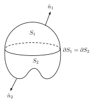
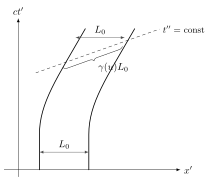
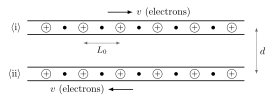

<a class="on">English</a><a href="../relativity-ko/">한국어</a>

Modern PhysicsPart II · Relativity

# Part II — Special Relativity { .part-title }

Complete lecture notes · <a class="pdf-link" href="notes.pdf" download="Modern-Physics-Part-II-Relativity.pdf">Download this part as PDF</a>

**In this part.** The Lorentz transformation is a rotation in spacetime with an imaginary angle. From it follow the relativity of simultaneity and its limits set by causality, the twin paradox, and the four-vectors whose squares are the same in every frame; energy–momentum conservation in collisions; and, starting from Maxwell's equations and the speed of light, the composition of velocities, Bell's spaceship paradox, the frame-dependence of electric and magnetic forces, and finally force and constant proper acceleration.

!!! quote "Conventions used in this part."
    - $S$ is the lab frame. A primed frame $S'$ moves relative to $S$ with velocity $v$ along $x$; $\beta = v/c$.
    - $\gamma(v) = \gamma_v = \dfrac{1}{\sqrt{1 - v^2/c^2}}$.
    - $L_0$ is a proper length (measured at rest); $\lambda$ is a line charge density and $\lambda_0$ its value in the lab; $I = \lambda v$.
    - $\hat n$ is an outward unit normal, $d\tau$ a volume element.

---

## 1 The Lorentz Transformation as a Rotation

A rotation of the axes by $\theta$ takes $(x, y)$ to

$$
\begin{pmatrix} x' \\ y' \end{pmatrix} = \begin{pmatrix} \cos\theta & \sin\theta \\ -\sin\theta & \cos\theta \end{pmatrix}\begin{pmatrix} x \\ y \end{pmatrix}.
$$

Replace the second coordinate by an imaginary time, $y \to ict$. A frame $S'$ moving with velocity $v$ has its $ct'$-axis along $x = vt$, which in the rotated picture means $\tan\theta' = -x/(ict)$, i.e.

$$
\theta' = \tan^{-1}\!\left(i\frac{v}{c}\right) = i\tanh^{-1}\beta \equiv i\phi .
$$

!!! info "Remark — hyperbolic functions"
    From $\cos\theta = \frac{e^{i\theta} + e^{-i\theta}}{2}$ and $\sin\theta = \frac{e^{i\theta} - e^{-i\theta}}{2i}$:

    $$
    \cos(i\phi) = \cosh\phi, \qquad \sin(i\phi) = i\sinh\phi, \qquad \cosh^2\phi - \sinh^2\phi = 1 ,
    $$

    and $\tan^{-1}x = \frac{1}{2i}\ln\frac{1+ix}{1-ix}$, $\tanh^{-1}x = \frac12\ln\frac{1+x}{1-x}$, so $\tan^{-1}(ix) = i\tanh^{-1}x$.

With $\beta = \tanh\phi$: $\cosh^2\phi = \dfrac{1}{1-\beta^2} = \gamma^2$, so $\cosh\phi = \gamma$ and $\sinh\phi = \gamma\beta$. The rotation becomes

$$
\begin{pmatrix} x' \\ ict' \end{pmatrix} = \begin{pmatrix} \cosh\phi & i\sinh\phi \\ -i\sinh\phi & \cosh\phi \end{pmatrix}\begin{pmatrix} x \\ ict \end{pmatrix}
= \begin{pmatrix} \gamma & i\gamma\beta \\ -i\gamma\beta & \gamma \end{pmatrix}\begin{pmatrix} x \\ ict \end{pmatrix}.
$$

!!! abstract "Lorentz transformation"
    $$
    x' = \gamma(x - vt), \qquad t' = \gamma\left(t - \frac{v}{c^2}x\right).
    $$

The parameter $\phi$ is called the **rapidity**. Rotations preserve $x^2 + y^2$; with $y = ict$ the preserved quantity is $x^2 - c^2t^2$.

---

## 2 Causality and Spacetime Diagrams

Let an event (say, the emission of a signal) happen at $(x_1, t_1)$ and another at $(x_2, t_2)$ in $S$. In $S'$,

$$
\Delta t' = \frac{\Delta t - \frac{v}{c^2}\Delta x}{\sqrt{1 - v^2/c^2}} .
$$

The order of the events reverses ($\Delta t' < 0$ with $\Delta t > 0$) when $\Delta t < \frac{v}{c^2}\Delta x$, i.e. $\dfrac{c\Delta t}{\Delta x} < \dfrac{v}{c} < 1$. This needs $c\Delta t < \Delta x$.

- If the events are causally connected (a signal no faster than light can go from one to the other), then $c\Delta t \ge \Delta x$ and the order is the same in every frame.
- If not, $c\Delta t < \Delta x$ is possible, and different frames may disagree about which came first.

On a spacetime diagram ($x$ horizontal, $ct$ vertical), the lines $x = \pm ct$ form the **light cone**. Events inside it, relative to the origin, are **timelike** separated and can be causally connected; events outside are **spacelike** separated. The axes of $S'$ are the $ct'$-axis $x = vt$ and the $x'$-axis $ct = \beta x$, tilted symmetrically toward the light line. Lines parallel to the $x'$-axis are lines of simultaneity in $S'$.

!!! info "Remark — simultaneity is not absolute"
    Two events on a line of simultaneity of $S'$ are simultaneous in $S'$ but not in $S$. Every paradox below comes down to this.

---

## 3 The Twin Paradox

A twin travels at $v = 0.6c$ to a star $6$ light-years away and returns; $\gamma = 1/0.8 = 1.25$.

- **Earth frame $S$.** Each leg takes $6/0.6 = 10$ years: the traveller turns around at the event $(x, ct) = (6, 10)$ and returns at $ct = 20$.
- **Traveller.** On each leg the distance is contracted to $6 \times 0.8 = 4.8$ light-years, which takes $4.8/0.6 = 8$ years. The round trip takes $16$ years.

The traveller is younger by $4$ years. The situation is not symmetric: the traveller changes inertial frame at the turnaround.

**The view from the outbound frame $S'$.** Using $x' = \gamma(x - vt)$, $t' = \gamma(t - vx/c^2)$, the turnaround $S(6, 10)$ is $S'(0, 8)$. The line of simultaneity through it hits the Earth's worldline at $ct = 6.4$: just before turning, the traveller says Earth's clock reads $6.4$ years. Just after turning, in the inbound frame, the line of simultaneity through the same event hits Earth's worldline at $ct = 13.6$. The traveller's notion of "Earth's now" jumps by $7.2$ years during the turnaround, and $6.4 + 7.2 + 6.4 = 20$.

---

## 4 Four-Vectors

Quantities are either **covariant** (they transform by the Lorentz transformation, like $(ct, x)$) or **invariant** (the same in every frame): the proper time $\tau$, the proper length $L_0$, the rest mass $m$, the charge $q$.

Proper time is the key invariant: two clocks $A$ and $B$ that each measure their own $\tau$ give each frame's time as $t_A = \gamma_A\tau$, $t_B = \gamma_B\tau$, and every frame agrees on $\tau$.

!!! note "Definition 4.1 (Position four-vector)"
    $\mathbb{X} = (ct, x, y, z) = (x_0, x_1, x_2, x_3)$, with the invariant square

    $$
    |\mathbb{X}|^2 = x_0^2 - (x_1^2 + x_2^2 + x_3^2) .
    $$

!!! abstract "Proposition 4.2"
    For two events, $|\Delta\mathbb X|^2 = (\Delta x_0)^2 - (\Delta x_1)^2$ is the same in $S$ and $S'$.

!!! success "Proof"
    $$
    (\Delta x_0')^2 - (\Delta x_1')^2 = \gamma^2\big[(\Delta x_0 - \beta\Delta x_1)^2 - (\Delta x_1 - \beta\Delta x_0)^2\big]
    = \gamma^2\big[(\Delta x_0)^2(1 - \beta^2) - (\Delta x_1)^2(1 - \beta^2)\big] = (\Delta x_0)^2 - (\Delta x_1)^2 . \;\square
    $$

Dividing $\Delta\mathbb X$ by the invariant $\Delta\tau$ gives new four-vectors.

!!! note "Definition 4.3 (Four-velocity, four-momentum)"
    $$
    \mathbb V = \frac{d\mathbb X}{d\tau} = (\gamma c, \gamma\vec v), \quad |\mathbb V|^2 = \gamma^2c^2(1 - \beta^2) = c^2;
    \qquad
    \mathbb P = m\mathbb V = (\gamma mc, \gamma m\vec v) = \left(\frac{E}{c}, \vec p\right).
    $$

    (Here $\frac{dx_1}{d\tau} = \frac{dx_1}{dt}\frac{dt}{d\tau} = v\gamma$.)

For $v \ll c$, $P_0 = mc(1 - v^2/c^2)^{-1/2} = mc + \frac12 mv^2/c + \cdots$, so $cP_0 = mc^2 + \frac12 mv^2 + \cdots = E$: the time component is the energy over $c$, including the rest energy $mc^2$.

!!! abstract "Energy–momentum relation"
    $|\mathbb P|^2 = \dfrac{E^2}{c^2} - p^2 = m^2c^2$, so

    $$
    E^2 = (pc)^2 + (mc^2)^2 .
    $$

For light, $m = 0$, $v = c$: $\gamma m v$ is $0\cdot\infty$, so we define the photon's four-momentum directly as $\mathbb K = (E/c, \vec p)$ with $|\mathbb K|^2 = 0$, i.e. $E = pc$. With $E = hf = \hbar\omega$ and $p = h/\lambda = \hbar k$,

$$
\mathbb K = \left(\frac{\hbar\omega}{c}, \hbar\vec k\right), \qquad \omega = ck .
$$

---

## 5 Collisions with Four-Momentum

Four-momentum is conserved in collisions, and $|\mathbb P|^2$ is invariant. Squaring a conservation law and evaluating the invariant in the most convenient frame is the main technique.

!!! example "Example 5.1 (A photon absorbed by a particle)"
    A photon of energy $\hbar\omega$ hits a particle of mass $m$ at rest and is absorbed, leaving one particle of mass $M$:

    $$
    \mathbb K + \mathbb P = \mathbb P_f, \qquad \mathbb K = \left(\tfrac{\hbar\omega}{c}, \hbar k\right),\ \mathbb P = (mc, 0).
    $$

    Squaring, $|\mathbb K|^2 + |\mathbb P|^2 + 2\mathbb K\cdot\mathbb P = |\mathbb P_f|^2$, with $|\mathbb K|^2 = 0$, $|\mathbb P|^2 = m^2c^2$, $|\mathbb P_f|^2 = M^2c^2$, $\mathbb K\cdot\mathbb P = \hbar\omega m$:

    $$
    2\hbar\omega m = (M^2 - m^2)c^2 .
    $$

!!! example "Example 5.2 (Antiproton production threshold)"
    A proton is accelerated onto a proton at rest, producing three protons and one antiproton: $p + p \to p + p + p + \bar p$. What is the minimum energy $E$ of the incoming proton?

    At threshold the four products move together, so in their centre-of-momentum frame $\mathbb P_f' = (4mc, \vec 0)$ and $|\mathbb P_f|^2 = 16m^2c^2$. With $\mathbb P_1 = (E/c, \vec p)$, $\mathbb P_2 = (mc, \vec 0)$:

    $$
    |\mathbb P_1 + \mathbb P_2|^2 = m^2c^2 + m^2c^2 + 2mE = 16m^2c^2 \;\Longrightarrow\; E = 7mc^2 .
    $$

    The kinetic energy needed is $6mc^2$, three times the rest energy of the pair that is created.

---

## 6 Divergence, Curl and the Invariance of Charge

### Divergence

For $\vec F = P\hat x + Q\hat y$, the outward flux through the boundary of a rectangle $[a, b]\times[c, d]$ is

$$
\oint_C \vec F\cdot\hat n\,ds = \int_c^d \big[P(b, y) - P(a, y)\big]dy + \int_a^b\big[Q(x, d) - Q(x, c)\big]dx
= \iint\left(\frac{\partial P}{\partial x} + \frac{\partial Q}{\partial y}\right)dx\,dy = \iint(\nabla\cdot\vec F)\,dA .
$$

So $\nabla\cdot\vec F$ is the outflow per unit area (per unit volume in three dimensions): the **divergence**.

### Curl

For the circulation around a small rectangle of size $2\Delta x \times 2\Delta y$ about $(x_0, y_0)$,

$$
\oint\vec F\cdot d\vec l = \int_{-\Delta y}^{\Delta y}\big[Q(x_0 + \Delta x, y) - Q(x_0 - \Delta x, y)\big]dy - \int_{-\Delta x}^{\Delta x}\big[P(x, y_0 + \Delta y) - P(x, y_0 - \Delta y)\big]dx
= \iint\left(\frac{\partial Q}{\partial x} - \frac{\partial P}{\partial y}\right)dx\,dy .
$$

Doing the same in each coordinate plane,

$$
\nabla\times\vec F = \hat x\left(\frac{\partial F_z}{\partial y} - \frac{\partial F_y}{\partial z}\right) + \hat y\left(\frac{\partial F_x}{\partial z} - \frac{\partial F_z}{\partial x}\right) + \hat z\left(\frac{\partial F_y}{\partial x} - \frac{\partial F_x}{\partial y}\right)
= \begin{vmatrix} \hat x & \hat y & \hat z \\ \partial_x & \partial_y & \partial_z \\ F_x & F_y & F_z \end{vmatrix},
$$

the circulation per unit area: the **curl**.

!!! example "Example 6.1"
    For $\vec F = (2x + y^2)\hat x + (x - 3y)\hat y$, $\nabla\cdot\vec F = 2 - 3 = -1$ and $(\nabla\times\vec F)_z = 1 - 2y$.

### Charge density is not invariant

Charge is invariant: $q = q_0$. A box of charge with rest volume $V_0 = L_0^3$ and rest density $\rho_0 = q_0/V_0$, seen from a frame where it moves along $x$, is contracted along $x$: $V = V_0/\gamma$. Hence

$$
\rho = \frac{q}{V} = \frac{q_0}{V_0/\gamma} = \gamma\rho_0 .
$$

This is why a neutral current-carrying wire is no longer neutral in another frame: positive and negative charges move at different speeds, so their densities change by different factors (§10).

---

## 7 Maxwell's Equations and the Speed of Light

### Magnetic flux

The magnetic flux through a surface is

$$
\Phi_B = \int \vec B\cdot\hat n\, dA .
$$

### The divergence of a curl vanishes

<figure markdown>
  { .tex-fig width="300" }
  <figcaption markdown="span">Figure 7.1. Two surfaces $S_1$, $S_2$ with the same boundary together enclose a volume.</figcaption>
</figure>

Let $S_1$ and $S_2$ share their boundary curve, as in Figure 7.1. By Stokes' theorem, with the outward normals of the closed surface they form,

$$
\iint_{S_1} (\nabla\times\vec A)\cdot\hat n_1\, dA_1 = \oint_{\partial S_1}\vec A\cdot d\vec l, \qquad
\iint_{S_2} (\nabla\times\vec A)\cdot\hat n_2\, dA_2 = -\oint_{\partial S_1}\vec A\cdot d\vec l ,
$$

since the outward normal of $S_2$ induces the opposite orientation on the common boundary. Adding, and using the divergence theorem on the enclosed volume $V$,

$$
\oiint_{\partial V} (\nabla\times\vec A)\cdot\hat n\, dA = 0 = \iiint_V \nabla\cdot(\nabla\times\vec A)\, d\tau .
$$

This holds for every volume, so $\nabla\cdot(\nabla\times\vec A) = 0$ for every vector field $\vec A$.

### Ampère's law needs a correction

Ampère's law $\nabla\times\vec B = \mu_0\vec J$ would then force $0 = \nabla\cdot(\mu_0\vec J)$. But charge conservation says otherwise: the current out of a closed surface equals the rate at which the charge inside decreases,

$$
\iiint (\nabla\cdot\vec J)\, d\tau = \oiint_{\partial V}\vec J\cdot\hat n\, dA = I = -\frac{dq}{dt}
\quad\Longrightarrow\quad
\nabla\cdot\vec J = -\frac{\partial\rho}{\partial t} .
$$

With Gauss's law $\rho = \varepsilon_0\nabla\cdot\vec E$, what does vanish is

$$
0 = \nabla\cdot\left( \mu_0\vec J + \mu_0\varepsilon_0\frac{\partial\vec E}{\partial t} \right),
\qquad\text{since}\qquad
\nabla\cdot(\nabla\times\vec B) = \mu_0\left( \nabla\cdot\vec J + \varepsilon_0\frac{\partial(\nabla\cdot\vec E)}{\partial t} \right) = 0 .
$$

!!! abstract "Ampère–Maxwell law"
    $$
    \nabla\times\vec B = \mu_0\left( \vec J + \varepsilon_0\frac{\partial\vec E}{\partial t} \right).
    $$

### Electromagnetic waves

Take the curl once more:

$$
\nabla\times(\nabla\times\vec B) = \mu_0\left( \nabla\times\vec J + \varepsilon_0\frac{\partial(\nabla\times\vec E)}{\partial t} \right)
= \nabla(\nabla\cdot\vec B) - \nabla^2\vec B ,
$$

where $(\nabla^2\vec B)_x = \dfrac{\partial^2 B_x}{\partial x^2} + \dfrac{\partial^2 B_x}{\partial y^2} + \dfrac{\partial^2 B_x}{\partial z^2}$, and similarly for the other components. In vacuum, $\rho = 0$ and $\vec J = 0$; with $\nabla\cdot\vec B = 0$ and Faraday's law $\nabla\times\vec E = -\partial\vec B/\partial t$,

$$
-\nabla^2\vec B = \mu_0\varepsilon_0\frac{\partial}{\partial t}\left( -\frac{\partial\vec B}{\partial t} \right)
\quad\Longrightarrow\quad
\nabla^2\vec B = \mu_0\varepsilon_0\frac{\partial^2\vec B}{\partial t^2} .
$$

!!! abstract "Wave equation"
    The magnetic field in vacuum obeys a wave equation with speed

    $$
    c = \frac{1}{\sqrt{\mu_0\varepsilon_0}} .
    $$

    Starting from $\nabla\times\vec E = -\partial\vec B/\partial t$ instead gives the same equation for $\vec E$.

!!! info "Remark — the speed of what, relative to what?"
    $\mu_0$ and $\varepsilon_0$ are constants of nature, so Maxwell's equations fix the speed of light without naming any frame. If they hold in every inertial frame, $c$ is the same in every inertial frame. This is the starting point of special relativity.

---

## 8 Composition of Velocities and the Lorentz Factor

Let $S'$ move with velocity $v$ relative to $S$, and let an object move with velocity $u$ relative to $S'$ (along the same line). Its velocity in $S$ is

$$
w = \frac{v + u}{1 + \dfrac{vu}{c^2}} .
$$

!!! abstract "Proposition 8.1"
    $$
    \gamma(w) = \gamma(v)\,\gamma(u)\left( 1 + \frac{vu}{c^2} \right).
    $$

!!! success "Proof"
    $$
    \frac{1}{\gamma(w)^2} = 1 - \frac{w^2}{c^2}
    = \frac{\left(1 + \frac{vu}{c^2}\right)^2 - \frac{(v+u)^2}{c^2}}{\left(1 + \frac{vu}{c^2}\right)^2}
    = \frac{1 - \frac{u^2}{c^2} - \frac{v^2}{c^2}\left(1 - \frac{u^2}{c^2}\right)}{\left(1 + \frac{vu}{c^2}\right)^2}
    = \frac{\left(1 - \frac{u^2}{c^2}\right)\left(1 - \frac{v^2}{c^2}\right)}{\left(1 + \frac{vu}{c^2}\right)^2} .
    $$

    In the numerator the cross terms $\pm 2vu/c^2$ cancel, and $1 + \frac{v^2u^2}{c^4} - \frac{u^2}{c^2} - \frac{v^2}{c^2}$ factors. So $\dfrac{1}{\gamma(w)^2} = \dfrac{1}{\big(\gamma(v)\gamma(u)(1 + vu/c^2)\big)^2}$. $\square$

!!! example "Example 8.2 (Two equal speeds in opposite directions)"
    If $S'$ moves at $-v$ relative to $S$ and the object moves at $-v$ relative to $S'$, then $w = -\dfrac{2v}{1 + \beta^2}$ and $\gamma(w) = \gamma_v^2(1 + \beta^2)$. This case is used in §10.

---

## 9 Length Contraction and Bell's Spaceship Paradox

A rod (or two spaceships joined by a thread) has proper length $L_0$ in $S'$; in $S$, where $S'$ moves at $v$, its length is $L_0/\gamma(v)$.

Now let both ends **accelerate simultaneously in $S'$** with identical programmes, until each moves with speed $u$ relative to $S'$. Because the two ends do exactly the same thing at the same $S'$-times, their separation measured in $S'$ stays $L_0$ throughout.

<figure markdown>
  { .tex-fig width="380" }
  <figcaption markdown="span">Figure 9.1. Worldlines of the two ends in $S'$. Their $x'$-separation stays $L_0$, but along a line of simultaneity of the new rest frame $S''$ it is $\gamma(u)L_0$.</figcaption>
</figure>

**In the new rest frame $S''$** of the ends: $S'$ sees the separation as $L_0$, and $S'$ moves at $u$ relative to $S''$, so the separation in $S''$ must be longer by the factor $\gamma(u)$:

$$
\text{separation in } S'' = \gamma(u)L_0 .
$$

**In $S$**, the ends move with $w = \dfrac{v+u}{1 + vu/c^2}$, so the separation is contracted from its rest value $\gamma(u)L_0$:

$$
\text{separation in } S = \frac{\gamma(u)L_0}{\gamma(w)} .
$$

A thread tied between the ships, with proper length $L_0$, would have length $L_0$ in $S''$ and $L_0/\gamma(w)$ in $S$:

| frame | separation of the ends | thread at its natural length |
|---|---|---|
| $S'$ (before) | $L_0$ | $L_0$ |
| $S''$ (after) | $\gamma(u)L_0$ | $L_0$ |
| $S$ (after) | $\gamma(u)L_0/\gamma(w)$ | $L_0/\gamma(w)$ |

In every frame the ends end up farther apart than the thread's natural length, by the same factor $\gamma(u)$, so the thread is stretched and breaks. All frames agree on this, as they must.

!!! info "Remark — what contracts"
    Length contraction is not something that happens to a gap between independently moving objects; it is a statement about measurements of a body in its own rest frame. Accelerating two ends "simultaneously" is simultaneous only in $S'$, and in the ends' new rest frame the front end started earlier, which is why their separation grows.

---

## 10 Electric and Magnetic Forces in Different Frames

### Setting

<figure markdown>
  { .tex-fig width="500" }
  <figcaption markdown="span">Figure 10.1. Two neutral wires a distance $d$ apart. The positive ions are at rest in $S$; the electrons move with $v$ in wire ⟨i⟩ and with $-v$ in wire ⟨ii⟩.</figcaption>
</figure>

In the lab frame $S$ each wire is neutral: positive ions with line density $+\lambda_0$ at rest, and electrons with $-\lambda_0$, moving. A line density measured in a frame where the charges move with speed $u$ is $\gamma(u)$ times the **proper** density (the density in their own rest frame), since lengths contract by $\gamma(u)$. The current is $I = \lambda v$.

In $S$ (proper densities measured in the charges' own rest frames):

| wire | carriers | density in $S$ | current in $S$ | proper density |
|---|---|---|---|---|
| ⟨i⟩ | $(+)$ | $+\lambda_0$ | $0$ | $+\lambda_0$ |
| | $(-)$ | $-\lambda_0$ | $-\lambda_0 v$ | $-\lambda_0/\gamma_v$ |
| ⟨ii⟩ | $(+)$ | $+\lambda_0$ | $0$ | $+\lambda_0$ |
| | $(-)$ | $-\lambda_0$ | $-\lambda_0(-v) = +\lambda_0 v$ | $-\lambda_0/\gamma_v$ |

So in $S$ there is no electric force: only the magnetic force between opposite currents $I_1 = -\lambda_0 v$, $I_2 = \lambda_0 v$. The force per unit length is

$$
f = \frac{F}{L} = I_2 B_1 = \frac{\mu_0 I_1 I_2}{2\pi d} ,
\qquad |f| = \frac{\mu_0\lambda_0^2 v^2}{2\pi d}\ \text{(repulsive)} .
$$

### The same wires in the electrons' frame

Let $S'$ move with the electrons of wire ⟨i⟩, at velocity $v$. There the ions of both wires move with $-v$; the electrons of ⟨i⟩ are at rest; the electrons of ⟨ii⟩ move with

$$
w = \frac{-v - v}{1 + v^2/c^2} = -\frac{2v}{1 + \beta^2}, \qquad \gamma(w) = \gamma_v^2(1 + \beta^2)
$$

(Proposition 8.1). Each density is $\gamma(\text{speed in } S')$ times its proper density:

| wire | carriers | density in $S'$ | current in $S'$ |
|---|---|---|---|
| ⟨i⟩ | $(+)$ | $\gamma_v\lambda_0$ | $\gamma_v\lambda_0(-v)$ |
| | $(-)$ | $-\lambda_0/\gamma_v$ | $0$ |
| ⟨ii⟩ | $(+)$ | $\gamma_v\lambda_0$ | $\gamma_v\lambda_0(-v)$ |
| | $(-)$ | $-\dfrac{\lambda_0}{\gamma_v}\gamma(w) = -\lambda_0\gamma_v(1+\beta^2)$ | $-\lambda_0\gamma_v(1+\beta^2)\,w = 2\lambda_0\gamma_v v$ |

**Electric force.** The wires are no longer neutral:

$$
\lambda_1' = \gamma_v\lambda_0 - \frac{\lambda_0}{\gamma_v} = \beta^2\gamma_v\lambda_0, \qquad
\lambda_2' = \gamma_v\lambda_0 - \lambda_0\gamma_v(1+\beta^2) = -\beta^2\gamma_v\lambda_0 ,
$$

using $\gamma_v - 1/\gamma_v = \gamma_v(1 - 1/\gamma_v^2) = \gamma_v\beta^2$. The field of a line charge gives

$$
f_E = \frac{1}{2\pi\varepsilon_0}\frac{\lambda_1'\lambda_2'}{d} = -\frac{\beta^4\gamma_v^2\lambda_0^2}{2\pi\varepsilon_0 d}
\quad\text{(attractive)} .
$$

With $\beta^2 = v^2/c^2$ and $c^2 = 1/(\mu_0\varepsilon_0)$, its size is

$$
|f_E| = \frac{\beta^2\gamma_v^2\lambda_0^2}{2\pi\varepsilon_0 d}\cdot\frac{v^2}{c^2} = \frac{\mu_0\gamma_v^2\lambda_0^2 v^2}{2\pi d}\,\beta^2 .
$$

**Magnetic force.** The net currents are

$$
I_1' = -\gamma_v\lambda_0 v, \qquad I_2' = -\gamma_v\lambda_0 v + 2\lambda_0\gamma_v v = \gamma_v\lambda_0 v ,
$$

opposite, so the force is repulsive:

$$
|f_B| = \frac{\mu_0\gamma_v^2\lambda_0^2 v^2}{2\pi d}\quad\text{(repulsive)} .
$$

**Net force.**

$$
S':\quad \sum f = \frac{\mu_0\gamma_v^2\lambda_0^2 v^2}{2\pi d}\,(1 - \beta^2) = \frac{\mu_0\lambda_0^2 v^2}{2\pi d}, \qquad
S:\quad \sum f = \frac{\mu_0 |I_1 I_2|}{2\pi d} = \frac{\mu_0\lambda_0^2 v^2}{2\pi d} ,
$$

since $1 - \beta^2 = 1/\gamma_v^2$. Both repulsive, and equal.

!!! abstract "Conclusion"
    Changing the inertial frame can create electric or magnetic fields that were not there before: in $S$ the force is purely magnetic, in $S'$ it is partly electric. **But the net force does not change.** Electric and magnetic fields are frame-dependent parts of a single electromagnetic field, and magnetism can be seen as the relativistic consequence of electrostatics plus length contraction.

---

## 11 Relativistic Force and Hyperbolic Motion

### The three-force

$$
F_1 = \frac{dp_1}{dt} = \frac{d(\gamma mv)}{dt} = m\frac{d(\gamma v)}{dv}\frac{dv}{dt} .
$$

Since $\dfrac{d\gamma}{dv} = \dfrac{d}{dv}\left(1 - \dfrac{v^2}{c^2}\right)^{-1/2} = \gamma^3\dfrac{v}{c^2}$,

$$
F_1 = m\left(\gamma^3\frac{v^2}{c^2} + \gamma\right)\frac{dv}{dt} = m\gamma(\gamma^2\beta^2 + 1)\frac{dv}{dt} = m\gamma^3\frac{dv}{dt},
$$

using $\gamma^2\beta^2 + 1 = \gamma^2$.

!!! abstract "Proposition 11.1"
    The component of force along the direction of motion is the same in $S$ and in the instantaneous rest frame $S'$: $F_1 = F_1'$.

!!! success "Proof"
    With $\mathbb P = (E/c, p_1, p_2, p_3)$, $p_1 = \gamma_v(p_1' + \beta E'/c)$ and $dt = \gamma_v\,dt'$ (for a particle momentarily at rest in $S'$). Then

    $$
    F_1 = \frac{dp_1}{dt} = \frac{\gamma_v\,d(p_1' + \beta E'/c)}{\gamma_v\,dt'} = \frac{dp_1'}{dt'} + \frac{\beta}{c}\frac{dE'}{dt'} = F_1',
    $$

    because in the rest frame the particle's energy does not change to first order ($dE'/dt' = F'\cdot v' = 0$). $\square$

### Constant proper acceleration

A particle has constant **proper acceleration** $a_0$: in its instantaneous rest frame at every moment, its acceleration is $a_0$. Then $F_1' = ma_0$, and by Proposition 11.1

$$
m\gamma^3\frac{dv}{dt} = ma_0, \qquad \frac{dv}{dt} = \frac{a_0}{\gamma^3} .
$$

Equivalently, $\dfrac{d(\gamma v)}{dt} = a_0$, so with $v = 0$ at $t = 0$, $\gamma v = a_0t$. Solving,

$$
\frac{v^2}{1 - v^2/c^2} = a_0^2t^2 \;\Longrightarrow\; v = \frac{a_0t}{\sqrt{1 + a_0^2t^2/c^2}} < c .
$$

Integrating once more,

$$
x = \frac{c^2}{a_0}\left(1 + \frac{a_0^2t^2}{c^2}\right)^{1/2} + C .
$$

!!! abstract "Hyperbolic motion"
    With $X = c^2/a_0$,

    $$
    (x - C)^2 - c^2t^2 = X^2 ,
    $$

    a hyperbola in the $(x, ct)$ plane with centre $(C, 0)$ and asymptotes $x - C = \pm ct$.

Differentiating, $2(x - C)\dfrac{dx}{dt} - 2c^2t = 0$, so $\beta = \dfrac{1}{c}\dfrac{dx}{dt} = \dfrac{ct}{x - C} < 1$: the particle approaches but never reaches the speed of light.

For $a_0^2t^2/c^2 \ll 1$, $x \approx X\left(1 + \dfrac{a_0^2t^2}{2c^2}\right) + C = X + C + \frac12 a_0t^2$, the Newtonian result.
