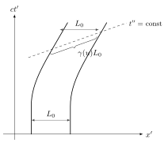
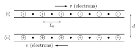
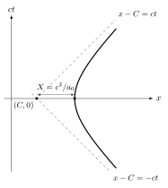

<a href="../sr2/">English</a><a class="on">한국어</a>

현대물리학2부 · 상대론 II

# 2부 — 특수상대론 II { .part-title #part-ii-special-relativity-ii }

수업 필기, 기말고사 범위 · <a class="pdf-link" href="notes.pdf" download="현대물리학-상대론-II.pdf">이 부를 PDF로 보기</a>

**이 부에서는.** 발산과 회전에서 출발해, 맥스웰 방정식이 모든 좌표계에서 속력 $c$로 진행하는 전자기파를 예측함을 본다. 여기서 속도의 합성, 벨의 우주선 역설, 기준틀에 따른 전기력과 자기력, 마지막으로 힘과 일정한 고유가속도 운동이 나온다. 1–5절은 [특수상대론 I](../sr1-ko/)에 있다.

!!! quote "이 부에서 쓰는 규약."
    - $S$는 실험실 좌표계이다. 프라임 붙은 좌표계 $S'$는 $S$에 대해 $x$ 방향으로 속도 $v$로 움직인다. $\beta = v/c$.
    - $\gamma(v) = \gamma_v = \dfrac{1}{\sqrt{1 - v^2/c^2}}$.
    - $L_0$는 고유 길이(정지 상태에서 잰 길이)이다. $\lambda$는 선전하밀도이고 $\lambda_0$는 실험실에서의 값이다. $I = \lambda v$.
    - $\hat n$은 바깥 방향 단위법선, $d\tau$는 부피요소이다.

---

## 6 발산, 회전, 그리고 전하의 불변성 { #6-divergence-curl-and-the-invariance-of-charge }

### 발산 { #divergence }

$\vec F = P\hat x + Q\hat y$에 대해, 직사각형 $[a, b]\times[c, d]$의 경계를 나가는 선속은

$$
\oint_C \vec F\cdot\hat n\,ds = \int_c^d \big[P(b, y) - P(a, y)\big]dy + \int_a^b\big[Q(x, d) - Q(x, c)\big]dx
= \iint\left(\frac{\partial P}{\partial x} + \frac{\partial Q}{\partial y}\right)dx\,dy = \iint(\nabla\cdot\vec F)\,dA .
$$

따라서 $\nabla\cdot\vec F$는 단위넓이(3차원에서는 단위부피)당 나가는 양, 즉 **발산**이다.

### 회전 { #curl }

$(x_0, y_0)$ 주위의 $2\Delta x \times 2\Delta y$ 크기의 작은 직사각형을 도는 순환은

$$
\oint\vec F\cdot d\vec l = \int_{-\Delta y}^{\Delta y}\big[Q(x_0 + \Delta x, y) - Q(x_0 - \Delta x, y)\big]dy - \int_{-\Delta x}^{\Delta x}\big[P(x, y_0 + \Delta y) - P(x, y_0 - \Delta y)\big]dx
= \iint\left(\frac{\partial Q}{\partial x} - \frac{\partial P}{\partial y}\right)dx\,dy .
$$

각 좌표평면에서 같은 일을 하면

$$
\nabla\times\vec F = \hat x\left(\frac{\partial F_z}{\partial y} - \frac{\partial F_y}{\partial z}\right) + \hat y\left(\frac{\partial F_x}{\partial z} - \frac{\partial F_z}{\partial x}\right) + \hat z\left(\frac{\partial F_y}{\partial x} - \frac{\partial F_x}{\partial y}\right)
= \begin{vmatrix} \hat x & \hat y & \hat z \\ \partial_x & \partial_y & \partial_z \\ F_x & F_y & F_z \end{vmatrix}
$$

이고, 이것은 단위넓이당 순환, 즉 **회전**이다.

!!! example "예제 6.1"
    $\vec F = (2x + y^2)\hat x + (x - 3y)\hat y$이면 $\nabla\cdot\vec F = 2 - 3 = -1$, $(\nabla\times\vec F)_z = 1 - 2y$.

### 전하밀도는 불변이 아니다 { #charge-density-is-not-invariant }

전하는 불변이다: $q = q_0$. 정지 부피 $V_0 = L_0^3$, 정지 밀도 $\rho_0 = q_0/V_0$인 전하 상자를 $x$ 방향으로 움직이는 것으로 보는 좌표계에서는 $x$ 방향으로 수축하여 $V = V_0/\gamma$이다. 따라서

$$
\rho = \frac{q}{V} = \frac{q_0}{V_0/\gamma} = \gamma\rho_0 .
$$

전류가 흐르는 중성 도선이 다른 좌표계에서 중성이 아닌 이유가 이것이다. 양전하와 음전하가 서로 다른 속력으로 움직이므로 밀도가 서로 다른 인자로 바뀐다(§10).

---

## 7 맥스웰 방정식과 빛의 속력 { #7-maxwells-equations-and-the-speed-of-light }

### 자기선속 { #magnetic-flux }

어떤 면을 지나는 자기선속은

$$
\Phi_B = \int \vec B\cdot\hat n\, dA .
$$

### 회전의 발산은 0이다 { #the-divergence-of-a-curl-vanishes }

<figure markdown>
  { .tex-fig width="300" }
  <figcaption markdown="span">그림 7.1. 경계가 같은 두 곡면 $S_1$, $S_2$는 함께 하나의 부피를 둘러싼다.</figcaption>
</figure>

그림 7.1처럼 $S_1$과 $S_2$가 경계곡선을 공유한다고 하자. 둘이 이루는 닫힌곡면의 바깥 법선을 쓰면, 스토크스 정리에 의해

$$
\iint_{S_1} (\nabla\times\vec A)\cdot\hat n_1\, dA_1 = \oint_{\partial S_1}\vec A\cdot d\vec l, \qquad
\iint_{S_2} (\nabla\times\vec A)\cdot\hat n_2\, dA_2 = -\oint_{\partial S_1}\vec A\cdot d\vec l
$$

이다. $S_2$의 바깥 법선은 공통 경계에 반대 방향을 주기 때문이다. 두 식을 더하고 둘러싸인 부피 $V$에 발산 정리를 쓰면

$$
\oiint_{\partial V} (\nabla\times\vec A)\cdot\hat n\, dA = 0 = \iiint_V \nabla\cdot(\nabla\times\vec A)\, d\tau .
$$

이것이 모든 부피에서 성립하므로, 모든 벡터장 $\vec A$에 대해 $\nabla\cdot(\nabla\times\vec A) = 0$이다.

### 앙페르 법칙은 수정이 필요하다 { #amperes-law-needs-a-correction }

그러면 앙페르 법칙 $\nabla\times\vec B = \mu_0\vec J$는 $0 = \nabla\cdot(\mu_0\vec J)$를 강요한다. 그런데 전하 보존은 다르게 말한다. 닫힌곡면 밖으로 나가는 전류는 안의 전하가 줄어드는 비율과 같다.

$$
\iiint (\nabla\cdot\vec J)\, d\tau = \oiint_{\partial V}\vec J\cdot\hat n\, dA = I = -\frac{dq}{dt}
\quad\Longrightarrow\quad
\nabla\cdot\vec J = -\frac{\partial\rho}{\partial t} .
$$

가우스 법칙 $\rho = \varepsilon_0\nabla\cdot\vec E$를 쓰면, 실제로 0이 되는 것은

$$
0 = \nabla\cdot\left( \mu_0\vec J + \mu_0\varepsilon_0\frac{\partial\vec E}{\partial t} \right),
\qquad\text{왜냐하면}\qquad
\nabla\cdot(\nabla\times\vec B) = \mu_0\left( \nabla\cdot\vec J + \varepsilon_0\frac{\partial(\nabla\cdot\vec E)}{\partial t} \right) = 0 .
$$

!!! abstract "앙페르–맥스웰 법칙"
    $$
    \nabla\times\vec B = \mu_0\left( \vec J + \varepsilon_0\frac{\partial\vec E}{\partial t} \right).
    $$

### 전자기파 { #electromagnetic-waves }

회전을 한 번 더 취하면

$$
\nabla\times(\nabla\times\vec B) = \mu_0\left( \nabla\times\vec J + \varepsilon_0\frac{\partial(\nabla\times\vec E)}{\partial t} \right)
= \nabla(\nabla\cdot\vec B) - \nabla^2\vec B
$$

이고, 여기서 $(\nabla^2\vec B)_x = \dfrac{\partial^2 B_x}{\partial x^2} + \dfrac{\partial^2 B_x}{\partial y^2} + \dfrac{\partial^2 B_x}{\partial z^2}$이며 다른 성분도 마찬가지이다. 이것은 벡터 항등식에 기댄 것으로, 아래에서 직교좌표로 증명한다.

!!! abstract "보조정리 7.1 (회전의 회전)"
    성분의 이계 편도함수가 연속인 벡터장 $\vec A$에 대해

    $$
    \nabla\times(\nabla\times\vec A) = \nabla(\nabla\cdot\vec A) - \nabla^2\vec A,
    \qquad (\nabla^2\vec A)_i = \frac{\partial^2 A_i}{\partial x^2} + \frac{\partial^2 A_i}{\partial y^2} + \frac{\partial^2 A_i}{\partial z^2} .
    $$

!!! success "증명"
    $\partial_x = \partial/\partial x$ 등으로 쓰자. 회전의 성분은

    $$
    (\nabla\times\vec A)_x = \partial_y A_z - \partial_z A_y, \qquad
    (\nabla\times\vec A)_y = \partial_z A_x - \partial_x A_z, \qquad
    (\nabla\times\vec A)_z = \partial_x A_y - \partial_y A_x
    $$

    이다. 회전을 한 번 더 취하면 $x$성분은

    $$
    \begin{aligned}
    \big[\nabla\times(\nabla\times\vec A)\big]_x
    &= \partial_y(\nabla\times\vec A)_z - \partial_z(\nabla\times\vec A)_y \\
    &= \partial_y(\partial_x A_y - \partial_y A_x) - \partial_z(\partial_z A_x - \partial_x A_z) \\
    &= \partial_x\partial_y A_y + \partial_x\partial_z A_z - \partial_y^2 A_x - \partial_z^2 A_x
    \end{aligned}
    $$

    이고, 여기서 혼합 편도함수의 순서를 바꿨다: $\partial_y\partial_x = \partial_x\partial_y$, $\partial_z\partial_x = \partial_x\partial_z$ (이계 편도함수가 연속이므로 성립한다). 이제 $\partial_x^2 A_x$를 더하고 빼면

    $$
    \begin{aligned}
    \big[\nabla\times(\nabla\times\vec A)\big]_x
    &= \big(\partial_x^2 A_x + \partial_x\partial_y A_y + \partial_x\partial_z A_z\big) - \big(\partial_x^2 A_x + \partial_y^2 A_x + \partial_z^2 A_x\big) \\
    &= \partial_x\big(\partial_x A_x + \partial_y A_y + \partial_z A_z\big) - \nabla^2 A_x \\
    &= \big[\nabla(\nabla\cdot\vec A)\big]_x - (\nabla^2\vec A)_x .
    \end{aligned}
    $$

    $y$성분과 $z$성분도 같은 방법으로 얻는다. 또는 $x \to y \to z \to x$로 이름을 바꾸면 회전, 발산, $\nabla^2$의 정의가 그대로이므로 바로 따라 나온다. 따라서 항등식은 성분마다 성립한다. $\square$

!!! info "참고 — 요령은 어디에 있나"
    회전의 회전은 교차항 $\partial_x\partial_y A_y$, $\partial_x\partial_z A_z$와 "빠진" 이계 도함수 $-\partial_y^2 A_x$, $-\partial_z^2 A_x$만 만든다. $\partial_x^2 A_x$ 한 항을 더하고 빼면 발산과 라플라시안이 한꺼번에 완성된다.

보조정리 7.1에서 $\vec A = \vec B$로 둔다.

진공에서는 $\rho = 0$, $\vec J = 0$이다. $\nabla\cdot\vec B = 0$과 패러데이 법칙 $\nabla\times\vec E = -\partial\vec B/\partial t$를 쓰면

$$
-\nabla^2\vec B = \mu_0\varepsilon_0\frac{\partial}{\partial t}\left( -\frac{\partial\vec B}{\partial t} \right)
\quad\Longrightarrow\quad
\nabla^2\vec B = \mu_0\varepsilon_0\frac{\partial^2\vec B}{\partial t^2} .
$$

!!! abstract "파동 방정식"
    진공에서 자기장은 속력이

    $$
    c = \frac{1}{\sqrt{\mu_0\varepsilon_0}}
    $$

    인 파동 방정식을 따른다. $\nabla\times\vec E = -\partial\vec B/\partial t$에서 출발해도 $\vec E$에 대한 같은 방정식이 나온다.

!!! info "참고 — 무엇의 속력, 무엇에 대한 속력?"
    $\mu_0$과 $\varepsilon_0$는 자연 상수이므로, 맥스웰 방정식은 어떤 기준틀도 지정하지 않고 빛의 속력을 정한다. 맥스웰 방정식이 모든 관성계에서 성립한다면 $c$는 모든 관성계에서 같다. 이것이 특수상대론의 출발점이다.

---

## 8 속도의 합성과 로렌츠 인자 { #8-composition-of-velocities-and-the-lorentz-factor }

$S'$가 $S$에 대해 속도 $v$로 움직이고, 어떤 물체가 $S'$에 대해 (같은 직선 위에서) 속도 $u$로 움직인다고 하자. $S$에서 이 물체의 속도는

$$
w = \frac{v + u}{1 + \dfrac{vu}{c^2}} .
$$

!!! abstract "명제 8.1"
    $$
    \gamma(w) = \gamma(v)\,\gamma(u)\left( 1 + \frac{vu}{c^2} \right).
    $$

!!! success "증명"
    $$
    \frac{1}{\gamma(w)^2} = 1 - \frac{w^2}{c^2}
    = \frac{\left(1 + \frac{vu}{c^2}\right)^2 - \frac{(v+u)^2}{c^2}}{\left(1 + \frac{vu}{c^2}\right)^2}
    = \frac{1 - \frac{u^2}{c^2} - \frac{v^2}{c^2}\left(1 - \frac{u^2}{c^2}\right)}{\left(1 + \frac{vu}{c^2}\right)^2}
    = \frac{\left(1 - \frac{u^2}{c^2}\right)\left(1 - \frac{v^2}{c^2}\right)}{\left(1 + \frac{vu}{c^2}\right)^2} .
    $$

    분자에서 교차항 $\pm 2vu/c^2$는 상쇄되고, $1 + \frac{v^2u^2}{c^4} - \frac{u^2}{c^2} - \frac{v^2}{c^2}$는 인수분해된다. 따라서 $\dfrac{1}{\gamma(w)^2} = \dfrac{1}{\big(\gamma(v)\gamma(u)(1 + vu/c^2)\big)^2}$이다. $\square$

!!! example "예제 8.2 (크기가 같고 방향이 반대인 두 속도)"
    $S'$가 $S$에 대해 $-v$로 움직이고 물체가 $S'$에 대해 $-v$로 움직이면 $w = -\dfrac{2v}{1 + \beta^2}$이고 $\gamma(w) = \gamma_v^2(1 + \beta^2)$이다. 이 경우는 §10에서 쓰인다.

---

## 9 길이 수축과 벨의 우주선 역설 { #9-length-contraction-and-bells-spaceship-paradox }

막대(또는 실로 이어진 두 우주선)가 $S'$에서 고유 길이 $L_0$를 가진다. $S'$가 $v$로 움직이는 $S$에서 그 길이는 $L_0/\gamma(v)$이다.

!!! note "세 좌표계"
    | 좌표계 | 무엇인가 | $S$에 대한 속도 |
    |---|---|---|
    | $S$ | 실험실 좌표계. 모든 것을 이 좌표계에서 지켜본다 | $0$ |
    | $S'$ | 우주선들이 가속하기 **전**의 정지 좌표계. 막대나 실은 여기서 고유 길이 $L_0$를 가진다 | $v$ |
    | $S''$ | 우주선들이 가속한 **후**의 정지 좌표계. $S'$에 대해 $u$로 움직인다 | $w = \dfrac{v+u}{1 + vu/c^2}$ |

    세 좌표계는 모두 같은 $x$축을 따라 움직인다. $S$와 $S'$는 처음부터 끝까지 고정되어 있고, $S''$는 우주선들이 결국 정지하게 되는 좌표계이다. 질문은 각 좌표계에서 두 우주선 사이의 간격이 얼마인가이다.

이제 양 끝이 같은 방식으로 **$S'$에서 동시에 가속**하여, 각각 $S'$에 대해 속력 $u$로 움직이게 되었다고 하자. 두 끝은 같은 $S'$ 시각에 정확히 같은 일을 하므로, $S'$에서 잰 둘 사이 거리는 내내 $L_0$이다.

<figure markdown>
  { .tex-fig width="380" }
  <figcaption markdown="span">그림 9.1. $S'$에서 본 양 끝의 세계선. $x'$ 간격은 $L_0$로 유지되지만, 새 정지 좌표계 $S''$의 동시선을 따라 재면 $\gamma(u)L_0$이다.</figcaption>
</figure>

**양 끝의 새 정지 좌표계 $S''$에서**: $S'$는 간격을 $L_0$로 보고, $S'$는 $S''$에 대해 $u$로 움직이므로, $S''$에서의 간격은 $\gamma(u)$배 더 길어야 한다.

$$
S'' \text{ 에서의 간격} = \gamma(u)L_0 .
$$

**$S$에서는** 양 끝이 $w = \dfrac{v+u}{1 + vu/c^2}$로 움직이므로, 간격은 정지 상태의 값 $\gamma(u)L_0$에서 수축한다.

$$
S \text{ 에서의 간격} = \frac{\gamma(u)L_0}{\gamma(w)} .
$$

두 우주선 사이에 묶은 고유 길이 $L_0$의 실은 $S''$에서 $L_0$, $S$에서 $L_0/\gamma(w)$의 길이를 가질 것이다.

| 좌표계 | 양 끝 사이의 간격 | 본래 길이의 실 |
|---|---|---|
| $S'$ (가속 전) | $L_0$ | $L_0$ |
| $S''$ (가속 후) | $\gamma(u)L_0$ | $L_0$ |
| $S$ (가속 후) | $\gamma(u)L_0/\gamma(w)$ | $L_0/\gamma(w)$ |

모든 좌표계에서 양 끝은 결국 실의 본래 길이보다 같은 인자 $\gamma(u)$만큼 더 멀어지므로, 실은 늘어나서 끊어진다. 모든 좌표계가 이 점에 동의하며, 당연히 그래야 한다.

!!! info "참고 — 무엇이 수축하는가"
    길이 수축은 독립적으로 움직이는 물체들 사이의 틈에 일어나는 일이 아니다. 어떤 물체를 그 물체의 정지 좌표계에서 잰 값에 대한 진술이다. 두 끝을 "동시에" 가속한다는 것은 $S'$에서만 동시이고, 양 끝의 새 정지 좌표계에서는 앞쪽 끝이 먼저 출발한 것이 되므로 둘 사이 간격이 늘어난다.

---

## 10 관성계에 따른 전기력과 자기력 { #10-electric-and-magnetic-forces-in-different-frames }

### 설정 { #setting }

<figure markdown>
  { .tex-fig width="500" }
  <figcaption markdown="span">그림 10.1. 거리 $d$만큼 떨어진 중성인 두 도선. 양이온은 $S$에서 정지해 있고, 전자는 도선 ⟨i⟩에서는 $v$로, 도선 ⟨ii⟩에서는 $-v$로 움직인다.</figcaption>
</figure>

실험실 좌표계 $S$에서 각 도선은 중성이다. 선밀도 $+\lambda_0$인 양이온은 정지해 있고, $-\lambda_0$인 전자는 움직인다. 전하들이 속력 $u$로 움직이는 좌표계에서 잰 선밀도는 **고유** 밀도(그 전하들의 정지 좌표계에서의 밀도)의 $\gamma(u)$배이다. 길이가 $\gamma(u)$배 수축하기 때문이다. 전류는 $I = \lambda v$이다.

$S$에서 (고유 밀도는 전하 자신의 정지 좌표계에서 잰 값):

| 도선 | 전하 | $S$에서의 밀도 | $S$에서의 전류 | 고유 밀도 |
|---|---|---|---|---|
| ⟨i⟩ | $(+)$ | $+\lambda_0$ | $0$ | $+\lambda_0$ |
| | $(-)$ | $-\lambda_0$ | $-\lambda_0 v$ | $-\lambda_0/\gamma_v$ |
| ⟨ii⟩ | $(+)$ | $+\lambda_0$ | $0$ | $+\lambda_0$ |
| | $(-)$ | $-\lambda_0$ | $-\lambda_0(-v) = +\lambda_0 v$ | $-\lambda_0/\gamma_v$ |

따라서 $S$에서는 전기력이 없고, 반대 방향의 전류 $I_1 = -\lambda_0 v$, $I_2 = \lambda_0 v$ 사이의 자기력만 있다. 단위길이당 힘은

$$
f = \frac{F}{L} = I_2 B_1 = \frac{\mu_0 I_1 I_2}{2\pi d} ,
\qquad |f| = \frac{\mu_0\lambda_0^2 v^2}{2\pi d}\ \text{(척력)} .
$$

### 전자의 좌표계에서 본 같은 도선 { #the-same-wires-in-the-electrons-frame }

$S'$가 도선 ⟨i⟩의 전자와 함께 속도 $v$로 움직인다고 하자. 거기서는 두 도선의 이온이 모두 $-v$로 움직이고, ⟨i⟩의 전자는 정지해 있으며, ⟨ii⟩의 전자는

$$
w = \frac{-v - v}{1 + v^2/c^2} = -\frac{2v}{1 + \beta^2}, \qquad \gamma(w) = \gamma_v^2(1 + \beta^2)
$$

로 움직인다(명제 8.1). 각 밀도는 $\gamma(S' \text{에서의 속력})$에 고유 밀도를 곱한 것이다.

| 도선 | 전하 | $S'$에서의 밀도 | $S'$에서의 전류 |
|---|---|---|---|
| ⟨i⟩ | $(+)$ | $\gamma_v\lambda_0$ | $\gamma_v\lambda_0(-v)$ |
| | $(-)$ | $-\lambda_0/\gamma_v$ | $0$ |
| ⟨ii⟩ | $(+)$ | $\gamma_v\lambda_0$ | $\gamma_v\lambda_0(-v)$ |
| | $(-)$ | $-\dfrac{\lambda_0}{\gamma_v}\gamma(w) = -\lambda_0\gamma_v(1+\beta^2)$ | $-\lambda_0\gamma_v(1+\beta^2)\,w = 2\lambda_0\gamma_v v$ |

**전기력.** 도선은 더 이상 중성이 아니다.

$$
\lambda_1' = \gamma_v\lambda_0 - \frac{\lambda_0}{\gamma_v} = \beta^2\gamma_v\lambda_0, \qquad
\lambda_2' = \gamma_v\lambda_0 - \lambda_0\gamma_v(1+\beta^2) = -\beta^2\gamma_v\lambda_0 ,
$$

여기서 $\gamma_v - 1/\gamma_v = \gamma_v(1 - 1/\gamma_v^2) = \gamma_v\beta^2$을 썼다. 선전하의 전기장으로부터

$$
f_E = \frac{1}{2\pi\varepsilon_0}\frac{\lambda_1'\lambda_2'}{d} = -\frac{\beta^4\gamma_v^2\lambda_0^2}{2\pi\varepsilon_0 d}
\quad\text{(인력)} .
$$

$\beta^2 = v^2/c^2$와 $c^2 = 1/(\mu_0\varepsilon_0)$을 쓰면 그 크기는

$$
|f_E| = \frac{\beta^2\gamma_v^2\lambda_0^2}{2\pi\varepsilon_0 d}\cdot\frac{v^2}{c^2} = \frac{\mu_0\gamma_v^2\lambda_0^2 v^2}{2\pi d}\,\beta^2 .
$$

**자기력.** 알짜 전류는

$$
I_1' = -\gamma_v\lambda_0 v, \qquad I_2' = -\gamma_v\lambda_0 v + 2\lambda_0\gamma_v v = \gamma_v\lambda_0 v
$$

로 방향이 반대이므로 힘은 척력이다.

$$
|f_B| = \frac{\mu_0\gamma_v^2\lambda_0^2 v^2}{2\pi d}\quad\text{(척력)} .
$$

**알짜힘.**

$$
S':\quad \sum f = \frac{\mu_0\gamma_v^2\lambda_0^2 v^2}{2\pi d}\,(1 - \beta^2) = \frac{\mu_0\lambda_0^2 v^2}{2\pi d}, \qquad
S:\quad \sum f = \frac{\mu_0 |I_1 I_2|}{2\pi d} = \frac{\mu_0\lambda_0^2 v^2}{2\pi d} ,
$$

$1 - \beta^2 = 1/\gamma_v^2$이기 때문이다. 둘 다 척력이고, 크기가 같다.

!!! abstract "결론"
    관성계를 바꾸면 원래 없던 전기장이나 자기장이 생길 수 있다. $S$에서는 힘이 순전히 자기력이고, $S'$에서는 일부가 전기력이다. **그러나 알짜힘은 변하지 않는다.** 전기장과 자기장은 하나의 전자기장이 기준틀에 따라 나뉜 부분이며, 자기는 정전기학에 길이 수축을 더한 상대론적 결과로 볼 수 있다.

---

## 11 상대론적 힘과 쌍곡선 운동 { #11-relativistic-force-and-hyperbolic-motion }

특수 상대성 이론은 등속 운동하는 관성계를 다루고, 일반 상대성 이론은 이를 중력과 가속 운동으로 넓힌다. 아인슈타인의 **등가 원리**에 따르면 가속하는 공간은 중력과 같은 효과를 낸다. 가속하는 좌표계 안에서 느끼는 관성력은 중력과 구별할 수 없다. 일반 상대성 이론의 결과 가운데 하나가 블랙홀의 사건의 지평선이다. 이 절과 다음 절에서는 고유 가속도가 일정한 질점과 강체의 운동을 따라가며, 이런 지평선과 비슷한 수학적 꼴을 찾는다.

### 3-힘 { #the-three-force }

4-벡터는 도구일 뿐이고, 그 성분을 관측하는 것은 아니다. 4-운동량의 공간 성분 $\gamma m v$는 얼마든지 커질 수 있지만, 3차원에서 측정하는 속도는 결코 $c$를 넘지 않는다. 결국 모든 양은 관측할 수 있는 3차원의 양으로 다시 바꿔야 한다.

뉴턴 역학에서 힘은 $F = ma$로 정의되었다. 이 식은 질량이 변하지 않을 때만 성립하고, 일반적으로 힘은 운동량의 시간 미분 $F = dp/dt$이다. 운동량은 보존된다. 두 물체가 서로 힘을 주고받으면 작용 반작용에 의해 크기가 같고 방향이 반대인 충격량을 받기 때문이다. 그러나 $p = mv$는 속도가 $c$보다 훨씬 작을 때만 근사적으로 보존된다. 광속에 가까워지면 보존되는 것은 4-운동량의 공간 성분 $\gamma m v$이므로, 그 시간 미분을 **3-힘**으로 삼는다. 질점의 질량은 변하지 않으므로 $m$을 미분 밖으로 빼고, 연쇄 법칙을 쓰면

$$
F_1 = \frac{dp_1}{dt} = \frac{d(\gamma mv)}{dt} = m\frac{d(\gamma v)}{dv}\frac{dv}{dt} .
$$

$\dfrac{d\gamma}{dv} = \dfrac{d}{dv}\left(1 - \dfrac{v^2}{c^2}\right)^{-1/2} = \gamma^3\dfrac{v}{c^2}$이므로

$$
F_1 = m\left(\gamma^3\frac{v^2}{c^2} + \gamma\right)\frac{dv}{dt} = m\gamma(\gamma^2\beta^2 + 1)\frac{dv}{dt} = m\gamma^3\frac{dv}{dt}
$$

이고, 여기서 $\gamma^2\beta^2 + 1 = \gamma^2$을 썼다.

!!! abstract "명제 11.1"
    운동 방향의 힘 성분은 $S$와 순간 정지 좌표계 $S'$에서 같다: $F_1 = F_1'$.

이것은 당연하지 않다. 운동에 수직인 힘의 성분은 두 좌표계에서 다를 수 있다.

!!! success "증명"
    $\mathbb P = (E/c, p_1, p_2, p_3)$이면 $p_1 = \gamma_v(p_1' + \beta E'/c)$이고 ($S'$에서 순간적으로 정지한 입자에 대해) $dt = \gamma_v\,dt'$이다. 그러면

    $$
    F_1 = \frac{dp_1}{dt} = \frac{\gamma_v\,d(p_1' + \beta E'/c)}{\gamma_v\,dt'} = \frac{dp_1'}{dt'} + \frac{\beta}{c}\frac{dE'}{dt'} = F_1'
    $$

    인데, 정지 좌표계에서는 입자의 에너지가 일차적으로 변하지 않기 때문이다($dE'/dt' = F'\cdot v' = 0$). $\square$

!!! info "참고 — 수업 중 나온 두 질문"
    *$\gamma_v$를 왜 미분 밖으로 뺄 수 있는가?* $v$는 $S$에 대한 $S'$의 속력이다. $S'$은 한 순간에 잡은 관성 좌표계로, 질점과 함께 가속하지 않는다. 따라서 $v$, 그리고 $\gamma_v$와 $\beta$는 상수이다.

    *질점의 $S'$에서의 속력 $u'$이 변하는데 $dE'/dt'$이 정말 0인가?* $dE'/dt'$은 에너지를 시간으로 나눈 일률이고, 일률은 힘과 속도의 곱이기도 하다: $dE'/dt' = F_1'u'$. 지금 보는 순간에는 $u' = 0$이다. 직접 계산하면, $E' = \gamma' mc^2$, $\gamma' = \gamma(u')$로 두고 위에서 구한 $\gamma$의 미분을 쓰면

    $$
    \frac{dE'}{dt'} = mc^2\,\gamma'^3\frac{u'}{c^2}\frac{du'}{dt'} = 0 \quad (u' = 0),
    \qquad
    \frac{dp_1'}{dt'} = m\left(\gamma'^3\frac{u'^2}{c^2} + \gamma'\right)\frac{du'}{dt'} = m\frac{du'}{dt'} \ne 0 .
    $$

    에너지에는 인자 $u'$이 남아 0이 되고, 운동량에는 $\gamma' = 1$인 항이 남아 0이 되지 않는다.

### 일정한 고유가속도 { #constant-proper-acceleration }

고유 길이, 고유 시간처럼 "고유"는 정지 좌표계를 가리킨다. 입자가 매 순간의 순간 정지 좌표계에서 가속도 $a_0$를 가지면, 일정한 **고유가속도** $a_0$를 가진다고 한다. 입자의 속도는 계속 변하므로 정지 좌표계를 매 순간 새로 잡아야 한다: 한 순간에 $S_1'$, 다음 순간에 $S_2'$, 이런 식이다. $S_k'$을 잡은 순간 입자는 그 안에서 정지해 있고, 시간 $dt_k'$이 지나면 $S_k'$에서의 속도는 $a_0\,dt_k'$이다.

정지 좌표계 $S'$에서 입자의 속도는 $u' = 0$으로 $c$보다 훨씬 작으므로, 거기서의 역학은 뉴턴 역학과 같아야 한다. $F_1' = m\left(\gamma'^3u'^2/c^2 + \gamma'\right)du'/dt'$에서 첫 항은 사라지고 $\gamma' = 1$이므로 $F_1' = m\,du'/dt' = ma_0$이다. 명제 11.1에 의해

$$
m\gamma^3\frac{dv}{dt} = ma_0, \qquad \frac{dv}{dt} = \frac{a_0}{\gamma^3} .
$$

같은 말로 $\dfrac{d(\gamma v)}{dt} = a_0$이므로, $t = 0$에서 $v = 0$이면 $\gamma v = a_0t$이다. 풀면

$$
\frac{v^2}{1 - v^2/c^2} = a_0^2t^2 \;\Longrightarrow\; v = \frac{a_0t}{\sqrt{1 + a_0^2t^2/c^2}} < c .
$$

한 번 더 적분하면

$$
x = \frac{c^2}{a_0}\left(1 + \frac{a_0^2t^2}{c^2}\right)^{1/2} + C = X\left(1 + \frac{c^2t^2}{X^2}\right)^{1/2} + C, \qquad X = \frac{c^2}{a_0} .
$$

여기서 $X$는 속도의 제곱을 가속도로 나눈 것이므로 길이의 차원을 가진다. $C$를 좌변으로 넘기고 제곱하면 근호가 없어진다.

!!! abstract "쌍곡선 운동"
    $X = c^2/a_0$라 하면

    $$
    (x - C)^2 - c^2t^2 = X^2
    $$

    이고, 이것은 $(x, ct)$ 평면에서 중심이 $(C, 0)$이고 점근선이 $x - C = \pm ct$인 쌍곡선이다.

미분하면 $2(x - C)\dfrac{dx}{dt} - 2c^2t = 0$이므로 $\beta = \dfrac{1}{c}\dfrac{dx}{dt} = \dfrac{ct}{x - C} < 1$이다. 입자는 빛의 속력에 다가가지만 결코 도달하지 못한다.

$a_0^2t^2/c^2 \ll 1$이면 $x \approx X\left(1 + \dfrac{a_0^2t^2}{2c^2}\right) + C = X + C + \frac12 a_0t^2$으로, 뉴턴 역학의 결과가 된다.

<figure markdown>
  { .tex-fig width="340" }
  <figcaption markdown="span">그림 11.1. 고유가속도 $a_0$가 일정한 입자의 세계선. 중심이 $(C, 0)$인 쌍곡선으로, 빛의 선 $x - C = \pm ct$에 다가간다.</figcaption>
</figure>

점근선을 찾으려면 $x$와 $ct$를 무한대로 보낸다. 그러면 $X^2$은 $(x - C)^2$, $c^2t^2$에 비해 무시할 수 있으므로 $x - C \approx \pm ct$이다. 세계선은 이 빛의 선에 다가가지만 결코 닿지 않는다. 마치 지평선 같다. $C = 0$이면 그림을 평행이동한 것뿐이고, 점근선은 원점을 지나는 빛원뿔 $x = \pm ct$이다.

!!! info "참고 — 다음에 할 것"
    이것으로 질점은 끝났다. 다음 강의에서는 이런 질점들로 이루어진 강체를 다룬다. 강체가 고유 길이 $L_0$를 유지하면서 가속하려면 무엇이 필요한지 묻는다. 벨의 역설로 말하면 실이 끊어지지 않을 조건이다. 그다음 린들러 지평선과 블랙홀의 사건의 지평선을 비교한다.
